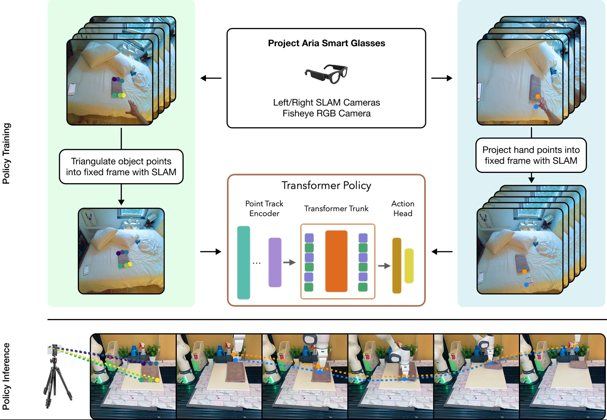

<!-- Generated by scripts/generate.py; edit data/works.json and data/media.json. -->

[← Back to the Awesome index](../../../README.md) · [Interactive website](https://chang-xinhai.github.io/Awesome-RGBDT-Manipulation/?collection=policy&item=egozero#library)

# EgoZero

EgoZero: Robot Learning from Smart Glasses

**2025-05-26 · arXiv preprint · New York University**

**[Paper](https://arxiv.org/abs/2505.20290)** · [Project](https://egozero-robot.github.io/) · [Code](https://github.com/vliu15/egozero)

Learns closed-loop gripper policies from smart-glasses human demonstrations using morphology-agnostic 3D representations.

*EgoZero authors · [Figure source](https://arxiv.org/html/2505.20290v1) · Original rights retained.*

| Field | Reported value and source scope |
| :-- | :-- |
| Record type | policy |
| Policy family | Point-based imitation policy [1](https://arxiv.org/html/2505.20290v1)  |
| Base model and architecture | Not reported [1](https://arxiv.org/html/2505.20290v1)  |
| Model size and component | Not reported [1](https://arxiv.org/html/2505.20290v1)  |
| Deployment inputs | RGB and reconstructed 3D interaction points; geometry comes from triangulation or monocular depth estimation. [1](https://arxiv.org/html/2505.20290v1)  |
| Action outputs and horizon | Robot-executable action points and gripper control. [1](https://arxiv.org/html/2505.20290v1)  |
| Training method | Human-only demonstration extraction and imitation; no robot training demonstrations. [1](https://arxiv.org/html/2505.20290v1)  |
| Training data | Project Aria glasses egocentric demonstrations, 100 demonstrations per task. [1](https://arxiv.org/html/2505.20290v1)  |
| Training duration | Not reported [1](https://arxiv.org/html/2505.20290v1)  |
| Training hardware | Not reported [1](https://arxiv.org/html/2505.20290v1)  |
| Inference and control rates | Not reported [1](https://arxiv.org/html/2505.20290v1)  |
| Evaluation scope | Seven real Franka manipulation tasks with 70% reported success and zero-shot transfer. [1](https://arxiv.org/html/2505.20290v1)  |
| Observations / modalities | RGB |
| Evaluation domain | Real world |
| Embodiment | Parallel-jaw gripper |
| Release: code | Available — source [2](https://egozero-robot.github.io/) [3](https://github.com/vliu15/egozero)  |
| Release: weights | Not verified [2](https://egozero-robot.github.io/) [3](https://github.com/vliu15/egozero)  |
| Release: data | Not verified [2](https://egozero-robot.github.io/) [3](https://github.com/vliu15/egozero)  |
| Release: license | MIT code license [2](https://egozero-robot.github.io/) [3](https://github.com/vliu15/egozero)  |
| Release: notes | Real policy and data-processing sources verified; no independently verified weights or dataset release. [2](https://egozero-robot.github.io/) [3](https://github.com/vliu15/egozero)  |

**Scope and qualifications**

- Human egocentric data and actual robot training/deployment observations are separate stages.
- Do not infer a measured depth policy input from camera hardware, reconstruction, or data generation alone.

**Primary evidence**

1. [Author manuscript and initial submission](https://arxiv.org/html/2505.20290v1) — Original manuscript distinguishes human capture, training labels and deployment observations.
2. [Official project and release evidence](https://egozero-robot.github.io/) — Current repository contents and access are assessed independently of paper claims.
3. [Official code and release evidence](https://github.com/vliu15/egozero) — Current repository contents and access are assessed independently of paper claims.
