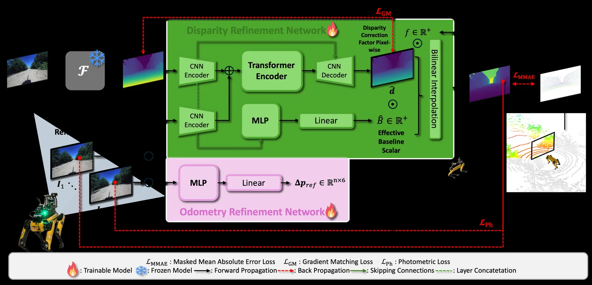

<!-- Generated by scripts/generate.py; edit data/works.json and data/media.json. -->

[← Back to the Awesome index](../../../README.md) · [Interactive website](https://chang-xinhai.github.io/Awesome-RGBDT-Manipulation/?collection=policy&item=em-vit#library)

# EM-ViT

Adapting Monocular Depth Estimation in Novel Scenes through Disparity Refinement and Robot Ego-Motion

**2026-11-11 · Preprint · University of California, Riverside and NASA JPL**

**[Paper](https://arxiv.org/abs/2611.14958)**

Adapts a frozen monocular depth prior to metric scale while a mobile robot explores, using sparse LiDAR and optional ego-motion supervision.

*EM-ViT authors · [Figure source](https://arxiv.org/html/2611.14958v1) · Original rights retained.*

| Field | Reported value and source scope |
| :-- | :-- |
| Record type | model |
| Model role and downstream interface | Geometry perception model [1](https://arxiv.org/html/2611.14958v1)  |
| Model family | Online metric depth adaptation [1](https://arxiv.org/html/2611.14958v1)  |
| Model architecture | Frozen Depth Anything V2 prior and lightweight virtual-stereo adaptation heads. [1](https://arxiv.org/html/2611.14958v1)  |
| Model size and component | Not reported [1](https://arxiv.org/html/2611.14958v1)  |
| Model inputs | RGB and focal length; sparse LiDAR and optionally ego-motion provide online supervision during operation. [1](https://arxiv.org/html/2611.14958v1)  |
| Model outputs | Dense metric depth from refined disparity and a learned effective baseline. [1](https://arxiv.org/html/2611.14958v1)  |
| Training method | Online lightweight training from sparse measured depth, optional temporal photometric supervision and structural gradients. [1](https://arxiv.org/html/2611.14958v1)  |
| Training data and scale | Onboard observations from the current scene provide adaptation supervision; includes mobile-robot and public sequences. [1](https://arxiv.org/html/2611.14958v1)  |
| Training duration | Not reported [1](https://arxiv.org/html/2611.14958v1)  |
| Training hardware | Not reported [1](https://arxiv.org/html/2611.14958v1)  |
| Inference setting and runtime | Individual-frame predictions reuse the scene-adapted lightweight heads rather than trusting metric scale from the frozen prior. [1](https://arxiv.org/html/2611.14958v1)  |
| Downstream evaluation and scope | KITTI, CitrusFarm, Perseverance Navcam and local robot environments. Sparse-beam ablations change available supervision. [1](https://arxiv.org/html/2611.14958v1)  |
| Observations / modalities | RGB · Depth · Point cloud |
| Evaluation domain | Real world |
| Embodiment |  |
| Release: code | Not verified |
| Release: weights | Not verified |
| Release: data | Not verified |
| Release: license | Not verified |
| Release: notes | Paper evidence is available; public code, weights and paired processed corpus were not verified. |

**Scope and qualifications**

- RGB-only forward inference after adaptation and the sensing needed to reach that state are separate.

**Primary evidence**

1. [Original author paper or dataset description](https://arxiv.org/html/2611.14958v1)
