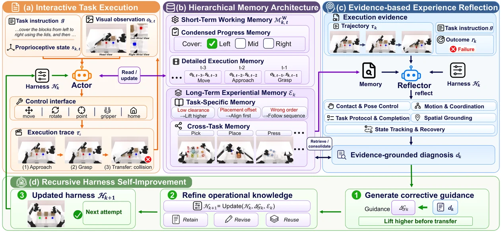

<!-- Generated by scripts/generate.py; edit data/works.json and data/media.json. -->

[← Back to the Awesome index](../../../README.md) · [Interactive website](https://chang-xinhai.github.io/Awesome-RGBDT-Manipulation/?collection=policy&item=embodied-harness#library)

# Embodied-Harness

Embodied-Harness: Towards Recursive Self-Improvement for Robotic Manipulation

**2026-11-20 · Preprint · Zhejiang University and Huazhong University of Science and Technology**

**[Paper](https://arxiv.org/abs/2611.27689)** · [Project](https://embodied-harness.github.io/)

An Actor executes manipulations while a Reflector revises executable guidance using feedback and memory. Both vision-language models remain frozen.

*Zhenxuan Fan and coauthors · [Figure source](https://arxiv.org/html/2611.27689v1) · Original rights retained.*

| Field | Reported value and source scope |
| :-- | :-- |
| Record type | policy |
| Policy family | Frozen Actor and Reflector with persistent execution guidance [1](https://arxiv.org/html/2611.27689v1)  |
| Base model and architecture | Separate frozen multimodal Actor and Reflector [1](https://arxiv.org/html/2611.27689v1)  |
| Model size and component | Not reported [1](https://arxiv.org/html/2611.27689v1)  |
| Deployment inputs | Camera images, current robot state, instruction and memory [1](https://arxiv.org/html/2611.27689v1)  |
| Action outputs and horizon | Cartesian movement, orientation, pointing, gripper and home commands via IK [1](https://arxiv.org/html/2611.27689v1)  |
| Training method | Revises the persistent natural-language execution guidance and memory after trajectories; no new gradients or Actor/Reflector weights [1](https://arxiv.org/html/2611.27689v1)  |
| Training data | Task-specific and cross-task execution feedback; held-out generalization scope depends on experiment [1](https://arxiv.org/html/2611.27689v1)  |
| Training duration | Not reported [1](https://arxiv.org/html/2611.27689v1)  |
| Training hardware | Not reported [1](https://arxiv.org/html/2611.27689v1)  |
| Inference and control rates | Not reported [1](https://arxiv.org/html/2611.27689v1)  |
| Evaluation scope | RoboTwin 2.0 / C2R, RoboSPA and RMBench in simulation; 29/30 physical Piper episodes across three tasks. [1](https://arxiv.org/html/2611.27689v1)  |
| Observations / modalities | RGB · Proprioception |
| Evaluation domain | Simulation · Real world |
| Embodiment | Parallel-jaw gripper |
| Release: code | Not verified [2](https://embodied-harness.github.io/)  |
| Release: weights | Not applicable [2](https://embodied-harness.github.io/)  |
| Release: data | Not verified [2](https://embodied-harness.github.io/)  |
| Release: license | Not verified [2](https://embodied-harness.github.io/)  |
| Release: notes | Paper and author project with rollout videos; implementation, checkpoints and training logs were not verified. [2](https://embodied-harness.github.io/)  |

**Scope and qualifications**

- Separate physical and simulation conditions, and retain trial/revision budgets when comparing outcomes.
- Physical evaluation is concentrated in three tasks; no measured depth or tactile input is established.

**Primary evidence**

1. [Original author paper or dataset description](https://arxiv.org/html/2611.27689v1)
2. [Author source and artifact entry points](https://embodied-harness.github.io/)
