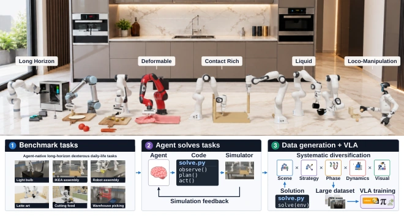

<!-- Generated by scripts/generate.py; edit data/works.json and data/media.json. -->

[← Back to the Awesome index](../../../README.md) · [Interactive website](https://chang-xinhai.github.io/Awesome-RGBDT-Manipulation/?collection=policy&item=embodiedswe#library)

# EmbodiedSWE

EmbodiedSWE: Coding Agents for Long Horizon Dexterous Robotics

**2026-09-23 · Preprint · Not reported**

**[Paper](https://arxiv.org/abs/2609.27308)** · [Project](https://embodiedswe.github.io) · [Code](https://github.com/EmbodiedSWE/EmbodiedSWE)

Uses coding agents to solve long-horizon simulator-control tasks, then diversifies verified programs into demonstrations for visuomotor policy training.

*EmbodiedSWE authors · [Figure source](https://arxiv.org/abs/2609.27308) · Original rights retained.*

| Field | Reported value and source scope |
| :-- | :-- |
| Record type | policy |
| Policy family | Hybrid [1](https://arxiv.org/abs/2609.27308)  |
| Base model and architecture | Coding-agent evaluation includes Fable 5.1, Opus 5 / 4.8, Astra, Sol and Terra; the sim-to-real learned policy is π0.5-DROID. [1](https://arxiv.org/abs/2609.27308)  |
| Model size and component | Not reported [1](https://arxiv.org/abs/2609.27308)  |
| Deployment inputs | Coding agents have simulator APIs and full simulator-state access. The distilled visuomotor policy uses its own visual / robot-state interface at deployment. [1](https://arxiv.org/abs/2609.27308)  |
| Action outputs and horizon | Executable controller programs; verified diversified rollouts become policy demonstrations, from which a VLA predicts physical actions. [1](https://arxiv.org/abs/2609.27308)  |
| Training method | Frozen-model program development plus learned-policy fine-tuning on diversified simulated demonstrations. Reward-hack auditing is separate from program success. [1](https://arxiv.org/abs/2609.27308)  |
| Training data | The reported real-transfer example uses 500 successful simulated trajectories generated from an Opus 5 program; no real-robot demonstrations. [1](https://arxiv.org/abs/2609.27308)  |
| Training duration | Sim-to-real π0.5 training: 20,000 updates, with the 14,000-step checkpoint deployed. Coding-agent runs use a four-hour wall-clock budget. [1](https://arxiv.org/abs/2609.27308)  |
| Training hardware | One NVIDIA B200 for the reported VLA training; one RTX 4090 simulator allocation per coding-agent run. [1](https://arxiv.org/abs/2609.27308)  |
| Inference and control rates | Not reported [1](https://arxiv.org/abs/2609.27308)  |
| Evaluation scope | 28 long-horizon simulated tasks, including dexterous / contact / deformable settings, and a selected real-transfer policy. [1](https://arxiv.org/abs/2609.27308)  |
| Observations / modalities | RGB · Proprioception · Language |
| Evaluation domain | Simulation · Real world |
| Embodiment | Dexterous hand · Parallel-jaw gripper · Bimanual |
| Release: code | Not verified |
| Release: weights | Not applicable |
| Release: data | Not verified |
| Release: license | Not verified |
| Release: notes | The paper is public; implementation and artifact availability require separate verification. |

**Scope and qualifications**

- The simulator coding agents receive privileged state; their results are not RGB-only policy results.
- Successful program generation and successful deployment of a distilled VLA are separate stages.

**Primary evidence**

1. [Primary paper, full text](https://arxiv.org/abs/2609.27308) — Publication date is the first arXiv submission. Policy fields distinguish model calls, controller execution and learning.
2. [Author-linked repository](https://github.com/EmbodiedSWE/EmbodiedSWE) — Repository identity; code and checkpoint release status are stated separately.
