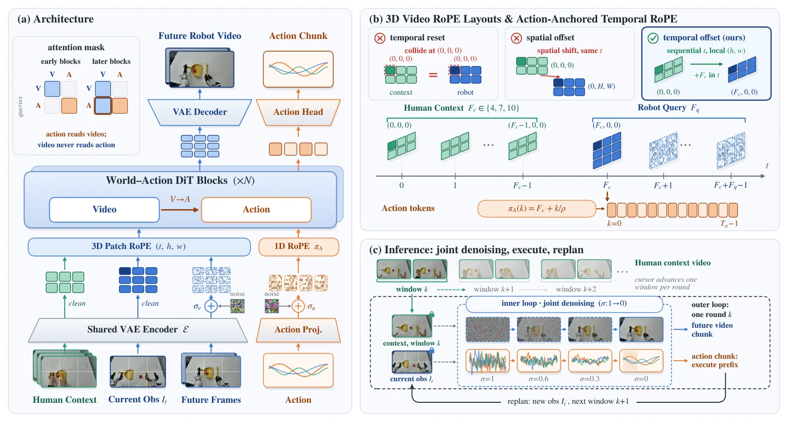

<!-- Generated by scripts/generate.py; edit data/works.json and data/media.json. -->

[← Back to the Awesome index](../../../README.md) · [Interactive website](https://chang-xinhai.github.io/Awesome-RGBDT-Manipulation/?collection=policy&item=entangle#library)

# Entangle

Entangle: Scaling Human-Video In-Context World-Action Models across Unseen Tasks and Contexts

**2026-11-21 · Preprint · Tsinghua University; GensPI Technology; Motubrain**

**[Paper](https://arxiv.org/abs/2611.28732)** · [Project](https://entangle-robotics.github.io/)

Conditions a world-action policy on a single human demonstration video plus robot observations for in-context execution of unseen task constraints.

*Chendong Xiang and coauthors · [Figure source](https://arxiv.org/html/2611.28732v2) · Original rights retained.*

| Field | Reported value and source scope |
| :-- | :-- |
| Record type | policy |
| Policy family | Entangle [1](https://arxiv.org/html/2611.28732v2)  |
| Base model and architecture | Not reported [1](https://arxiv.org/html/2611.28732v2)  |
| Model size and component | Not reported [1](https://arxiv.org/html/2611.28732v2)  |
| Deployment inputs | Human reference RGB video, camera image from robot observation and robot state. Future frames and action outputs are generated jointly. [1](https://arxiv.org/html/2611.28732v2)  |
| Action outputs and horizon | Action chunks and predicted visual trajectories; receding-horizon execution with adaptive chunk length. [1](https://arxiv.org/html/2611.28732v2)  |
| Training method | Translate robot videos into aligned human contexts, combine with real matches, then train with variable horizon and intra-task contrastive objective. [1](https://arxiv.org/html/2611.28732v2)  |
| Training data | 21.3K temporally paired examples: 5.3K real and 16.0K synthetic, split by robot episode. [1](https://arxiv.org/html/2611.28732v2)  |
| Training duration | Not reported [1](https://arxiv.org/html/2611.28732v2)  |
| Training hardware | Not reported [1](https://arxiv.org/html/2611.28732v2)  |
| Inference and control rates | Predicts 24 steps at 10 Hz in the physical Astribot S1 protocol; executes a variable 6–24 step prefix. [1](https://arxiv.org/html/2611.28732v2)  |
| Evaluation scope | RoboTwin unseen tasks under the paper’s generated-context protocol and six independent physical Astribot S1 context generalization tasks. [1](https://arxiv.org/html/2611.28732v2)  |
| Observations / modalities | RGB · Proprioception |
| Evaluation domain | Simulation · Real world |
| Embodiment | Bimanual · Parallel-jaw gripper |
| Release: code | Not verified |
| Release: weights | Not verified |
| Release: data | Not verified |
| Release: license | Not verified |
| Release: notes | Public paper verified. Code, task weights and data are tracked separately. |

**Scope and qualifications**

- The human video supplies context without task-specific model fine-tuning during test. Converted/synthetic human views are an independent training data condition.
- Downloadable source, model and paired data were not verified on the author project page.

**Primary evidence**

1. [Original author paper with methods, evaluation and scope](https://arxiv.org/html/2611.28732v2)
2. [Public author project with method and evaluation examples](https://entangle-robotics.github.io/)
