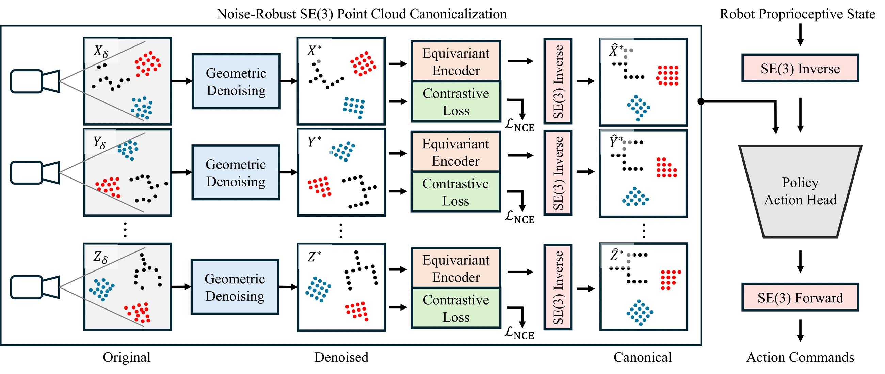

<!-- Generated by scripts/generate.py; edit data/works.json and data/media.json. -->

[← Back to the Awesome index](../../../README.md) · [Interactive website](https://chang-xinhai.github.io/Awesome-RGBDT-Manipulation/?collection=policy&item=equiform#library)

# EquiForm

EquiForm: Noise-Robust SE(3)-Equivariant Policy Learning from 3D Point Clouds

**2026-01-24 · arXiv preprint · Purdue University**

**[Paper](https://arxiv.org/abs/2601.17486)** · [Project](https://zhangzhiyuanzhang.github.io/equiform-website/) · [Code](https://github.com/ZhangZhiyuanZhang/equiform)

Geometric denoising and contrastive equivariant alignment stabilize canonicalized 3D policies under noisy partial observations.

*EquiForm authors · [Figure source](https://arxiv.org/html/2601.17486) · Original rights retained.*

| Field | Reported value and source scope |
| :-- | :-- |
| Record type | policy |
| Policy family | Diffusion [1](https://arxiv.org/abs/2601.17486)  |
| Base model and architecture | Canonical Policy with surface/tangential point refinement and equivariant contrastive encoding. [1](https://arxiv.org/abs/2601.17486)  |
| Model size and component | Not reported in the inspected primary-source sections [1](https://arxiv.org/abs/2601.17486)  |
| Deployment inputs | Noisy RGB-D-derived point clouds and proprioception. [1](https://arxiv.org/abs/2601.17486)  |
| Action outputs and horizon | Canonical-frame generative actions transformed to the robot frame. [1](https://arxiv.org/abs/2601.17486)  |
| Training method | Behavior cloning plus geometric denoising and feature consistency losses. [1](https://arxiv.org/abs/2601.17486)  |
| Training data | Task demonstrations from MimicGen, Push-T, RoboTwin and physical Franka experiments. [1](https://arxiv.org/abs/2601.17486)  |
| Training duration | Not reported in the inspected primary-source sections [1](https://arxiv.org/abs/2601.17486)  |
| Training hardware | Not reported in the inspected primary-source sections [1](https://arxiv.org/abs/2601.17486)  |
| Inference and control rates | Not reported in the inspected primary-source sections [1](https://arxiv.org/abs/2601.17486)  |
| Evaluation scope | Sixteen simulated tasks and four real task types; sensor noise, perturbation and occlusion. [1](https://arxiv.org/abs/2601.17486)  |
| Observations / modalities | RGB · Depth · Point cloud · Proprioception |
| Evaluation domain | Simulation · Real world |
| Embodiment | Parallel-jaw gripper |
| Release: code | Available [2](https://zhangzhiyuanzhang.github.io/equiform-website/) [3](https://github.com/ZhangZhiyuanZhang/equiform) [5](https://github.com/ZhangZhiyuanZhang/equiform/tree/main)  |
| Release: weights | Not verified [2](https://zhangzhiyuanzhang.github.io/equiform-website/) [3](https://github.com/ZhangZhiyuanZhang/equiform)  |
| Release: data | Not verified [2](https://zhangzhiyuanzhang.github.io/equiform-website/) [3](https://github.com/ZhangZhiyuanZhang/equiform)  |
| Release: license | MIT for repository code; pretrained models, data and figure rights remain separate [2](https://zhangzhiyuanzhang.github.io/equiform-website/) [3](https://github.com/ZhangZhiyuanZhang/equiform) [4](https://github.com/ZhangZhiyuanZhang/equiform/blob/main/LICENSE)  |
| Release: notes | Code, data and weights are checked independently; an upstream pretrained model is not a released task policy. [2](https://zhangzhiyuanzhang.github.io/equiform-website/) [3](https://github.com/ZhangZhiyuanZhang/equiform)  |

**Scope and qualifications**

- Real demonstrations recorded at 10 Hz; that capture rate does not establish the model inference rate.

**Primary evidence**

1. [Original manuscript and first submission history](https://arxiv.org/abs/2601.17486) — Full author HTML method/evaluation/appendix inspected; depth observations, pseudo-labels and generated outputs retain distinct roles.
2. [Official author project](https://zhangzhiyuanzhang.github.io/equiform-website/) — Public author-linked project; figure and downstream scope verified separately.
3. [Official implementation and release scope](https://github.com/ZhangZhiyuanZhang/equiform) — Availability of research implementation does not establish public task-policy checkpoints.
4. [Actual license file in released source](https://github.com/ZhangZhiyuanZhang/equiform/blob/main/LICENSE) — Only source code covered by this file; not a blanket license for paper figures or upstream weights.
5. [Actual repository content inventory](https://github.com/ZhangZhiyuanZhang/equiform/tree/main) — 149 tracked paths inspected; code release is distinguished from a README/project/figure-only repository.
