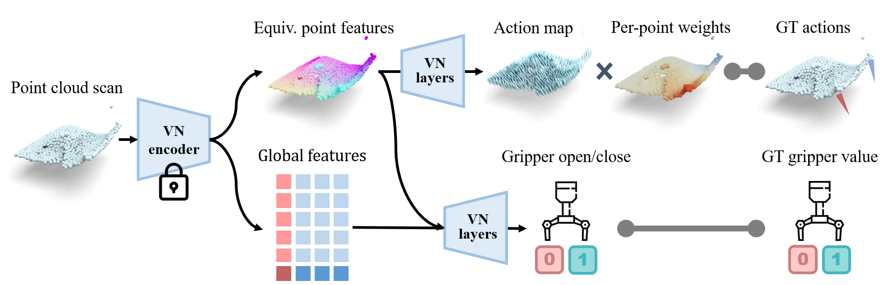

<!-- Generated by scripts/generate.py; edit data/works.json and data/media.json. -->

[← Back to the Awesome index](../../../README.md) · [Interactive website](https://chang-xinhai.github.io/Awesome-RGBDT-Manipulation/?collection=policy&item=equivact#library)

# EquivAct

EquivAct: SIM(3)-Equivariant Visuomotor Policies beyond Rigid Object Manipulation

**2023-10-24 · ICRA 2024 · Stanford University; Princeton University**

**[Paper](https://arxiv.org/abs/2310.16050)** · [Project](https://equivact.github.io/)

SIM(3)-equivariant 3D perception/action structure transfers tabletop demonstrations to larger deformable and articulated manipulation.

*EquivAct authors · [Figure source](https://arxiv.org/html/2310.16050) · Original rights retained.*

| Field | Reported value and source scope |
| :-- | :-- |
| Record type | policy |
| Policy family | Transformer / BC [1](https://arxiv.org/abs/2310.16050)  |
| Base model and architecture | Equivariant point-cloud representation pretraining and equivariant behavior-cloning policy. [1](https://arxiv.org/abs/2310.16050)  |
| Model size and component | Not reported in the inspected primary-source sections [1](https://arxiv.org/abs/2310.16050)  |
| Deployment inputs | Partial object point clouds and proprioception. [1](https://arxiv.org/abs/2310.16050)  |
| Action outputs and horizon | Equivariant robot action/velocity predictions. [1](https://arxiv.org/abs/2310.16050)  |
| Training method | Contrastive geometry pretraining in simulation, then few-demonstration imitation learning. [1](https://arxiv.org/abs/2310.16050)  |
| Training data | Twenty real human demonstrations per tabletop task; separate simulated representation data. [1](https://arxiv.org/abs/2310.16050)  |
| Training duration | Not reported in the inspected primary-source sections [1](https://arxiv.org/abs/2310.16050)  |
| Training hardware | Not reported in the inspected primary-source sections [1](https://arxiv.org/abs/2310.16050)  |
| Inference and control rates | Not reported in the inspected primary-source sections [1](https://arxiv.org/abs/2310.16050)  |
| Evaluation scope | Cloth folding, object covering and box closing in simulation/real mobile manipulation. [1](https://arxiv.org/abs/2310.16050)  |
| Observations / modalities | Depth · Point cloud · Proprioception |
| Evaluation domain | Simulation · Real world |
| Embodiment | Parallel-jaw gripper |
| Release: code | Not verified [2](https://equivact.github.io/)  |
| Release: weights | Not verified [2](https://equivact.github.io/)  |
| Release: data | Not verified [2](https://equivact.github.io/)  |
| Release: license | Not verified [2](https://equivact.github.io/)  |
| Release: notes | Code, data and weights are checked independently; an upstream pretrained model is not a released task policy. [2](https://equivact.github.io/)  |

**Scope and qualifications**

- Scale/pose equivariance is a structural property; visibility, contact and gravity changes remain deployment limitations.

**Primary evidence**

1. [Original manuscript and first submission history](https://arxiv.org/abs/2310.16050) — Full author HTML method/evaluation/appendix inspected; depth observations, pseudo-labels and generated outputs retain distinct roles.
2. [Official author project](https://equivact.github.io/) — Public author-linked project; figure and downstream scope verified separately.
