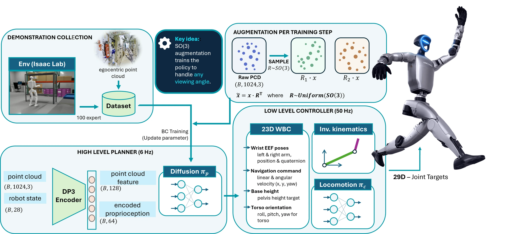

<!-- Generated by scripts/generate.py; edit data/works.json and data/media.json. -->

[← Back to the Awesome index](../../../README.md) · [Interactive website](https://chang-xinhai.github.io/Awesome-RGBDT-Manipulation/?collection=policy&item=equivdp3#library)

# EquivDP3

EquivDP3: A SIM(3)-Invariant Point-Cloud Encoder for Data-Efficient Humanoid Loco-Manipulation

**2026-09-29 · arXiv preprint · KAIST**

**[Paper](https://arxiv.org/abs/2609.36575)**

A SIM(3)-invariant point-cloud encoder improves low-data humanoid diffusion control over a frozen locomotion executor.

*EquivDP3 authors · [Figure source](https://arxiv.org/html/2609.36575) · Original rights retained.*

| Field | Reported value and source scope |
| :-- | :-- |
| Record type | policy |
| Policy family | Diffusion [1](https://arxiv.org/abs/2609.36575)  |
| Base model and architecture | DP3 with vector-neuron encoder, frozen RL locomotion policy and differential arm IK. [1](https://arxiv.org/abs/2609.36575)  |
| Model size and component | Not reported in the inspected primary-source sections [1](https://arxiv.org/abs/2609.36575)  |
| Deployment inputs | Depth-derived point cloud and proprioception. [1](https://arxiv.org/abs/2609.36575)  |
| Action outputs and horizon | Whole-body command chunks executed by locomotion and IK controllers. [1](https://arxiv.org/abs/2609.36575)  |
| Training method | Behavior cloning; shared DP3 decoder isolates point-encoder comparisons. [1](https://arxiv.org/abs/2609.36575)  |
| Training data | IsaacLab Mimic produces 200 and 360 episodes; 5–100 demonstration budgets. [1](https://arxiv.org/abs/2609.36575)  |
| Training duration | Not reported in the inspected primary-source sections [1](https://arxiv.org/abs/2609.36575)  |
| Training hardware | Not reported in the inspected primary-source sections [1](https://arxiv.org/abs/2609.36575)  |
| Inference and control rates | ~6 Hz high-level chunks; 50 Hz frozen low-level execution. [1](https://arxiv.org/abs/2609.36575)  |
| Evaluation scope | Two simulated Unitree G1 loco-manipulation tasks with in-/out-of-distribution tests. [1](https://arxiv.org/abs/2609.36575)  |
| Observations / modalities | Depth · Point cloud · Proprioception |
| Evaluation domain | Simulation |
| Embodiment | Humanoid · Bimanual |
| Release: code | Not verified |
| Release: weights | Not verified |
| Release: data | Not verified |
| Release: license | Not verified |
| Release: notes | Code, data and weights are checked independently; an upstream pretrained model is not a released task policy. |

**Scope and qualifications**

- Results are simulation only; low-data improvements diminish near the high-data benchmark ceiling.

**Primary evidence**

1. [Original manuscript and first submission history](https://arxiv.org/abs/2609.36575) — Full author HTML method/evaluation/appendix inspected; depth observations, pseudo-labels and generated outputs retain distinct roles.
