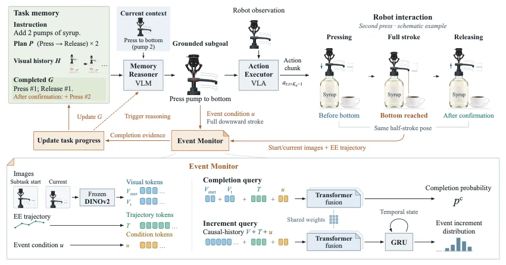

<!-- Generated by scripts/generate.py; edit data/works.json and data/media.json. -->

[← Back to the Awesome index](../../../README.md) · [Interactive website](https://chang-xinhai.github.io/Awesome-RGBDT-Manipulation/?collection=policy&item=eventsync#library)

# EventSync

EventSync: Event-Driven Memory Updates for History-Dependent Manipulation

**2026-10-20 · Preprint · Renmin University of China**

**[Paper](https://arxiv.org/abs/2610.27917)** · [Project](https://zjjJacinthe.github.io/eventsync-project) · [Weights](https://huggingface.co/zjjJacinthe/EventSync-Reasoner) · [Weights-Executor](https://huggingface.co/zjjJacinthe/EventSync-Executor) · [Weights-History-Executor](https://huggingface.co/zjjJacinthe/EventSync-Executor-FrameSamp-Modul) · [Weights-Monitor](https://huggingface.co/zjjJacinthe/EventSync-Monitor)

A learned event monitor updates explicit task memory only after execution evidence supports subgoal completion.

*EventSync authors · [Figure source](https://arxiv.org/abs/2610.27917) · Original rights retained.*

| Field | Reported value and source scope |
| :-- | :-- |
| Record type | policy |
| Policy family | Robot agent [1](https://arxiv.org/abs/2610.27917)  |
| Base model and architecture | Qwen3-VL-4B LoRA Memory Reasoner, DINOv2 Event Monitor and π0.5 action executor; optional FrameSamp+Modul visual history. [1](https://arxiv.org/abs/2610.27917)  |
| Model size and component | 87.39M total Event Monitor parameters; 4B base reasoner;executor capacity separate. [1](https://arxiv.org/abs/2610.27917)  |
| Deployment inputs | Instruction, RGB history, external/wrist observations and end-effector trajectories; memory stores completed subgoals. [1](https://arxiv.org/abs/2610.27917)  |
| Action outputs and horizon | Subgoal instructions and low-level robot actions, gated by learned completion events. [1](https://arxiv.org/abs/2610.27917)  |
| Training method | Fine-tune reasoner and monitor using demonstration/event labels; inference updates task memory and plans rather than online model weights. [1](https://arxiv.org/abs/2610.27917)  |
| Training data | Not reported [1](https://arxiv.org/abs/2610.27917)  |
| Training duration | Not reported [1](https://arxiv.org/abs/2610.27917)  |
| Training hardware | Not reported [1](https://arxiv.org/abs/2610.27917)  |
| Inference and control rates | Not reported [1](https://arxiv.org/abs/2610.27917)  |
| Evaluation scope | 16 RoboMME tasks ×50 episodes: 64.5% with visual history; four real Franka tasks cover counting, permanence, reference and imitation. [1](https://arxiv.org/abs/2610.27917)  |
| Observations / modalities | RGB · Proprioception · Language |
| Evaluation domain | Simulation · Real world |
| Embodiment | Parallel-jaw gripper |
| Release: code | Not released [2](https://zjjJacinthe.github.io/eventsync-project) [3](https://huggingface.co/zjjJacinthe/EventSync-Reasoner) [4](https://huggingface.co/zjjJacinthe/EventSync-Monitor)  |
| Release: weights | Available — reasoner adapter, monitor and two executor variants [2](https://zjjJacinthe.github.io/eventsync-project) [3](https://huggingface.co/zjjJacinthe/EventSync-Reasoner) [4](https://huggingface.co/zjjJacinthe/EventSync-Monitor)  |
| Release: data | Not verified [2](https://zjjJacinthe.github.io/eventsync-project) [3](https://huggingface.co/zjjJacinthe/EventSync-Reasoner) [4](https://huggingface.co/zjjJacinthe/EventSync-Monitor)  |
| Release: license | EventSync Non-Commercial Research License1.0 for contributed checkpoints/adapters/modifications; separate Qwen, DINOv2, Apache and Gemma upstream terms remain applicable. [2](https://zjjJacinthe.github.io/eventsync-project) [3](https://huggingface.co/zjjJacinthe/EventSync-Reasoner) [4](https://huggingface.co/zjjJacinthe/EventSync-Monitor)  |
| Release: notes | Four actual HF inventories contain reasoner adapter_model.safetensors, monitor best.pt and complete Orbax/OCDBT executor variants. Their cards link github.com/zjjJacinthe/EventSync, but that runtime endpoint returns 404 on26 October; no runnable method source release is verified. Model availability does not establish code availability. [2](https://zjjJacinthe.github.io/eventsync-project) [3](https://huggingface.co/zjjJacinthe/EventSync-Reasoner) [4](https://huggingface.co/zjjJacinthe/EventSync-Monitor)  |

**Scope and qualifications**

- A past observation and the current execution phase are different sources of memory.
- The left physical camera records evaluation only; executor uses right/wrist and reasoner/monitor use the right external view.

**Primary evidence**

1. [Primary manuscript and first-submission history](https://arxiv.org/abs/2610.27917) — Current primary manuscript reviewed; first-public date uses arXiv v1. Observations, training privileges and deployed interfaces retain their separate scopes.
2. [Official project source and actual artifact inventory](https://zjjJacinthe.github.io/eventsync-project) — Reviewed 26 October 2026. Availability and licensing apply only to the described released component, independently of paper results.
3. [Actual checkpoint inventory and noncommercial LICENSE](https://huggingface.co/zjjJacinthe/EventSync-Reasoner) — Original EventSync additions use a noncommercial research license; upstream model grants are separately preserved.
4. [Actual checkpoint inventory and noncommercial LICENSE](https://huggingface.co/zjjJacinthe/EventSync-Monitor) — Original EventSync additions use a noncommercial research license; upstream model grants are separately preserved.
5. [Actual checkpoint inventory and noncommercial LICENSE](https://huggingface.co/zjjJacinthe/EventSync-Executor) — Original EventSync additions use a noncommercial research license; upstream model grants are separately preserved.
6. [Actual checkpoint inventory and noncommercial LICENSE](https://huggingface.co/zjjJacinthe/EventSync-Executor-FrameSamp-Modul) — Original EventSync additions use a noncommercial research license; upstream model grants are separately preserved.
