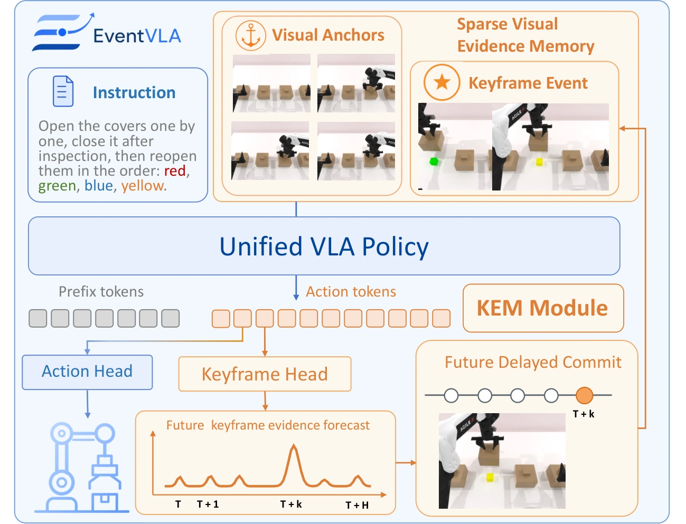

<!-- Generated by scripts/generate.py; edit data/works.json and data/media.json. -->

[← Back to the Awesome index](../../../README.md) · [Interactive website](https://chang-xinhai.github.io/Awesome-RGBDT-Manipulation/?collection=policy&item=eventvla#library)

# EventVLA

EventVLA: Event-Driven Visual Evidence Memory for Long-Horizon Vision-Language-Action Policies

**2026-06-18 · Preprint · USTC / Dalian University of Technology / Huawei / Shanghai AI Laboratory**

**[Paper](https://arxiv.org/abs/2606.20092)** · [Code](https://github.com/XPolicyLab/XPolicyLab/tree/main/policy/EventVLA)

Maintains initial/recent visual anchors and a sparse keyframe evidence memory for history-dependent robot actions.

*EventVLA authors · [Figure source](https://arxiv.org/html/2606.20092v3) · Original rights retained.*

| Field | Reported value and source scope |
| :-- | :-- |
| Record type | policy |
| Policy family | VLA [1](https://arxiv.org/abs/2606.20092)  |
| Base model and architecture | Simulation: Qwen3-VL-4B-Instruct with QwenOFT; real robot: π0.5 / PaliGemma configuration [1](https://arxiv.org/abs/2606.20092)  |
| Model size and component | 4B simulation VLM backbone; complete memory/head aggregate not reported; real robot uses a different backbone [1](https://arxiv.org/abs/2606.20092)  |
| Deployment inputs | Current RGB, initial and recent frames, event-selected keyframes, language and robot state [1](https://arxiv.org/abs/2606.20092)  |
| Action outputs and horizon | OFT or flow action chunks, horizon 50; real table pads actions to 32 dimensions [1](https://arxiv.org/abs/2606.20092)  |
| Training method | End-to-end action learning with event-keyframe prediction and annealed teacher-forced memory updates [1](https://arxiv.org/abs/2606.20092)  |
| Training data | RMBench, 8-task RoboTwin-MeM, RoboTwin 2.0 demonstrations; real ARX ACONE memory tasks; training-only Qwen3-VL event labels [1](https://arxiv.org/abs/2606.20092)  |
| Training duration | Simulation 80k steps; real 60k steps; wall-clock not reported [1](https://arxiv.org/abs/2606.20092)  |
| Training hardware | Not reported [1](https://arxiv.org/abs/2606.20092)  |
| Inference and control rates | Not reported [1](https://arxiv.org/abs/2606.20092)  |
| Evaluation scope | RMBench, RoboTwin-MeM, RoboTwin 2.0 and real bimanual memory-dependent tasks [1](https://arxiv.org/abs/2606.20092)  |
| Observations / modalities | RGB · Proprioception · Language |
| Evaluation domain | Simulation · Real world |
| Embodiment | Parallel-jaw gripper · Bimanual |
| Release: code | Available [2](https://github.com/XPolicyLab/XPolicyLab/tree/main/policy/EventVLA)  |
| Release: weights | Not verified [2](https://github.com/XPolicyLab/XPolicyLab/tree/main/policy/EventVLA)  |
| Release: data | Not verified [2](https://github.com/XPolicyLab/XPolicyLab/tree/main/policy/EventVLA)  |
| Release: license | Apache-2.0 for repository code, verified from LICENSE; pretrained models, datasets, dependencies and figure rights retain separate terms. [2](https://github.com/XPolicyLab/XPolicyLab/tree/main/policy/EventVLA) [3](https://github.com/XPolicyLab/XPolicyLab/blob/main/LICENSE)  |
| Release: notes | Availability reflects public source/model links; complete paper-scale reproduction and all dataset access terms were not tested. [2](https://github.com/XPolicyLab/XPolicyLab/tree/main/policy/EventVLA)  |

**Scope and qualifications**

- Qwen3-VL event labeling is an offline training process; it is not a required extra model at deployment.
- Public XPolicyLab integration is distinguishable from an independently packaged upstream release.

**Primary evidence**

1. [Primary manuscript and first-submission history](https://arxiv.org/abs/2606.20092) — Latest available full manuscript inspected; publication date retains the first arXiv submission. Sizes, training cost and deployment rates keep their experimental scope.
2. [Official policy implementation](https://github.com/XPolicyLab/XPolicyLab/tree/main/policy/EventVLA) — Source and checkpoint availability checked separately; no local policy execution was performed.
3. [Actual repository code license](https://github.com/XPolicyLab/XPolicyLab/blob/main/LICENSE) — 2026-10-19 actual file inspection; applies to repository code, not a blanket grant over models/data/third-party assets.
