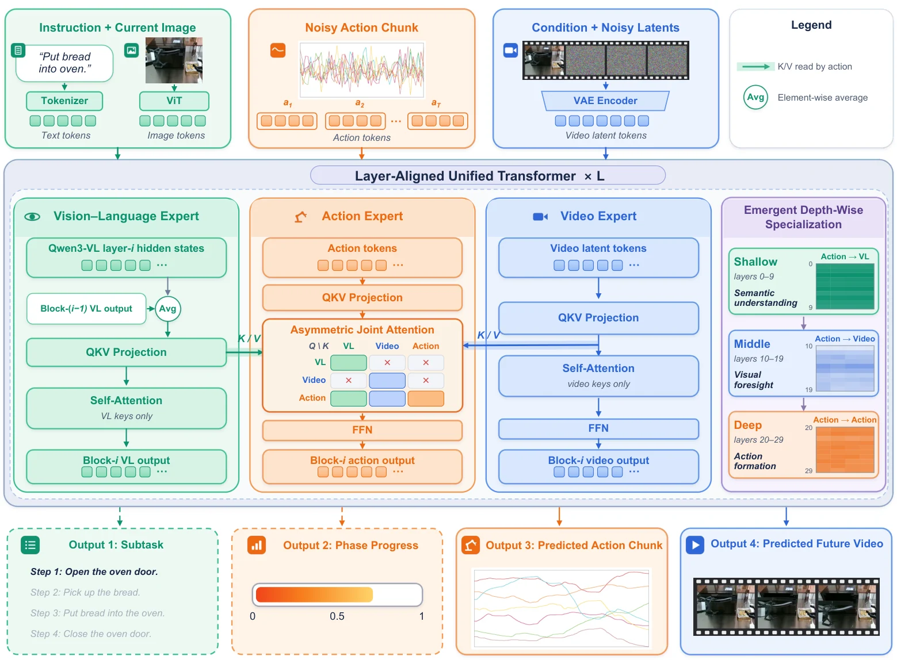

<!-- Generated by scripts/generate.py; edit data/works.json and data/media.json. -->

[← Back to the Awesome index](../../../README.md) · [Interactive website](https://chang-xinhai.github.io/Awesome-RGBDT-Manipulation/?collection=policy&item=ewam-emergent#library)

# EWAM (Emergent Specialization)

EWAM: Emergent Depth-Wise Specialization in a Unified Embodied Model -- From Semantic Understanding through Visual Foresight to Action

**2026-09-30 · Preprint · Sun Yat-sen University**

**[Paper](https://arxiv.org/abs/2609.39973)** · [Project](https://wanghao00pro.github.io/EWAM-project/) · [Code](https://github.com/Wanghao00pro/EWAM) · [Weights](https://huggingface.co/HaoWang00/EWAM)

An asymmetric joint transformer lets action tokens combine semantics, current/future visual features and prior action information across network layers.

*EWAM (Emergent Specialization) authors · [Figure source](https://arxiv.org/abs/2609.39973) · Original rights retained.*

| Field | Reported value and source scope |
| :-- | :-- |
| Record type | policy |
| Policy family | World-action model [1](https://arxiv.org/abs/2609.39973)  |
| Base model and architecture | Qwen3-VL-2B semantic expert and Wan2.2 video expert with an aligned action diffusion stream. [1](https://arxiv.org/abs/2609.39973)  |
| Model size and component | Not reported [1](https://arxiv.org/abs/2609.39973)  |
| Deployment inputs | Current RGB image, language and robot state; future video is predicted, while time-of-flight depth belongs to human-data capture/retargeting. [1](https://arxiv.org/abs/2609.39973)  |
| Action outputs and horizon | Joint future-video and robot-action chunks. [1](https://arxiv.org/abs/2609.39973)  |
| Training method | Separate robot-trajectory and human-egocentric pretraining regimes; task-specific post-training with optional subtask-phase labels. Emergent layer-wise attention transitions are measured, not architecturally enforced stage gates. [1](https://arxiv.org/abs/2609.39973)  |
| Training data | Not reported [1](https://arxiv.org/abs/2609.39973)  |
| Training duration | Not reported [1](https://arxiv.org/abs/2609.39973)  |
| Training hardware | Not reported [1](https://arxiv.org/abs/2609.39973)  |
| Inference and control rates | Not reported [1](https://arxiv.org/abs/2609.39973)  |
| Evaluation scope | RoboTwin clean-to-random82.2/72.1/77.2%; in-domain93.0/92.8/92.9%; LIBERO:98.8%. Seven real tasks across Franka, Dobot and UnitreeG1-D retain separate trial counts and embodiment settings. [1](https://arxiv.org/abs/2609.39973)  |
| Observations / modalities | RGB · Proprioception · Language |
| Evaluation domain | Simulation · Real world |
| Embodiment | Bimanual · Parallel-jaw gripper · Humanoid |
| Release: code | Available [3](https://github.com/Wanghao00pro/EWAM) [4](https://huggingface.co/HaoWang00/EWAM)  |
| Release: weights | Available [3](https://github.com/Wanghao00pro/EWAM) [4](https://huggingface.co/HaoWang00/EWAM)  |
| Release: data | Not verified [3](https://github.com/Wanghao00pro/EWAM) [4](https://huggingface.co/HaoWang00/EWAM)  |
| Release: license | Apache-2.0 code, verified actual LICENSE; model card declares Apache-2.0 for EWAM contributions. Upstream Wan/Qwen components retain their own terms. [3](https://github.com/Wanghao00pro/EWAM) [4](https://huggingface.co/HaoWang00/EWAM)  |
| Release: notes | Actual training/inference source and DeepSpeed-style model-state checkpoints exist for pretraining, RoboTwin C2R/in-domain, LIBERO and RoboDojo; binary RoboDojo checkpoint Range 206 verified. Raw robot/human training corpora are not inferred released. [3](https://github.com/Wanghao00pro/EWAM) [4](https://huggingface.co/HaoWang00/EWAM)  |

**Scope and qualifications**

- Depth-wise refers to transformer-layer specialization, not a measured depth-policy stream.
- Distinct from the June 2026 Enhanced World Action Model with the same acronym.
- Robot-trajectory and human-egocentric pretraining are separate regimes; do not merge their transfer results.
- The newly listed official RoboDojo EWAM alias is not linked to this paper without an unambiguous author/benchmark cross-reference.
- The report frontmatter is corporately attributed to Yinwang Intelligent Technology Co. Ltd.; this catalog institution follows first contributor Hao Wang’s numbered affiliation1, Sun Yat-sen University.

**Primary evidence**

1. [Primary paper, full text and arXiv v1 history](https://arxiv.org/abs/2609.39973) — Current primary manuscript verified independently of discovery collections and leaderboard labels.
2. [Official author project](https://wanghao00pro.github.io/EWAM-project/) — Author/institution and actual figure provenance.
3. [Actual source tree and LICENSE](https://github.com/Wanghao00pro/EWAM) — Substantive implementation verified; code license is not automatically a model-weight license.
4. [Actual checkpoint inventory, card and binary sample](https://huggingface.co/HaoWang00/EWAM) — Method checkpoint files verified through inventory and HTTP206 binary sample; upstream components and own license scopes stay separate.
5. [Authors section: first numbered affiliation and corporate attribution](https://arxiv.org/html/2609.39973v1) — Main frontmatter attributes the report to Yinwang Intelligent Technology Co. Ltd. The Authors section identifies first contributor Hao Wang (1,2):1Sun Yat-sen University;2Beijing Zhongguancun Academy;9Yinwang. Institution follows the first numbered affiliation, not corporate frontmatter.
