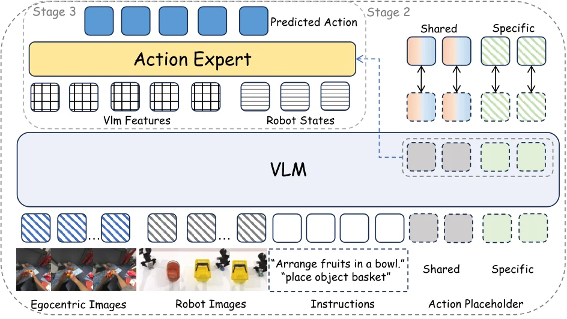

<!-- Generated by scripts/generate.py; edit data/works.json and data/media.json. -->

[← Back to the Awesome index](../../../README.md) · [Interactive website](https://chang-xinhai.github.io/Awesome-RGBDT-Manipulation/?collection=policy&item=exe-ego#library)

# EXE

EXE: Egocentric Cross-Embodiment Pretraining via Factorized Latent Actions for VLA Models

**2026-10-24 · arXiv preprint · ROBOTERA**

**[Paper](https://arxiv.org/abs/2610.33685)**

Factorizes shared and embodiment-specific latent actions for human egocentric pretraining of robot VLAs.

*EXE authors · [Figure source](https://arxiv.org/html/2610.33685v1) · Original rights retained.*

| Field | Reported value and source scope |
| :-- | :-- |
| Record type | policy |
| Policy family | Latent-action VLA pretraining [1](https://arxiv.org/html/2610.33685v1)  |
| Base model and architecture | Not reported [1](https://arxiv.org/html/2610.33685v1)  |
| Model size and component | Not reported [1](https://arxiv.org/html/2610.33685v1)  |
| Deployment inputs | Egocentric human video during pretraining; RGB and instruction for the downstream policy. [1](https://arxiv.org/html/2610.33685v1)  |
| Action outputs and horizon | Robot action sequences after cross-embodiment action decoding and robot training. [1](https://arxiv.org/html/2610.33685v1)  |
| Training method | Shared and human-specific latent action tokenization, followed by embodiment-specific VLA training. [1](https://arxiv.org/html/2610.33685v1)  |
| Training data | Egocentric human videos, simulated robot training and separate real robot demonstrations. [1](https://arxiv.org/html/2610.33685v1)  |
| Training duration | Not reported [1](https://arxiv.org/html/2610.33685v1)  |
| Training hardware | Not reported [1](https://arxiv.org/html/2610.33685v1)  |
| Inference and control rates | Not reported [1](https://arxiv.org/html/2610.33685v1)  |
| Evaluation scope | RoboTwin 2.0, RoboCasa GR1 and physical AgileX Piper bimanual evaluation.  [1](https://arxiv.org/html/2610.33685v1)  |
| Observations / modalities | RGB · Language |
| Evaluation domain | Simulation · Real world |
| Embodiment | Bimanual · Dexterous hand |
| Release: code | Not verified |
| Release: weights | Not verified |
| Release: data | Not verified |
| Release: license | Not verified |
| Release: notes | Public manuscript verified; no project-specific implementation or checkpoints established. |

**Scope and qualifications**

- Human egocentric data and actual robot training/deployment observations are separate stages.

**Primary evidence**

1. [Author manuscript and initial submission](https://arxiv.org/html/2610.33685v1) — Original manuscript distinguishes human capture, training labels and deployment observations.
