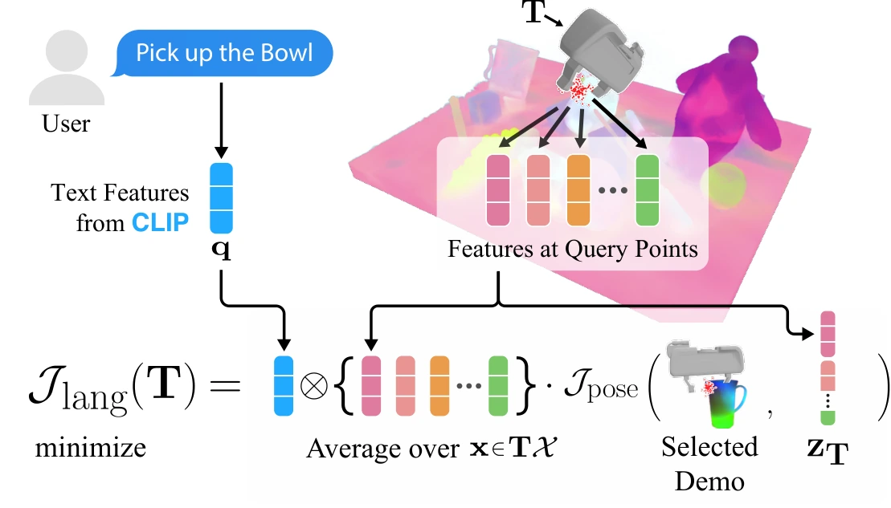

<!-- Generated by scripts/generate.py; edit data/works.json and data/media.json. -->

[← Back to the Awesome index](../../../README.md) · [Interactive website](https://chang-xinhai.github.io/Awesome-RGBDT-Manipulation/?collection=policy&item=f3rm#library)

# F3RM

Distilled Feature Fields Enable Few-Shot Language-Guided Manipulation

**2023-07-27 · CoRL 2023 · MIT CSAIL; IAIFI**

**[Paper](https://arxiv.org/abs/2308.07931)** · [Project](https://f3rm.csail.mit.edu/) · [Code](https://github.com/f3rm/f3rm)

Language-guided pose optimization uses 3D feature fields distilled from 2D foundation models.

*F3RM authors · [Figure source](https://arxiv.org/html/2308.07931) · Original rights retained.*

| Field | Reported value and source scope |
| :-- | :-- |
| Record type | policy |
| Policy family | Geometric transfer [1](https://arxiv.org/abs/2308.07931)  |
| Base model and architecture | NeRF with CLIP/DINO feature distillation and demonstration-conditioned 6-DoF optimization. [1](https://arxiv.org/abs/2308.07931)  |
| Model size and component | Not reported in the inspected primary-source sections [1](https://arxiv.org/abs/2308.07931)  |
| Deployment inputs | Calibrated multi-view RGB scans, few demonstrated poses and optional free-text query. [1](https://arxiv.org/abs/2308.07931)  |
| Action outputs and horizon | 6-DoF grasp/place pose for a physical robot planner. [1](https://arxiv.org/abs/2308.07931)  |
| Training method | Per-scene feature-field fitting and matching demonstration descriptors; no universal end-to-end action network. [1](https://arxiv.org/abs/2308.07931)  |
| Training data | Few grasp/place demonstrations across four object categories; pretrained image/language priors. [1](https://arxiv.org/abs/2308.07931)  |
| Training duration | Not reported in the inspected primary-source sections [1](https://arxiv.org/abs/2308.07931)  |
| Training hardware | Not reported in the inspected primary-source sections [1](https://arxiv.org/abs/2308.07931)  |
| Inference and control rates | Not reported in the inspected primary-source sections [1](https://arxiv.org/abs/2308.07931)  |
| Evaluation scope | Real open-set grasping/placing with unseen objects, descriptions and categories. [1](https://arxiv.org/abs/2308.07931)  |
| Observations / modalities | RGB · Language · Proprioception |
| Evaluation domain | Real world |
| Embodiment | Parallel-jaw gripper |
| Release: code | Available [2](https://f3rm.csail.mit.edu/) [3](https://github.com/f3rm/f3rm) [5](https://github.com/f3rm/f3rm/tree/main)  |
| Release: weights | Not verified [2](https://f3rm.csail.mit.edu/) [3](https://github.com/f3rm/f3rm)  |
| Release: data | Not verified [2](https://f3rm.csail.mit.edu/) [3](https://github.com/f3rm/f3rm)  |
| Release: license | MIT for repository code; pretrained models, data and figure rights remain separate [2](https://f3rm.csail.mit.edu/) [3](https://github.com/f3rm/f3rm) [4](https://github.com/f3rm/f3rm/blob/main/LICENSE)  |
| Release: notes | Code, data and weights are checked independently; an upstream pretrained model is not a released task policy. [2](https://f3rm.csail.mit.edu/) [3](https://github.com/f3rm/f3rm)  |

**Scope and qualifications**

- The original system reconstructs geometry from calibrated RGB views; a NeRF-derived field is not a measured depth observation.
- Scene scanning/fitting is a separate cost from final pose inference.

**Primary evidence**

1. [Original manuscript and first submission history](https://arxiv.org/abs/2308.07931) — Full author HTML method/evaluation/appendix inspected; depth observations, pseudo-labels and generated outputs retain distinct roles.
2. [Official author project](https://f3rm.csail.mit.edu/) — Public author-linked project; figure and downstream scope verified separately.
3. [Official implementation and release scope](https://github.com/f3rm/f3rm) — Availability of research implementation does not establish public task-policy checkpoints.
4. [Actual license file in released source](https://github.com/f3rm/f3rm/blob/main/LICENSE) — Only source code covered by this file; not a blanket license for paper figures or upstream weights.
5. [Actual repository content inventory](https://github.com/f3rm/f3rm/tree/main) — 93 tracked paths inspected; code release is distinguished from a README/project/figure-only repository.
