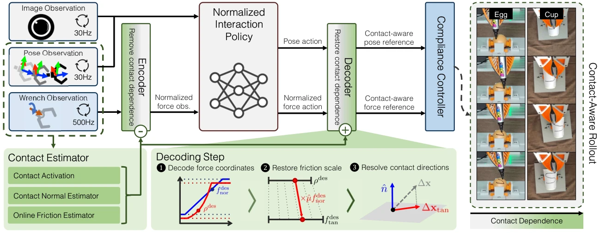

<!-- Generated by scripts/generate.py; edit data/works.json and data/media.json. -->

[← Back to the Awesome index](../../../README.md) · [Interactive website](https://chang-xinhai.github.io/Awesome-RGBDT-Manipulation/?collection=policy&item=face-contact-factorization#library)

# FACE

Contact-Aware Imitation Learning Through Contact Factorization

**2026-10-07 · Preprint · Kyung Hee University / Ewha Womans University / University of Central Florida**

**[Paper](https://arxiv.org/abs/2610.09533)** · [Project](https://rcilab.khu.ac.kr/face)

Contact-relative force factorization preserves learned behavior while online normal/friction estimation adapts its physical realization.

*Contact-Aware Imitation Learning Through Contact Factorization authors · [Figure source](https://arxiv.org/abs/2610.09533) · Original rights retained.*

| Field | Reported value and source scope |
| :-- | :-- |
| Record type | policy |
| Policy family | Flow matching [1](https://arxiv.org/abs/2610.09533)  |
| Base model and architecture | Flow-matching imitation policy; learned GRU contact normal estimator and scalar Kal man friction filter. [1](https://arxiv.org/abs/2610.09533)  |
| Model size and component | Not reported [1](https://arxiv.org/abs/2610.09533)  |
| Deployment inputs | RGB, proprioceptive motion and measured six-axis wrench; online estimated contact normal/friction scale. [1](https://arxiv.org/abs/2610.09533)  |
| Action outputs and horizon | Normalized motion/force actions decoded into hybrid controller references. [1](https://arxiv.org/abs/2610.09533)  |
| Training method | Supervised policy/normal estimator learning; online contact factor estimation without task policy weight updates. [1](https://arxiv.org/abs/2610.09533)  |
| Training data | 200 human handheld demonstrations per object category on nominal paper-cup/egg instances; unseen friction/geometry conditions only at deployment. [1](https://arxiv.org/abs/2610.09533)  |
| Training duration | Not reported [1](https://arxiv.org/abs/2610.09533)  |
| Training hardware | Not reported [1](https://arxiv.org/abs/2610.09533)  |
| Inference and control rates | RGB/pose 30 Hz; wrist wrench 500 Hz retained for online contact processing. [1](https://arxiv.org/abs/2610.09533)  |
| Evaluation scope | Franka FR3 marking an S on fragile paper cups/eggs with unseen geometries and friction conditions. [1](https://arxiv.org/abs/2610.09533)  |
| Observations / modalities | RGB · Force/Torque · Proprioception |
| Evaluation domain | Real world |
| Embodiment | Parallel-jaw gripper |
| Release: code | Not verified [2](https://rcilab.khu.ac.kr/face)  |
| Release: weights | Not verified [2](https://rcilab.khu.ac.kr/face)  |
| Release: data | Not verified [2](https://rcilab.khu.ac.kr/face)  |
| Release: license | Not verified [2](https://rcilab.khu.ac.kr/face)  |
| Release: notes | Original paper reviewed; claimed future releases are not treated as currently available. [2](https://rcilab.khu.ac.kr/face)  |

**Scope and qualifications**

- Six-axis wrench is not skin touch; geometry-derived normal supervision is training only.
- Online friction estimation does not imply online reinforcement learning.

**Primary evidence**

1. [Original paper and supplementary implementation details](https://arxiv.org/abs/2610.09533) — Primary full text reviewed; dataset, deployment modalities and training-only privileges are scoped separately.
2. [Official author project](https://rcilab.khu.ac.kr/face) — Live project artifact links inspected on2026-10-17.
