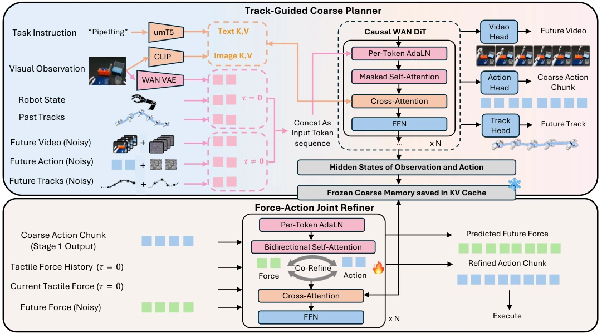

<!-- Generated by scripts/generate.py; edit data/works.json and data/media.json. -->

[← Back to the Awesome index](../../../README.md) · [Interactive website](https://chang-xinhai.github.io/Awesome-RGBDT-Manipulation/?collection=policy&item=fact-force-action-track#library)

# FACT

FACT: A Multimodal Force-Action-Track Foundation Model for Human-to-Robot Dexterity

**2026-10-13 · Preprint · University of Michigan / Stanford University / Microsoft Research**

**[Paper](https://arxiv.org/abs/2610.19155)** · [Project](https://fact-1-0.github.io/)

A visual track-guided world/action planner and force-aware refiner support human-to-robot dexterous transfer.

*FACT: A Multimodal Force-Action-Track Foundation Model for Human-to-Robot Dexterity authors · [Figure source](https://arxiv.org/abs/2610.19155) · Original rights retained.*

| Field | Reported value and source scope |
| :-- | :-- |
| Record type | policy |
| Policy family | World-action model [1](https://arxiv.org/abs/2610.19155)  |
| Base model and architecture | Wan2.2-TI2V-5B track-guided video/action planner; force–action joint refiner trained from scratch; frozen VAE, umT5-XXL and CLIP encoders. [1](https://arxiv.org/abs/2610.19155)  |
| Model size and component | 5.05B coarse planner and 65M force–action refiner (Table IV); frozen external VAE/text/image encoders are separate. [1](https://arxiv.org/abs/2610.19155)  |
| Deployment inputs | RGB, task language, robot state, visual track history and five fingertip 6-axis wrenches/hand. [1](https://arxiv.org/abs/2610.19155)  |
| Action outputs and horizon | 16-step 62D bimanual action chunks plus future video, tracks and force predictions. [1](https://arxiv.org/abs/2610.19155)  |
| Training method | Joint pretraining then 100-trajectory/task fine-tuning; coarse planner runs per chunk and refiner refreshes from measured contact. [1](https://arxiv.org/abs/2610.19155)  |
| Training data | Ego Force~2,000 h/40k episodes/1,000 tasks/120 scenes/1,000 demonstrators; ten evaluation tasks each use 10 robot+90 human demos for fine-tuning. [1](https://arxiv.org/abs/2610.19155)  |
| Training duration | Not reported [1](https://arxiv.org/abs/2610.19155)  |
| Training hardware | Table IV: 240 Alibaba T-Head PPU Zhenwu 810E accelerators,96GB HBM2e each. Task-specific fine-tuning reports8 GPUs separately, without type. [1](https://arxiv.org/abs/2610.19155)  |
| Inference and control rates | Actions 20 Hz; contact refinement 5 Hz; coarse 16-step chunk. [1](https://arxiv.org/abs/2610.19155)  |
| Evaluation scope | Bimanual YAM station with two Sharpa Wave hands across 10 real tasks; task-specific post-training, not zero-shot all-task execution. [1](https://arxiv.org/abs/2610.19155)  |
| Observations / modalities | RGB · Tactile · Force/Torque · Proprioception · Language |
| Evaluation domain | Real world |
| Embodiment | Dexterous hand · Bimanual |
| Release: code | Not verified [2](https://fact-1-0.github.io/)  |
| Release: weights | Not verified [2](https://fact-1-0.github.io/)  |
| Release: data | Not verified [2](https://fact-1-0.github.io/)  |
| Release: license | Not verified [2](https://fact-1-0.github.io/)  |
| Release: notes | Original paper reviewed; claimed future releases are not treated as currently available. [2](https://fact-1-0.github.io/)  |

**Scope and qualifications**

- Fingertip 6-axis contact wrenches differ from a single wrist F/T sensor.
- Ego Force collection corpus and task-specific 100 demo mixtures have distinct roles.
- EgoForce human fingertip6D wrenches are derived from12 normal-pressure taxels: normal force and center-of-pressure moments, with shear/twist components set tozero. Robot Sharpa tactile wrenches are a different sensing realization.
- EgoForce human fingertip6D wrenches are derived from12 normal-pressure taxels: normal force and center-of-pressure moments, with shear/twist components set tozero. Robot Sharpa tactile wrenches are a different sensing realization.

**Primary evidence**

1. [Original paper and supplementary implementation details](https://arxiv.org/abs/2610.19155) — Primary full text reviewed; dataset, deployment modalities and training-only privileges are scoped separately.
2. [Official author project](https://fact-1-0.github.io/) — Live artifact status reviewed separately from paper claims.
