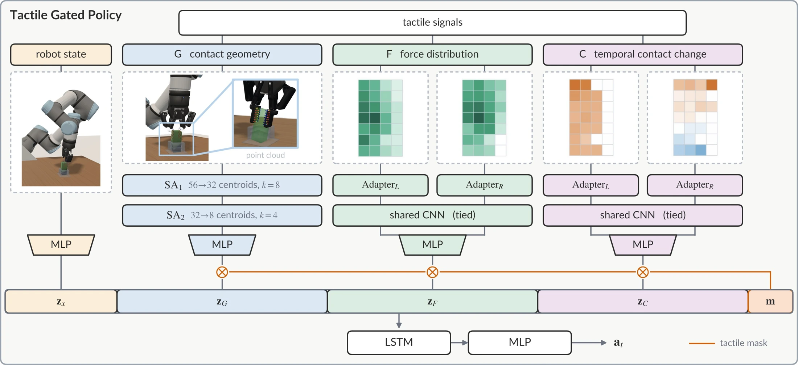

<!-- Generated by scripts/generate.py; edit data/works.json and data/media.json. -->

[← Back to the Awesome index](../../../README.md) · [Interactive website](https://chang-xinhai.github.io/Awesome-RGBDT-Manipulation/?collection=policy&item=factorized-tactile-control#library)

# Factorized Tactile Representation and Control

Factorized Tactile Representation and Control for Sim-to-Real Manipulation

**2026-10-07 · Preprint · Amazon Fulfillment Technologies & Robotics / University of Texas at Austin**

**[Paper](https://arxiv.org/abs/2610.10510)**

Separated contact geometry, force distribution and temporal-change representations enable mask-configurable tactile sim-to-real control.

*Factorized Tactile Representation and Control for Sim-to-Real Manipulation authors · [Figure source](https://arxiv.org/abs/2610.10510) · Original rights retained.*

| Field | Reported value and source scope |
| :-- | :-- |
| Record type | policy |
| Policy family | RL [1](https://arxiv.org/abs/2610.10510)  |
| Base model and architecture | Tactile Gated Policy with recurrent PPO/LSTM actor and asymmetric privileged critic. [1](https://arxiv.org/abs/2610.10510)  |
| Model size and component | Not reported [1](https://arxiv.org/abs/2610.10510)  |
| Deployment inputs | Deployment-available tactile/proprioceptive observations with separately masked tactile factor channels. [1](https://arxiv.org/abs/2610.10510)  |
| Action outputs and horizon | Force-regulation and peg-insertion robot commands. [1](https://arxiv.org/abs/2610.10510)  |
| Training method | Sensor-response fitting and representation-specific randomization; recurrent PPO policy transfer. [1](https://arxiv.org/abs/2610.10510)  |
| Training data | Calibration 280 localized pokes, 45 edge grasps, 20 whole-pad grasps (~29 min); GPU-parallel simulated policy learning. [1](https://arxiv.org/abs/2610.10510)  |
| Training duration | Not reported [1](https://arxiv.org/abs/2610.10510)  |
| Training hardware | 4096 environments/A100reported for simulator timing; total training GPU count Not reported. [1](https://arxiv.org/abs/2610.10510)  |
| Inference and control rates | 10 Hz policy;500 Hz sensor sampling;12 physics steps/policy step. [1](https://arxiv.org/abs/2610.10510)  |
| Evaluation scope | UR5e/Robotiq 2 F-85 with two 7×4 TSF-85 capacitive pads: force regulation and adversarial peg insertion. [1](https://arxiv.org/abs/2610.10510)  |
| Observations / modalities | Tactile · Proprioception |
| Evaluation domain | Simulation · Real world |
| Embodiment | Parallel-jaw gripper |
| Release: code | Not verified |
| Release: weights | Not verified |
| Release: data | Not verified |
| Release: license | Not verified |
| Release: notes | Original paper reviewed; claimed future releases are not treated as currently available. |

**Scope and qualifications**

- IsaacSim 5.1.0/IsaacLab 2.3.2 explicitly reported; actor excludes privileged simulation critic state.
- A100figure characterizes timing/parallelism, not a reported training cluster budget.
- Paper explicitly identifies this work as performed at Amazon and not associated with Northeastern University, despite a concurrent author appointment.
- Paper explicitly identifies this work as performed at Amazon and not associated with Northeastern University, despite a concurrent author appointment.

**Primary evidence**

1. [Original paper and supplementary implementation details](https://arxiv.org/abs/2610.10510) — Primary full text reviewed; dataset, deployment modalities and training-only privileges are scoped separately.
