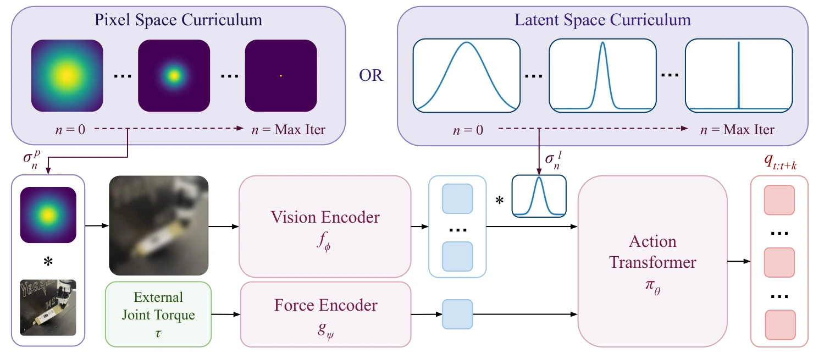

<!-- Generated by scripts/generate.py; edit data/works.json and data/media.json. -->

[← Back to the Awesome index](../../../README.md) · [Interactive website](https://chang-xinhai.github.io/Awesome-RGBDT-Manipulation/?collection=policy&item=factr#library)

# FACTR

FACTR: Force-Attending Curriculum Training for Contact-Rich Policy Learning

**2025-02-24 · Preprint · Carnegie Mellon University**

**[Paper](https://arxiv.org/abs/2502.17432)** · [Project](https://jasonjzliu.com/factr/) · [Code](https://github.com/RaindragonD/factr)

A curriculum gradually restores visual detail so force-aware imitation policies learn to use joint-torque feedback.

*FACTR: Force-Attending Curriculum Training for Contact-Rich Policy Learning authors · [Figure source](https://arxiv.org/abs/2502.17432) · Original rights retained.*

| Field | Reported value and source scope |
| :-- | :-- |
| Record type | policy |
| Policy family | ACT [1](https://arxiv.org/abs/2502.17432)  |
| Base model and architecture | ACT with pretrained visual transformer and MLP torque token. [1](https://arxiv.org/abs/2502.17432)  |
| Model size and component | Not reported [1](https://arxiv.org/abs/2502.17432)  |
| Deployment inputs | RGB and robot joint-torque/proprioceptive feedback. [1](https://arxiv.org/abs/2502.17432)  |
| Action outputs and horizon | Transformer action chunks for contact-rich arm manipulation. [1](https://arxiv.org/abs/2502.17432)  |
| Training method | Behavior cloning with decreasing visual corruption in pixel/latent space. [1](https://arxiv.org/abs/2502.17432)  |
| Training data | 50 demonstration collection setting; four tasks:box lifting, non-prehensile pivoting, fruit pick-and-place, rolling dough. [1](https://arxiv.org/abs/2502.17432)  |
| Training duration | 20 k–50 k gradient steps, 2–6 h (appendix typical-policy setting). [1](https://arxiv.org/abs/2502.17432)  |
| Training hardware | Single NVIDIA RTX4090. [1](https://arxiv.org/abs/2502.17432)  |
| Inference and control rates | Not reported [1](https://arxiv.org/abs/2502.17432)  |
| Evaluation scope | Real contact-rich manipulation and unseen object appearance/geometry. [1](https://arxiv.org/abs/2502.17432)  |
| Observations / modalities | RGB · Force/Torque · Proprioception |
| Evaluation domain | Real world |
| Embodiment | Parallel-jaw gripper |
| Release: code | Available [2](https://jasonjzliu.com/factr/) [3](https://github.com/RaindragonD/factr)  |
| Release: weights | Not verified [2](https://jasonjzliu.com/factr/) [3](https://github.com/RaindragonD/factr)  |
| Release: data | Not verified [2](https://jasonjzliu.com/factr/) [3](https://github.com/RaindragonD/factr)  |
| Release: license | Apache-2.0 [2](https://jasonjzliu.com/factr/) [3](https://github.com/RaindragonD/factr)  |
| Release: notes | Author-linked repository and actual LICENSE inspected; code, checkpoints anddatasets have independent availability. [2](https://jasonjzliu.com/factr/) [3](https://github.com/RaindragonD/factr)  |

**Scope and qualifications**

- Force token is robot joint torque, not a skin tactile array.

**Primary evidence**

1. [Original paper and supplementary implementation details](https://arxiv.org/abs/2502.17432) — Primary full text reviewed; dataset, deployment modalities and training-only privileges are scoped separately.
2. [Official author project](https://jasonjzliu.com/factr/) — Live artifact status reviewed separately from paper claims.
3. [Official released implementation and LICENSE](https://github.com/RaindragonD/factr) — Repository metadata,README and actualLICENSE inspected; availability scoped to the listed component.
