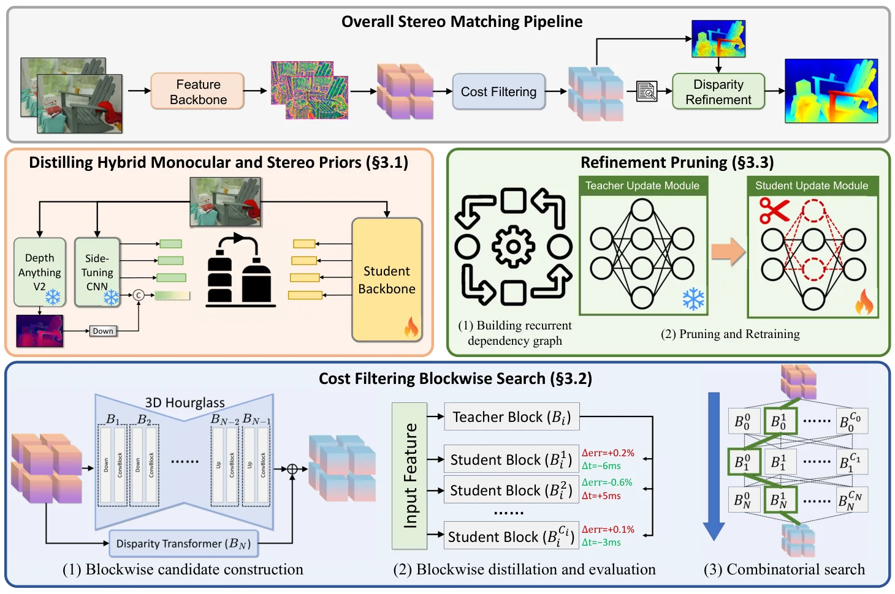

<!-- Generated by scripts/generate.py; edit data/works.json and data/media.json. -->

[← Back to the Awesome index](../../../README.md) · [Interactive website](https://chang-xinhai.github.io/Awesome-RGBDT-Manipulation/?collection=policy&item=fast-foundationstereo#library)

# Fast-FoundationStereo

Fast-FoundationStereo: Real-Time Zero-Shot Stereo Matching

**2025-12-11 · CVPR 2026 · NVIDIA**

**[Paper](https://arxiv.org/abs/2512.11130)** · [Project](https://nvlabs.github.io/Fast-FoundationStereo/) · [Code](https://github.com/NVlabs/Fast-FoundationStereo) · [Weights](https://huggingface.co/nvidia/c-fast-foundationstereo)

A distilled and optimized stereo model enables faster zero-shot disparity estimation.

*Fast-FoundationStereo authors · [Figure source](https://nvlabs.github.io/Fast-FoundationStereo/) · Original rights retained.*

| Field | Reported value and source scope |
| :-- | :-- |
| Record type | model |
| Model role and downstream interface | Depth and geometry perception reference [1](https://arxiv.org/html/2512.11130v1)  |
| Model family | Depth estimation [1](https://arxiv.org/html/2512.11130v1)  |
| Model architecture | See original paper [1](https://arxiv.org/html/2512.11130v1)  |
| Model size and component | Not reported [1](https://arxiv.org/html/2512.11130v1)  |
| Model inputs | Rectified stereo RGB images. [1](https://arxiv.org/html/2512.11130v1)  |
| Model outputs | Disparity; metric depth additionally needs focal length and stereo baseline. [1](https://arxiv.org/html/2512.11130v1)  |
| Training method | Architecture search, distillation and pruning, with synthetic and pseudo-labelled stereo data. [1](https://arxiv.org/html/2512.11130v1)  |
| Training data and scale | See original paper for dataset scope [1](https://arxiv.org/html/2512.11130v1)  |
| Training duration | Not reported [1](https://arxiv.org/html/2512.11130v1)  |
| Training hardware | Not reported [1](https://arxiv.org/html/2512.11130v1)  |
| Inference setting and runtime | See original paper and official implementation [1](https://arxiv.org/html/2512.11130v1)  |
| Downstream evaluation and scope | Stereo datasets and speed/accuracy evaluation; stereo geometry is applicable to robot capture processing. [1](https://arxiv.org/html/2512.11130v1)  |
| Observations / modalities | RGB |
| Evaluation domain |  |
| Embodiment |  |
| Release: code | Available — source linked [2](https://github.com/NVlabs/Fast-FoundationStereo)  |
| Release: weights | Available — see official model page; terms vary by checkpoint [2](https://github.com/NVlabs/Fast-FoundationStereo)  |
| Release: data | Not verified [2](https://github.com/NVlabs/Fast-FoundationStereo)  |
| Release: license | Research code and checkpoints are subject to NVIDIA research terms; C-Fast model uses the separate NVIDIA Open Model Agreement. [2](https://github.com/NVlabs/Fast-FoundationStereo)  |
| Release: notes | Research and C-Fast commercial variants have different terms; reconstructed depth is predicted rather than an independent measured channel. [2](https://github.com/NVlabs/Fast-FoundationStereo)  |

**Scope and qualifications**

- Research and C-Fast commercial variants have different terms; reconstructed depth is predicted rather than an independent measured channel.

**Primary evidence**

1. [Author paper and first submission](https://arxiv.org/html/2512.11130v1)
2. [Official code and license](https://github.com/NVlabs/Fast-FoundationStereo)
