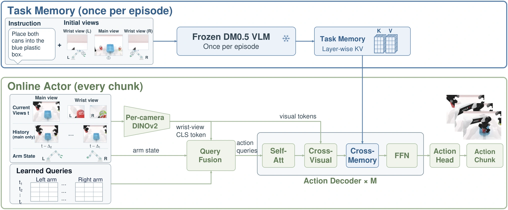

<!-- Generated by scripts/generate.py; edit data/works.json and data/media.json. -->

[← Back to the Awesome index](../../../README.md) · [Interactive website](https://chang-xinhai.github.io/Awesome-RGBDT-Manipulation/?collection=policy&item=fast-vla#library)

# Fast-VLA

Fast-VLA: You Only Think Once for Robot Manipulation

**2026-10-15 · Preprint · Huawei Technologies / Huawei Central Research Institute**

**[Paper](https://arxiv.org/abs/2610.21389)** · [Project](https://garfield-kh.github.io/FastVLA) · [Code](https://github.com/Garfield-kh/FastVLA) · [Weights](https://huggingface.co/kehong/FastVLA-weights)

Encodes language and initial views into fixed VLM KV memory once per episode, then uses a compact live-feedback actor for repeated action decisions.

*Fast-VLA authors · [Figure source](https://arxiv.org/html/2610.21389v1) · Original rights retained.*

| Field | Reported value and source scope |
| :-- | :-- |
| Record type | policy |
| Policy family | VLA [1](https://arxiv.org/abs/2610.21389)  |
| Base model and architecture | Frozen4B task-memory VLM (DM0.5 default); DINOv2-initialized online vision encoders and learned action decoder/head [1](https://arxiv.org/abs/2610.21389)  |
| Model size and component | 4B offline-prefill backbone; complete online-actor parameter total not reported [1](https://arxiv.org/abs/2610.21389)  |
| Deployment inputs | Initial RGB/task language for prefill; live RGB, optional history and proprioception for online actor [1](https://arxiv.org/abs/2610.21389)  |
| Action outputs and horizon | RoboTwin50 absolute bimanual-joint action commands; benchmark-specific chunk/execution settings [1](https://arxiv.org/abs/2610.21389)  |
| Training method | Train shared online actor with fixed episode KV task memory, current-feedback query fusion and action supervision [1](https://arxiv.org/abs/2610.21389)  |
| Training data | RoboTwin2 all 50 clean + randomized tasks; LIBERO all 40 tasks; frozen VLM memory caches precomputed [1](https://arxiv.org/abs/2610.21389)  |
| Training duration | RoboTwin200k steps ≈ 150 accelerator-hours; LIBERO30k≈ 5 accelerator-hours [1](https://arxiv.org/abs/2610.21389)  |
| Training hardware | Accelerator model not disclosed in inspected manuscript [1](https://arxiv.org/abs/2610.21389)  |
| Inference and control rates | RoboTwin subsequent chunks44.87 ms; first call452.47 ms including 407.60 ms prefill; hardware-specific servo rate not stated [1](https://arxiv.org/abs/2610.21389)  |
| Evaluation scope | RoboTwin2, LIBERO and LIBERO-Plus; memory-swap and efficiency ablations [1](https://arxiv.org/abs/2610.21389)  |
| Observations / modalities | RGB · Proprioception · Language |
| Evaluation domain | Simulation |
| Embodiment | Parallel-jaw gripper · Bimanual |
| Release: code | Available [2](https://garfield-kh.github.io/FastVLA) [3](https://github.com/Garfield-kh/FastVLA)  |
| Release: weights | Available [2](https://garfield-kh.github.io/FastVLA) [3](https://github.com/Garfield-kh/FastVLA)  |
| Release: data | Not verified [2](https://garfield-kh.github.io/FastVLA)  |
| Release: license | Not reported [2](https://garfield-kh.github.io/FastVLA)  |
| Release: notes | Availability reflects public source/model links; complete paper-scale reproduction and all dataset access terms were not tested. [2](https://garfield-kh.github.io/FastVLA)  |

**Scope and qualifications**

- Initial VLM prefill must be included when comparing amortized latency; subsequent-chunk timing is not first-call timing.
- This method uses fixed task memory; it does not establish context adaptation from demonstrated actions.

**Primary evidence**

1. [Primary manuscript and first-submission history](https://arxiv.org/abs/2610.21389) — Latest available full manuscript inspected; publication date retains the first arXiv submission. Sizes, training cost and deployment rates keep their experimental scope.
2. [Official policy implementation](https://garfield-kh.github.io/FastVLA) — Source and checkpoint availability checked separately; no local policy execution was performed.
3. [Official executable release linked from project](https://github.com/Garfield-kh/FastVLA) — Repository provides policy training, evaluation and model links.
