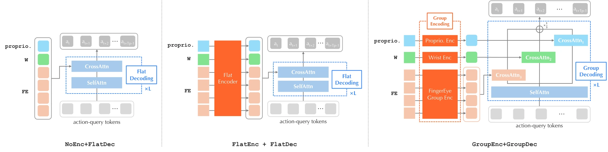

<!-- Generated by scripts/generate.py; edit data/works.json and data/media.json. -->

[← Back to the Awesome index](../../../README.md) · [Interactive website](https://chang-xinhai.github.io/Awesome-RGBDT-Manipulation/?collection=policy&item=fingereye#library)

# FingerEye Policy

FingerEye: Learning Dexterous Manipulation with Continuous Vision-Tactile Sensing

**2026-04-22 · Preprint · National University of Singapore / Robo Science / Huazhong University of Science and Technology / South China University of Technology**

**[Paper](https://arxiv.org/abs/2604.20689)** · [Project](https://nus-lins-lab.github.io/FingerEyeWeb/) · [Code](https://github.com/ariszxxu/FingerEye)

Continuous fingertip RGB carries both pre-contact stereo cues and post-contact deformation for dexterous policy learning.

*FingerEye: Learning Dexterous Manipulation with Continuous Vision-Tactile Sensing authors · [Figure source](https://arxiv.org/abs/2604.20689) · Original rights retained.*

| Field | Reported value and source scope |
| :-- | :-- |
| Record type | policy |
| Policy family | Transformer [1](https://arxiv.org/abs/2604.20689)  |
| Base model and architecture | Transformer action-chunk policy with4 encoder and4 decoder layers, width512,16 heads; group-local observation encoding and grouped action cross-attention. [1](https://arxiv.org/abs/2604.20689)  |
| Model size and component | Not reported [1](https://arxiv.org/abs/2604.20689)  |
| Deployment inputs | Wrist RGB, proprioception andper-fingertip binocular RGB. Main policies do not use estimated wrench/plate pose. [1](https://arxiv.org/abs/2604.20689)  |
| Action outputs and horizon | Dexterous action chunks with grouped modality fusion. [1](https://arxiv.org/abs/2604.20689)  |
| Training method | Demonstration-based policy learning with controlled fusion interface comparisons. [1](https://arxiv.org/abs/2604.20689)  |
| Training data | Task-specific demonstrations: simulation Coin50, Nut50, Peg-in-Hole200; real Coin60, Chip30, Letter60, Syringe40. Table8 counts are separate simulation/real task settings. [1](https://arxiv.org/abs/2604.20689)  |
| Training duration | Simulation Coin/Nut500 epochs each, Peg-in-Hole300; each real task500 epochs. Wall-clock time Not reported. [1](https://arxiv.org/abs/2604.20689)  |
| Training hardware | Not reported [1](https://arxiv.org/abs/2604.20689)  |
| Inference and control rates | 10 Hz collection and policy execution. [1](https://arxiv.org/abs/2604.20689)  |
| Evaluation scope | Coin standing, chip picking, letter retrieving, syringe manipulation, nut picking, peg-in-hole pushing and related settings;64 sim rollouts/evaluation seed, 20 real rollouts/method/task. [1](https://arxiv.org/abs/2604.20689)  |
| Observations / modalities | RGB · Tactile · Proprioception |
| Evaluation domain | Simulation · Real world |
| Embodiment | Dexterous hand |
| Release: code | Available [2](https://nus-lins-lab.github.io/FingerEyeWeb/) [3](https://github.com/ariszxxu/FingerEye)  |
| Release: weights | Not verified [2](https://nus-lins-lab.github.io/FingerEyeWeb/) [3](https://github.com/ariszxxu/FingerEye)  |
| Release: data | Not verified [2](https://nus-lins-lab.github.io/FingerEyeWeb/) [3](https://github.com/ariszxxu/FingerEye)  |
| Release: license | Not verified; no unambiguous repository license identified. [2](https://nus-lins-lab.github.io/FingerEyeWeb/) [3](https://github.com/ariszxxu/FingerEye)  |
| Release: notes | Author-linked repository and actual LICENSE inspected; code, checkpoints anddatasets have independent availability. [2](https://nus-lins-lab.github.io/FingerEyeWeb/) [3](https://github.com/ariszxxu/FingerEye)  |

**Scope and qualifications**

- Main learned policy sees RGB contact deformation, not explicit measured depth, plate pose or wrench; these are sensor characterization/auxiliary studies.
- Digital twin matches compliant surface pose approximately; nonlinear silicone/deformable mechanics not validated.
- Four/six FingerEye RGB views mean two/three binocular modules, not four/six physical sensors; Table8 also includes one wrist camera.
- Four/six FingerEye RGB views mean two/three binocular modules, not four/six physical sensors; Table8 also includes one wrist camera.

**Primary evidence**

1. [Original paper and supplementary implementation details](https://arxiv.org/abs/2604.20689) — Primary full text reviewed; dataset, deployment modalities and training-only privileges are scoped separately.
2. [Official author project](https://nus-lins-lab.github.io/FingerEyeWeb/) — Live artifact status reviewed separately from paper claims.
3. [Official released implementation and LICENSE](https://github.com/ariszxxu/FingerEye) — Repository metadata,README and actualNone inspected; availability scoped to the listed component.
