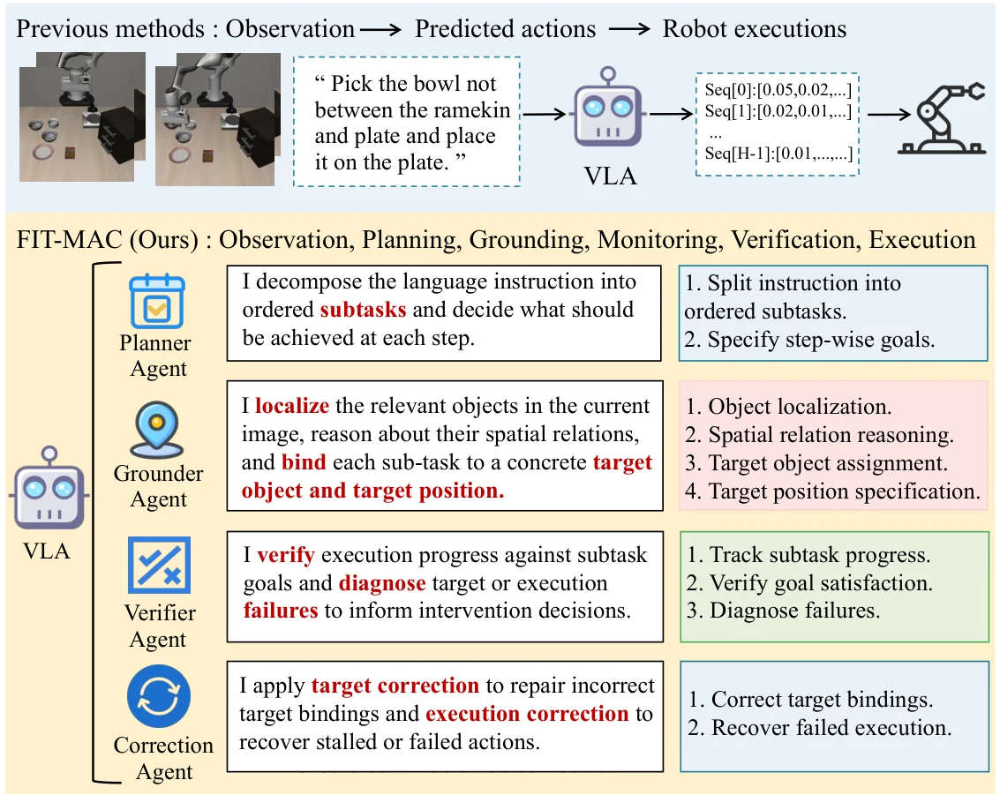

<!-- Generated by scripts/generate.py; edit data/works.json and data/media.json. -->

[← Back to the Awesome index](../../../README.md) · [Interactive website](https://chang-xinhai.github.io/Awesome-RGBDT-Manipulation/?collection=policy&item=fit-mac#library)

# FIT-MAC

FIT-MAC: A Closed-Loop Multi-Agent Framework for Robust Vision-Language-Action Models

**2026-10-20 · Preprint · Lanzhou University**

**[Paper](https://arxiv.org/abs/2610.28109)** · [Project](https://fitmac-research.pages.dev/) · [Code](https://anonymous.4open.science/r/research-artifact-B431/README.md)

Planner, Grounder, Verifier and Correction modules route target-binding and execution errors to bounded recovery around a pretrained VLA.

*FIT-MAC authors · [Figure source](https://arxiv.org/abs/2610.28109) · Original rights retained.*

| Field | Reported value and source scope |
| :-- | :-- |
| Record type | policy |
| Policy family | Robot agent [1](https://arxiv.org/abs/2610.28109)  |
| Base model and architecture | OpenVLA, π0 and π0.5 evaluated as frozen action backbones. [1](https://arxiv.org/abs/2610.28109)  |
| Model size and component | Not reported [1](https://arxiv.org/abs/2610.28109)  |
| Deployment inputs | Task, current RGB, proprioception and execution feedback; explicit target binding and controller state. [1](https://arxiv.org/abs/2610.28109)  |
| Action outputs and horizon | Subgoals, corrected target bindings and bounded local rescue actions around VLA predictions. [1](https://arxiv.org/abs/2610.28109)  |
| Training method | Inference-time modular feedback and recovery; no backbone parameter updates are needed by the wrapper. [1](https://arxiv.org/abs/2610.28109)  |
| Training data | Not reported [1](https://arxiv.org/abs/2610.28109)  |
| Training duration | Not reported [1](https://arxiv.org/abs/2610.28109)  |
| Training hardware | Not reported [1](https://arxiv.org/abs/2610.28109)  |
| Inference and control rates | Not reported [1](https://arxiv.org/abs/2610.28109)  |
| Evaluation scope | LIBERO-Object/Spatial under five LIBERO-PRO perturbation types; OpenVLA+FIT-MAC reports 85.4% and 72.0% suite averages. [1](https://arxiv.org/abs/2610.28109)  |
| Observations / modalities | RGB · Proprioception · Language |
| Evaluation domain | Simulation |
| Embodiment | Parallel-jaw gripper |
| Release: code | Available — anonymous research artifact [2](https://fitmac-research.pages.dev/) [3](https://anonymous.4open.science/r/research-artifact-B431) [4](https://anonymous.4open.science/r/research-artifact-B431)  |
| Release: weights | Not verified [2](https://fitmac-research.pages.dev/) [3](https://anonymous.4open.science/r/research-artifact-B431) [4](https://anonymous.4open.science/r/research-artifact-B431)  |
| Release: data | Not verified [2](https://fitmac-research.pages.dev/) [3](https://anonymous.4open.science/r/research-artifact-B431) [4](https://anonymous.4open.science/r/research-artifact-B431)  |
| Release: license | Not verified [2](https://fitmac-research.pages.dev/) [3](https://anonymous.4open.science/r/research-artifact-B431) [4](https://anonymous.4open.science/r/research-artifact-B431)  |
| Release: notes | Anonymous artifact contains substantive fit_mac modules, grounding server and evaluation runtime. Original-code licensing is not verified; no method checkpoint release is established. [2](https://fitmac-research.pages.dev/) [3](https://anonymous.4open.science/r/research-artifact-B431) [4](https://anonymous.4open.science/r/research-artifact-B431)  |

**Scope and qualifications**

- No measured-depth input is established for this wrapper.
- Robustness comparisons preserve each backbone, seed and perturbation setting.

**Primary evidence**

1. [Primary manuscript and first-submission history](https://arxiv.org/abs/2610.28109) — Current primary manuscript reviewed; first-public date uses arXiv v1. Observations, training privileges and deployed interfaces retain their separate scopes.
2. [Official project source and actual artifact inventory](https://fitmac-research.pages.dev/) — Reviewed 26 October 2026. Availability and licensing apply only to the described released component, independently of paper results.
3. [Official code source and actual artifact inventory](https://anonymous.4open.science/r/research-artifact-B431) — Reviewed 26 October 2026. Availability and licensing apply only to the described released component, independently of paper results.
4. [Official anonymous artifact: landing access limitation and readable source entry](https://anonymous.4open.science/r/research-artifact-B431) — Canonical repository landing currently redirects to an API root returning401. Its official README.md and substantive evaluation/grounding source-file APIs return200. Code link uses that readable entry; anonymous artifact licensing remains Not verified.
