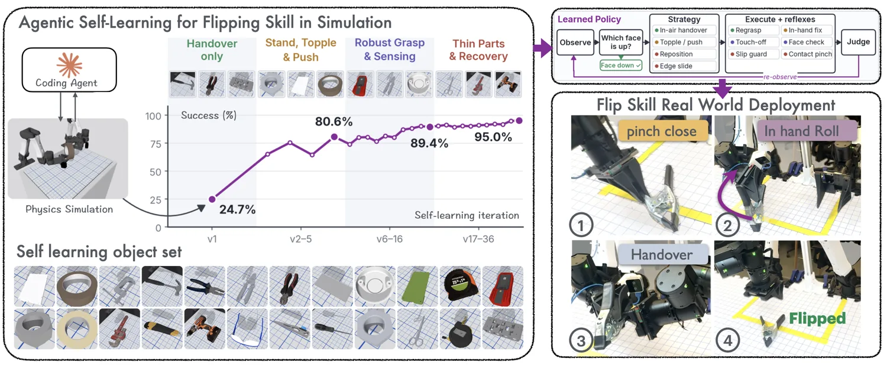

<!-- Generated by scripts/generate.py; edit data/works.json and data/media.json. -->

[← Back to the Awesome index](../../../README.md) · [Interactive website](https://chang-xinhai.github.io/Awesome-RGBDT-Manipulation/?collection=policy&item=flip-anything#library)

# Flip Anything

Flip Anything with Agentic Robotics Self-Learning

**2026-11-09 · Preprint · University of California, Berkeley**

**[Paper](https://arxiv.org/abs/2611.11941)** · [Project](https://berkeleyautomation.github.io/flipanything/)

A coding agent improves an object-flipping graph policy through simulation feedback and transfers it to a bimanual robot.

*Flip Anything authors · [Figure source](https://arxiv.org/abs/2611.11941) · Original rights retained.*

| Field | Reported value and source scope |
| :-- | :-- |
| Record type | policy |
| Policy family | Code-as-policy robot agent [1](https://arxiv.org/abs/2611.11941)  |
| Base model and architecture | Coding agent and reactive graph policy [1](https://arxiv.org/abs/2611.11941)  |
| Model size and component | Not reported [1](https://arxiv.org/abs/2611.11941)  |
| Deployment inputs | RGB-D observations, robot state and execution feedback. [1](https://arxiv.org/abs/2611.11941)  |
| Action outputs and horizon | Graph-based perception, grasping, handover and recovery programs. [1](https://arxiv.org/abs/2611.11941)  |
| Training method | Agent iteratively revises executable logic from simulation feedback; no foundation-model weight update is claimed. [1](https://arxiv.org/abs/2611.11941)  |
| Training data | Not reported [1](https://arxiv.org/abs/2611.11941)  |
| Training duration | Not reported [1](https://arxiv.org/abs/2611.11941)  |
| Training hardware | Not reported [1](https://arxiv.org/abs/2611.11941)  |
| Inference and control rates | Not reported [1](https://arxiv.org/abs/2611.11941)  |
| Evaluation scope | Object-flipping simulation and separately reported physical robot trials. [1](https://arxiv.org/abs/2611.11941)  |
| Observations / modalities | RGB · Depth · Proprioception |
| Evaluation domain | Simulation · Real world |
| Embodiment |  |
| Release: code | Not verified [2](https://berkeleyautomation.github.io/flipanything/)  |
| Release: weights | Not verified [2](https://berkeleyautomation.github.io/flipanything/)  |
| Release: data | Not verified [2](https://berkeleyautomation.github.io/flipanything/)  |
| Release: license | Not verified [2](https://berkeleyautomation.github.io/flipanything/)  |
| Release: notes | Availability is distinguished for source, data and model weights. [2](https://berkeleyautomation.github.io/flipanything/)  |

**Scope and qualifications**

- Simulation and physical camera setups differ; tuned development performance is not a held-out benchmark score.

**Primary evidence**

1. [Original paper and first submission](https://arxiv.org/abs/2611.11941)
2. [Official project and release scope](https://berkeleyautomation.github.io/flipanything/)
