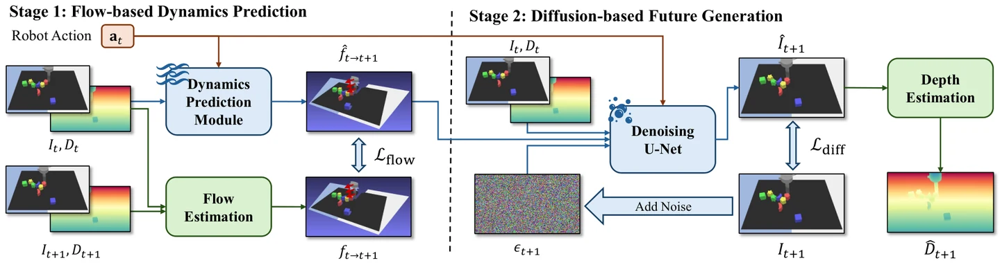

<!-- Generated by scripts/generate.py; edit data/works.json and data/media.json. -->

[← Back to the Awesome index](../../../README.md) · [Interactive website](https://chang-xinhai.github.io/Awesome-RGBDT-Manipulation/?collection=policy&item=flowdreamer#library)

# FlowDreamer

FlowDreamer: A RGB-D World Model with Flow-based Motion Representations for Robot Manipulation

**2025-05-15 · IEEE Robotics and Automation Letters (2026) · BIGAI; Tsinghua University and collaborators**

**[Paper](https://arxiv.org/abs/2505.10075)** · [Project](https://sharinka0715.github.io/FlowDreamer/) · [Code](https://github.com/sharinka0715/FlowDreamer) · [Weights](https://huggingface.co/sharinka0715/flowdreamer_pretrained) · [Published Version](https://doi.org/10.1109/LRA.2026.3653273)

Predicts RGB-D futures from a robot action by learning a 3D scene-flow field before rendering the next image.

*Jun Guo and coauthors · [Figure source](https://arxiv.org/html/2505.10075v1) · Original rights retained.*

| Field | Reported value and source scope |
| :-- | :-- |
| Record type | model |
| Model role and downstream interface | Action-conditioned RGB-D world model [1](https://arxiv.org/html/2505.10075v1)  |
| Model family | FlowDreamer [1](https://arxiv.org/html/2505.10075v1)  |
| Model architecture | Two-stage modular 3D flow prediction and Stable Diffusion 2.1-based frame generation. [1](https://arxiv.org/html/2505.10075v1)  |
| Model size and component | Not reported [1](https://arxiv.org/html/2505.10075v1)  |
| Model inputs | Current aligned RGB-D observation and robot action. Benchmark and autoregressive paths differ; the authors use a learned metric depth estimator for autoregressive inference. [1](https://arxiv.org/html/2505.10075v1)  |
| Model outputs | Future RGB-D observation and intermediate 3D scene flow for prediction or downstream planning. [1](https://arxiv.org/html/2505.10075v1)  |
| Training method | Flow and rendering modules are optimized together with scene-flow geometry supervision. [1](https://arxiv.org/html/2505.10075v1)  |
| Training data and scale | Language Table, RoboDesk, RoboSuite, and SimplerEnv evaluation/data regimes in the paper. [1](https://arxiv.org/html/2505.10075v1)  |
| Training duration | Not reported [1](https://arxiv.org/html/2505.10075v1)  |
| Training hardware | Not reported [1](https://arxiv.org/html/2505.10075v1)  |
| Inference setting and runtime | Not reported [1](https://arxiv.org/html/2505.10075v1) [3](https://github.com/sharinka0715/FlowDreamer#readme)  |
| Downstream evaluation and scope | Four benchmark settings cover visual prediction and planning, with separately reported semantic/pixel metrics and manipulation success. [1](https://arxiv.org/html/2505.10075v1)  |
| Observations / modalities | RGB · Depth · Point cloud · Proprioception |
| Evaluation domain | Simulation · Real world |
| Embodiment | Parallel-jaw gripper |
| Release: code | Available — training and inference source [3](https://github.com/sharinka0715/FlowDreamer#readme)  |
| Release: weights | Partial — fine-tuned metric-depth modules, not the full world-model weights [3](https://github.com/sharinka0715/FlowDreamer#readme)  |
| Release: data | Upstream datasets, separately versioned [3](https://github.com/sharinka0715/FlowDreamer#readme)  |
| Release: license | Repository and upstream model terms are separate [3](https://github.com/sharinka0715/FlowDreamer#readme)  |
| Release: notes | Paper or official project reviewed. Code, weights and data are tracked independently. [3](https://github.com/sharinka0715/FlowDreamer#readme)  |

**Scope and qualifications**

- This record describes a predictive model. Input depth can be estimated in the autoregressive path; published depth weights are not the two full prediction stages.

**Primary evidence**

1. [Original paper and evaluation settings](https://arxiv.org/html/2505.10075v1)
2. [Official project with task and method examples](https://sharinka0715.github.io/FlowDreamer/)
3. [Training/inference and explicit depth-module scope of download](https://github.com/sharinka0715/FlowDreamer#readme)
