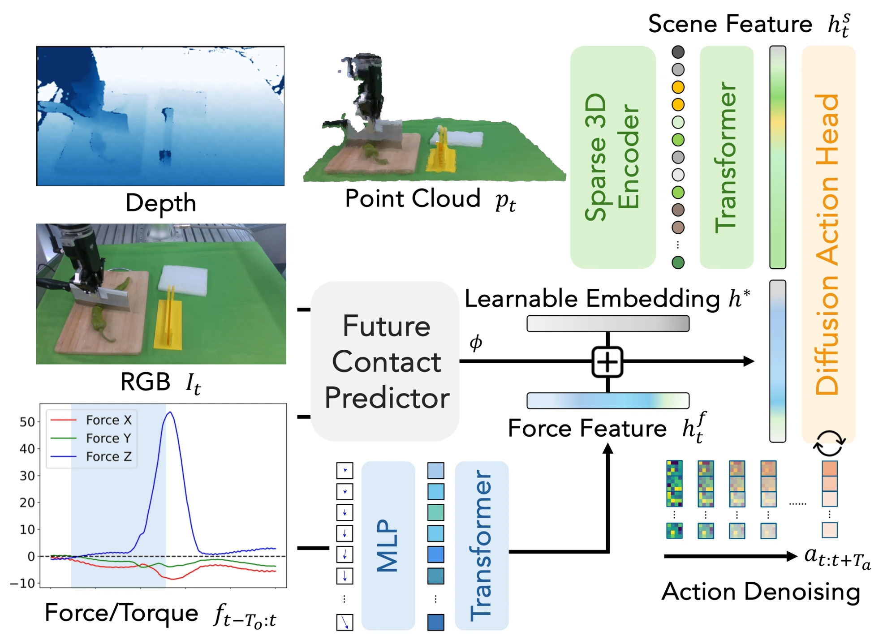

<!-- Generated by scripts/generate.py; edit data/works.json and data/media.json. -->

[← Back to the Awesome index](../../../README.md) · [Interactive website](https://chang-xinhai.github.io/Awesome-RGBDT-Manipulation/?collection=policy&item=foar#library)

# FoAR

FoAR: Force-Aware Reactive Policy for Contact-Rich Robotic Manipulation

**2024-11-24 · IEEE RA-L 2025 · Shanghai Jiao Tong University**

**[Paper](https://arxiv.org/abs/2411.15753)** · [Project](https://tonyfang.net/FoAR/) · [Code](https://github.com/Alan-Heoooh/FoAR) · [Data](https://drive.google.com/drive/folders/1Tq7wR9MdLLFr5AZTqXvypF2_2CJ-ghd5)

A contact predictor controls RGB-D/force fusion and reactive position correction in a diffusion manipulation policy.

*FoAR: Force-Aware Reactive Policy for Contact-Rich Robotic Manipulation Thanks: * Equal Contribution. Thanks: † Hao-Shu Fang and Cewu Lu are the corresponding authors. Thanks: Emails: {he0610, galaxies, jjchen20}@sjtu.edu.cn, fhaoshu@gmail.com, lucewu@sjtu.edu.cn authors · [Figure source](https://arxiv.org/abs/2411.15753) · Original rights retained.*

| Field | Reported value and source scope |
| :-- | :-- |
| Record type | policy |
| Policy family | Diffusion [1](https://arxiv.org/abs/2411.15753)  |
| Base model and architecture | RISE sparse point-cloud encoder and CNN diffusion action head, with force-history transformer and contact predictor. [1](https://arxiv.org/abs/2411.15753)  |
| Model size and component | Not reported. [1](https://arxiv.org/abs/2411.15753)  |
| Deployment inputs | RealSense D435 RGB-D colored point cloud, RGB for the contact predictor, 200 past wrist six-axis F/T samples at 100 Hz and current TCP state for reactive correction. [1](https://arxiv.org/abs/2411.15753)  |
| Action outputs and horizon | 20-step end-effector action chunks with gripper commands; predicted contact probability gates fusion and position adjustment. [1](https://arxiv.org/abs/2411.15753)  |
| Training method | Diffusion imitation loss plus contact classification labels derived from thresholded demonstration forces within a surrounding temporal window; deployment uses reactive position control. [1](https://arxiv.org/abs/2411.15753)  |
| Training data | 50 expert demonstrations for wiping and peeling, 40 for chopping. Wiping (General) is an orientation variant; do not multiply the main task counts by four. [1](https://arxiv.org/abs/2411.15753)  |
| Training duration | Not reported. [1](https://arxiv.org/abs/2411.15753)  |
| Training hardware | 2 NVIDIA A100 GPUs; batch size 240. RTX 3090 workstation is for collection/evaluation, not the reported training setup. [1](https://arxiv.org/abs/2411.15753)  |
| Inference and control rates | F/T history sampled at 100 Hz; a distinct achieved action/inference frequency is Not reported. [1](https://arxiv.org/abs/2411.15753)  |
| Evaluation scope | Flexiv Rizon / Dahuan AG-95 with flange-mounted OptoForce F/T and D435; wiping, arbitrary-orientation wiping, peeling and chopping. Twenty wiping/peeling trials and ten chopping trials; ASR and quality metrics are distinct. [1](https://arxiv.org/abs/2411.15753)  |
| Observations / modalities | RGB · Depth · Point cloud · Force/Torque · Proprioception |
| Evaluation domain | Real world |
| Embodiment | Parallel-jaw gripper |
| Release: code | Available [2](https://tonyfang.net/FoAR/) [3](https://github.com/Alan-Heoooh/FoAR)  |
| Release: weights | Not verified [2](https://tonyfang.net/FoAR/) [3](https://github.com/Alan-Heoooh/FoAR)  |
| Release: data | Partial [2](https://tonyfang.net/FoAR/) [3](https://github.com/Alan-Heoooh/FoAR) [4](https://drive.google.com/drive/folders/1Tq7wR9MdLLFr5AZTqXvypF2_2CJ-ghd5)  |
| Release: license | Not reported in inspected repository; no root LICENSE file. [2](https://tonyfang.net/FoAR/) [3](https://github.com/Alan-Heoooh/FoAR)  |
| Release: notes | Training/deployment code verified. Public Drive folder lists peel and wipe sample data; no chopping/full-corpus release or pretrained weights verified. [2](https://tonyfang.net/FoAR/) [3](https://github.com/Alan-Heoooh/FoAR)  |

**Scope and qualifications**

- Wrist F/T is distinct from fingertip tactile skin.
- The future-contact predictor uses future logged force only to form training labels; runtime sees current/history observations.
- Wiping quality and normalized peeled length are not binary full-task success rates.

**Primary evidence**

1. [Original paper and reviewed full text](https://arxiv.org/abs/2411.15753) — Full primary text, including available supplementary implementation details; first public date retained separately from reviewed revision.
2. [Official author project](https://tonyfang.net/FoAR/) — Current project links and release claims checked independently of paper prose.
3. [Official implementation and repository files](https://github.com/Alan-Heoooh/FoAR) — Training/deployment implementation, README and actual LICENSE inspected where present.
4. [Official public data link and visible file inventory](https://drive.google.com/drive/folders/1Tq7wR9MdLLFr5AZTqXvypF2_2CJ-ghd5) — Accessible public sample/example assets verified; completeness against full paper corpus not established.
