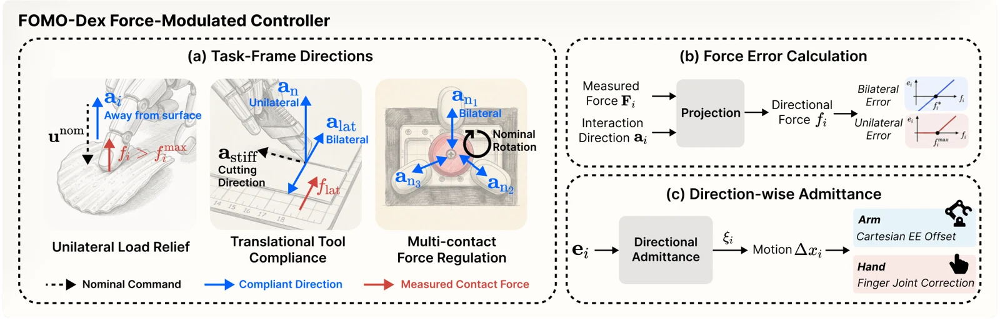

<!-- Generated by scripts/generate.py; edit data/works.json and data/media.json. -->

[← Back to the Awesome index](../../../README.md) · [Interactive website](https://chang-xinhai.github.io/Awesome-RGBDT-Manipulation/?collection=policy&item=fomo-dex#library)

# FOMO-Dex

Force-Modulated Dexterity: Unified Compliance for Contact-Rich Manipulation

**2026-10-12 · arXiv preprint · Amazon FAR**

**[Paper](https://arxiv.org/abs/2610.17161)** · [Project](https://yingyuan0414.github.io/fomo-dex/)

Applies task-coordinate force modulation to teleoperation and learns policies from corrected commands.

*Fomo Dex authors; original rights retained. · [Figure source](https://arxiv.org/html/2610.17161v1) · Original rights retained.*

| Field | Reported value and source scope |
| :-- | :-- |
| Record type | policy |
| Policy family | Diffusion [2](https://arxiv.org/html/2610.17161v1)  |
| Base model and architecture | Task-frame compliance controller; DINOv2 visual encoder with diffusion imitation policy. [2](https://arxiv.org/html/2610.17161v1)  |
| Model size and component | Not reported [2](https://arxiv.org/html/2610.17161v1)  |
| Deployment inputs | Head ZED RGB, robot proprioception and measured forces; autonomous policy consumes the observations rather than nominal operator commands. [2](https://arxiv.org/html/2610.17161v1)  |
| Action outputs and horizon | Joint-space actions imitating the force-modulated commands sent to the robot. [2](https://arxiv.org/html/2610.17161v1)  |
| Training method | Direction-selective force corrections followed by behavior cloning with proprioceptive masking. [2](https://arxiv.org/html/2610.17161v1)  |
| Training data | Contact-rich teleoperation for card picking, paper cutting, screwdriving and nut/bolt assembly. [2](https://arxiv.org/html/2610.17161v1)  |
| Training duration | Not reported [2](https://arxiv.org/html/2610.17161v1)  |
| Training hardware | Not reported [2](https://arxiv.org/html/2610.17161v1)  |
| Inference and control rates | Compliance controller 90 Hz; logged demonstrations 30 Hz; policy inference frequency Not reported. [2](https://arxiv.org/html/2610.17161v1)  |
| Evaluation scope | Controller-force analysis, operator data-collection study and autonomous card/rotation policies. [2](https://arxiv.org/html/2610.17161v1)  |
| Observations / modalities | RGB · Tactile · Force/Torque · Proprioception |
| Evaluation domain | Real world |
| Embodiment | Dexterous hand |
| Release: code | Not verified [3](https://yingyuan0414.github.io/fomo-dex/)  |
| Release: weights | Not verified [3](https://yingyuan0414.github.io/fomo-dex/)  |
| Release: data | Not verified [3](https://yingyuan0414.github.io/fomo-dex/)  |
| Release: license | Not verified [3](https://yingyuan0414.github.io/fomo-dex/)  |
| Release: notes | Paper and public presentation verified; no implementation, weight or data release is inferred from a publication or demonstration. [3](https://yingyuan0414.github.io/fomo-dex/)  |

**Scope and qualifications**

- Controller/user-study results and autonomous policy evaluations cover different task subsets.
- Fingertip contact forces and wrist wrench retain distinct roles.

**Primary evidence**

1. [Canonical author manuscript and arXiv submission history](https://arxiv.org/abs/2610.17161) — Date retains the initial v1 submission, independently of revisions or current artifact releases.
2. [Full author paper: method, observations and evaluation scope](https://arxiv.org/html/2610.17161v1) — Physical sensors, predicted signals, training labels and policy inputs are recorded separately; undisclosed quantities remain unknown.
3. [Official paper-linked project page; release review on 19 October 2026](https://yingyuan0414.github.io/fomo-dex/) — Current artifacts are checked separately from paper experiments. A project-only link is not proof of an implementation release.
