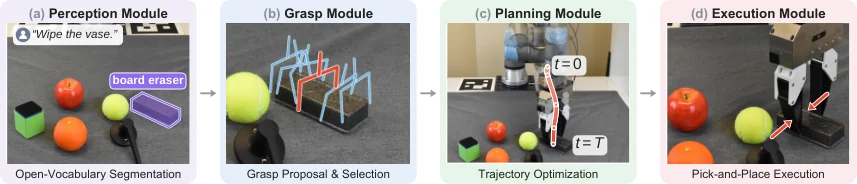

<!-- Generated by scripts/generate.py; edit data/works.json and data/media.json. -->

[← Back to the Awesome index](../../../README.md) · [Interactive website](https://chang-xinhai.github.io/Awesome-RGBDT-Manipulation/?collection=policy&item=forca#library)

# FORCA

FORCA: A Force-Aware Coding Agent for Contact-Rich Robot Manipulation

**2026-10-22 · Preprint · University of Illinois Urbana-Champaign**

**[Paper](https://arxiv.org/abs/2610.31841)** · [Project](https://tanoom.github.io/forca/)

A coding agent revises force-responsive manipulation programs using measured wrist wrench and visual execution records.

*FORCA authors · [Figure source](https://arxiv.org/abs/2610.31841) · Original rights retained.*

| Field | Reported value and source scope |
| :-- | :-- |
| Record type | policy |
| Policy family | Robot agent [1](https://arxiv.org/abs/2610.31841)  |
| Base model and architecture | Claude Fable 5; SAM3, GraspGen and PyRoKi skills. [1](https://arxiv.org/abs/2610.31841)  |
| Model size and component | Not reported [1](https://arxiv.org/abs/2610.31841)  |
| Deployment inputs | Language, RealSense D455 RGB-D, robot state and measured UR5e wrist F/T; live and recorded wrench. [1](https://arxiv.org/abs/2610.31841)  |
| Action outputs and horizon | Complete Python programs with contact probes and Cartesian velocity-feedback control. [1](https://arxiv.org/abs/2610.31841)  |
| Training method | Frozen model; physical rollouts revise code and routines, then freeze the final program for repeated evaluation. [1](https://arxiv.org/abs/2610.31841)  |
| Training data | No demonstrations or task-specific neural training; real execution traces refine programs. [1](https://arxiv.org/abs/2610.31841)  |
| Training duration | Not reported [1](https://arxiv.org/abs/2610.31841)  |
| Training hardware | Not reported [1](https://arxiv.org/abs/2610.31841)  |
| Inference and control rates | 100 Hz host-side wrench-feedback loop; coding-agent revision takes minutes. [1](https://arxiv.org/abs/2610.31841)  |
| Evaluation scope | Five real tasks: drawer, door handle, cube-to-target, vase wiping and cucumber peeling. Frozen programs succeed 10/10 on drawer and door, versus 4/10 and 1/10 vision-only. [1](https://arxiv.org/abs/2610.31841)  |
| Observations / modalities | RGB · Depth · Force/Torque · Proprioception · Language |
| Evaluation domain | Real world |
| Embodiment | Parallel-jaw gripper |
| Release: code | Not released [2](https://tanoom.github.io/forca/)  |
| Release: weights | Not verified [2](https://tanoom.github.io/forca/)  |
| Release: data | Not verified [2](https://tanoom.github.io/forca/)  |
| Release: license | Not verified [2](https://tanoom.github.io/forca/)  |
| Release: notes | Official project provides paper and demonstrations; no author implementation or method checkpoint is linked. [2](https://tanoom.github.io/forca/)  |

**Scope and qualifications**

- Wrist wrench is not distributed skin tactile.
- Development permits up to 20 rollouts and four hours per run; human scene operations, execution authorization and final acceptance remain.
- The foundation model is not queried inside the 100 Hz feedback loop.

**Primary evidence**

1. [Primary manuscript and first-submission history](https://arxiv.org/abs/2610.31841) — Current primary manuscript reviewed; first-public date uses arXiv v1. Observations, training privileges and deployed interfaces retain their separate scopes.
2. [Official project source and actual artifact inventory](https://tanoom.github.io/forca/) — Reviewed 26 October 2026. Availability and licensing apply only to the described released component, independently of paper results.
