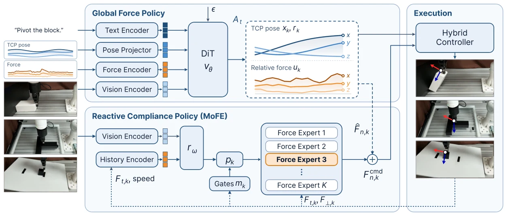

<!-- Generated by scripts/generate.py; edit data/works.json and data/media.json. -->

[← Back to the Awesome index](../../../README.md) · [Interactive website](https://chang-xinhai.github.io/Awesome-RGBDT-Manipulation/?collection=policy&item=force2act#library)

# Force2Act

Force2Act: A Force-Aware Visuomotor Policy for Generalizable Compliant Robot Manipulation

**2026-11-22 · Preprint · National University of Singapore**

**[Paper](https://arxiv.org/abs/2611.29208)** · [Project](https://magiclab-nus.github.io/Force2Act/) · [Code](https://github.com/MAGICLAB-NUS/Force2Act) · [Data](https://huggingface.co/datasets/NUSMAGIC/Force2Act-Bench-Data) · [Weights](https://huggingface.co/NUSMAGIC/Force2Act-Sim)

Plans action chunks with relative force targets and selects between faster compliance controllers for contact changes within a chunk.

*Keerthi Vasan Murugan and coauthors · [Figure source](https://arxiv.org/html/2611.29208v1) · Original rights retained.*

| Field | Reported value and source scope |
| :-- | :-- |
| Record type | policy |
| Policy family | Force2Act [1](https://arxiv.org/html/2611.29208v1)  |
| Base model and architecture | Not reported [1](https://arxiv.org/html/2611.29208v1)  |
| Model size and component | Not reported [1](https://arxiv.org/html/2611.29208v1)  |
| Deployment inputs | RGB views, robot state and measured TCP force/wrench, with language at the global policy. The reactive controller conditions on image and force history. [1](https://arxiv.org/html/2611.29208v1)  |
| Action outputs and horizon | Tool pose and target-wrench chunks plus step-wise compliant force control. [1](https://arxiv.org/html/2611.29208v1)  |
| Training method | Train a global relative-force visuomotor planner and a reactive mixture of force experts with interaction-specific motion frames. [1](https://arxiv.org/html/2611.29208v1)  |
| Training data | Simulated five-task demonstrations with captured force feedback and separate physical data and trials. [1](https://arxiv.org/html/2611.29208v1)  |
| Training duration | Not reported [1](https://arxiv.org/html/2611.29208v1)  |
| Training hardware | Not reported [1](https://arxiv.org/html/2611.29208v1)  |
| Inference and control rates | Not reported [1](https://arxiv.org/html/2611.29208v1)  |
| Evaluation scope | 93.8% mean simulated success on Force2Act-Bench versus 77.0% for strongest tested baseline. Separate physical evaluations include pivoting and insertions. [1](https://arxiv.org/html/2611.29208v1)  |
| Observations / modalities | RGB · Force/Torque · Proprioception · Language |
| Evaluation domain | Simulation · Real world |
| Embodiment | Parallel-jaw gripper |
| Release: code | Available — training and inference [3](https://github.com/MAGICLAB-NUS/Force2Act#readme)  |
| Release: weights | Available — simulation policy and compliance checkpoints [3](https://github.com/MAGICLAB-NUS/Force2Act#readme) [4](https://huggingface.co/NUSMAGIC/Force2Act-Sim/tree/main)  |
| Release: data | Available — five-task simulation parquet demonstrations [3](https://github.com/MAGICLAB-NUS/Force2Act#readme) [5](https://huggingface.co/datasets/NUSMAGIC/Force2Act-Bench-Data/tree/main)  |
| Release: license | MIT author repository and cited simulation releases. [3](https://github.com/MAGICLAB-NUS/Force2Act#readme)  |
| Release: notes | Public paper verified. Code, task weights and data are tracked separately. [3](https://github.com/MAGICLAB-NUS/Force2Act#readme)  |

**Scope and qualifications**

- Uses wrench and RGB. Wrench sensing should not be indexed as skin tactile.

**Primary evidence**

1. [Original author paper with methods, evaluation and scope](https://arxiv.org/html/2611.29208v1)
2. [Public author project with method and evaluation examples](https://magiclab-nus.github.io/Force2Act/)
3. [Public policy, simulation and benchmark source](https://github.com/MAGICLAB-NUS/Force2Act#readme)
4. [Simulator policy checkpoint files](https://huggingface.co/NUSMAGIC/Force2Act-Sim/tree/main)
5. [Released simulation demonstrations](https://huggingface.co/datasets/NUSMAGIC/Force2Act-Bench-Data/tree/main)
