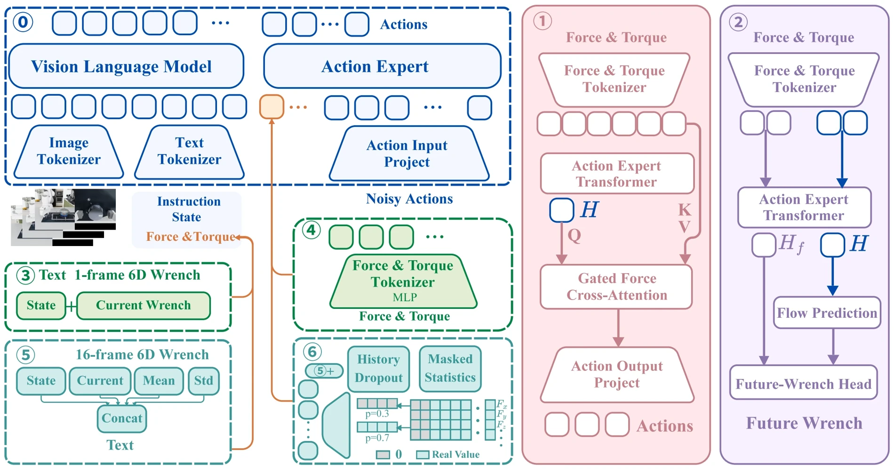

<!-- Generated by scripts/generate.py; edit data/works.json and data/media.json. -->

[← Back to the Awesome index](../../../README.md) · [Interactive website](https://chang-xinhai.github.io/Awesome-RGBDT-Manipulation/?collection=policy&item=forcebench#library)

# ForceBench force-integration policies

ForceBench: Benchmarking Force Integration for Robotic Manipulation

**2026-10-14 · arXiv preprint · Peking University / UC Berkeley / National University of Singapore / ePyBot Intelligence**

**[Paper](https://arxiv.org/abs/2610.19604)** · [Project](https://forcebench-platform.github.io/)

A common π0.5 backbone compares wrist-wrench conditioning, predictive supervision and temporal force interfaces across controlled physical interactions.

*forcebench authors; original research figure · [Figure source](https://forcebench-platform.github.io/) · Original rights retained.*

| Field | Reported value and source scope |
| :-- | :-- |
| Record type | policy |
| Policy family | VLA [1](https://arxiv.org/html/2610.19604)  |
| Base model and architecture | π0.5 with alternative numerical-prompt, continuous-token or output cross-attention force interfaces; temporal variants add16-sample summaries. [1](https://arxiv.org/html/2610.19604)  |
| Model size and component | Not reported in the inspected paper and appendix [1](https://arxiv.org/html/2610.19604)  |
| Deployment inputs | External/wrist RGB, language,7-D robot state; current6-D wrench or16-sample history depending on variant. No-force baseline excludes wrench. [1](https://arxiv.org/html/2610.19604)  |
| Action outputs and horizon | 50-step chunks of absolute TCP poses and gripper targets. [1](https://arxiv.org/html/2610.19604)  |
| Training method | Task-specific flow-matching fine-tuning. Token Fusion+Pred adds a ten-step future-wrench objective during training only; it does not run at deployment. [1](https://arxiv.org/html/2610.19604)  |
| Training data | Same200 successful scripted demos per simulation task for compared methods; real policies use200 demos/task. [1](https://arxiv.org/html/2610.19604)  |
| Training duration | 10,000 steps for π0.5 variants and π0;100,000 for ForceFlow. Wall-clock time not reported. [1](https://arxiv.org/html/2610.19604)  |
| Training hardware | Not reported in the inspected paper and appendix [1](https://arxiv.org/html/2610.19604)  |
| Inference and control rates | Simulation15Hz execution/recording and60Hz physics. Executing all50 steps gives a3.33s observation-query interval, not15Hz closed-loop policy queries. Physical end-to-end policy Hz not reported. [1](https://arxiv.org/html/2610.19604)  |
| Evaluation scope | Eight simulation tasks with200 episodes/task; hardware comparison on five tasks with20 trials/task. Overall point estimates do not establish paired significance or training-seed variance. [1](https://arxiv.org/html/2610.19604)  |
| Observations / modalities | RGB · Force/Torque · Proprioception · Language |
| Evaluation domain | Simulation · Real world |
| Embodiment | Parallel-jaw gripper |
| Release: code | Not released [2](https://forcebench-platform.github.io/)  |
| Release: weights | Not released [2](https://forcebench-platform.github.io/)  |
| Release: data | Not released [2](https://forcebench-platform.github.io/)  |
| Release: license | Not verified; source figures retain original rights [2](https://forcebench-platform.github.io/)  |
| Release: notes | Official Resources section explicitly provides no code, demonstrations or checkpoint downloads. Its stale no-paper-download notice is superseded by the public arXiv manuscript; result tables are available separately. [2](https://forcebench-platform.github.io/)  |

**Scope and qualifications**

- Wrist F/T is not skin tactile; force varies through physical properties that may also affect visible motion and proprioception.
- Single simulated embodiment and one assembly task limit scope; 20 real trials/task do not establish a general sim-to-real ranking correlation.
- The best two simulation means differ by three successful episodes out of1600; no significance claim is inferred.

**Primary evidence**

1. [Original full manuscript and appendices](https://arxiv.org/html/2610.19604) — Method, evaluation and appendix read; observations, training-only labels, rates and task scopes remain distinct.
2. [Official benchmark, task/protocol pages and release notice](https://forcebench-platform.github.io/) — Live project inspected; implementation/data/weights are independently distinguished from paper and published result tables.
3. [Data collection method and scope](https://arxiv.org/abs/2610.19604) — Original method/data protocol reviewed for the collection mechanism. Data volume, evaluation rollouts and downstream training remain separate; undisclosed or unresolved interfaces are labeled explicitly.
