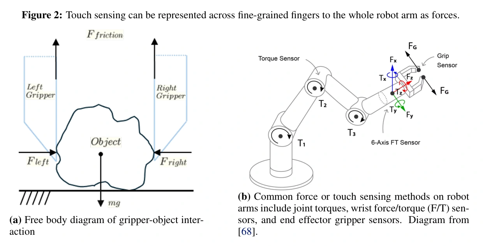

<!-- Generated by scripts/generate.py; edit data/works.json and data/media.json. -->

[← Back to the Awesome index](../../../README.md) · [Interactive website](https://chang-xinhai.github.io/Awesome-RGBDT-Manipulation/?collection=policy&item=forceful-foundation-survey#library)

# Forceful Robotic Foundation Models — Survey

Towards Forceful Robotic Foundation Models: a Literature Survey

**2025-04-16 · Preprint · Survey · University of Colorado Boulder**

**[Paper](https://arxiv.org/abs/2504.11827)**

Reviews how force is sensed, collected, represented and controlled in manipulation-policy learning, distinguishing skin touch from wrist and joint sensing.

*William Xie and Nikolaus Correll; original Figure 2, with subpanel (b) credited by the survey to reference [68] · [Figure source](https://arxiv.org/pdf/2504.11827#page=6) · Original rights retained.*

| Field | Reported value and source scope |
| :-- | :-- |
| Record type | Survey |
| Review scope | Force-aware manipulation learning, spanning tactile sensing, wrist F/T, joint torques, action spaces, data collection and multimodal representation. [1](https://arxiv.org/abs/2504.11827) [2](https://arxiv.org/html/2504.11827)  |
| Organizing taxonomy | Force/touch sensing and robot proprioception · Data collection: teleoperation, kinesthetic and augmented teaching · Action spaces and explicit force/compliance control · Behavior cloning and visuotactile/force representations · Scaling multimodal reasoning toward foundation models [1](https://arxiv.org/abs/2504.11827) [2](https://arxiv.org/html/2504.11827)  |
| Adaptation mechanisms | Behavior cloning · Reinforcement learning · Representation pretraining and transfer · Explicit low-level force/compliance control [1](https://arxiv.org/abs/2504.11827) [2](https://arxiv.org/html/2504.11827)  |
| Context and evidence | Fingertip tactile/pressure/audio signals · Wrist force/torque · Whole-arm joint sensing · Vision, language and demonstrations [1](https://arxiv.org/abs/2504.11827) [2](https://arxiv.org/html/2504.11827)  |
| Evaluation dimensions | Required interaction forces and task duration · Sensor modality and placement · Data collection and amount · Action/control interface · Policy architecture and force dependence [1](https://arxiv.org/abs/2504.11827) [2](https://arxiv.org/html/2504.11827)  |
| Literature corpus and snapshot | 20-page review; Section 3 analyzes 25 selected works. The complete bibliography also contains background literature. [1](https://arxiv.org/abs/2504.11827) [2](https://arxiv.org/html/2504.11827)  |
| Literature selection | Comparative narrative analysis of selected force-aware manipulation papers, with distributions of sensing, data collection, action spaces and model architectures. [1](https://arxiv.org/abs/2504.11827) [2](https://arxiv.org/html/2504.11827)  |
| Coverage boundaries | The 25 selected works are not an exhaustive modern tactile-model inventory. The discussion questions whether existing tasks fully isolate force dependence; it does not show that touch is unnecessary for precision manipulation. [1](https://arxiv.org/abs/2504.11827) [2](https://arxiv.org/html/2504.11827)  |
| Review format | Literature review |
| Release: code | Not applicable — survey; no new robot implementation |
| Release: weights | Not applicable — survey |
| Release: data | Not verified — no separate coded corpus linked |
| Release: license | Paper and third-party figures retain their stated original rights |
| Release: notes | Literature inventories and review tables are not robot demonstration data or deployable model weights. |

**Scope and qualifications**

- Survey, not an executable policy or model; deployment modalities, training costs and control rates do not apply.

**Literature trail:** [Reference-to-record mappings and scope decisions](../../../data/survey-source-audit.json). Indexed methods retain their own primary evidence.

**Primary evidence**

1. [Original survey and first submission](https://arxiv.org/abs/2504.11827) — Manuscript structure, tables and bibliography inspected; underlying method specifications require their original paper.
2. [Primary full-text survey and references](https://arxiv.org/html/2504.11827) — Citation extraction preserves original bibliography identities, including background and adjacent resources.
