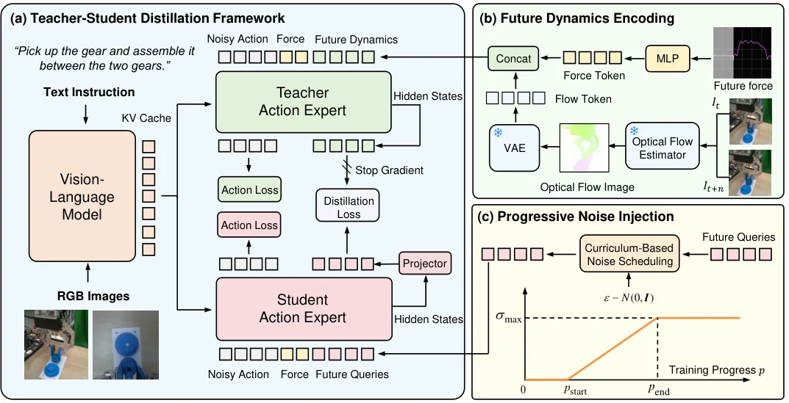

<!-- Generated by scripts/generate.py; edit data/works.json and data/media.json. -->

[← Back to the Awesome index](../../../README.md) · [Interactive website](https://chang-xinhai.github.io/Awesome-RGBDT-Manipulation/?collection=policy&item=forceldm#library)

# ForceLDM

ForceLDM: A Force-aware Latent Dynamics Model for Contact-Rich Manipulation

**2026-11-02 · Preprint · Xi’an Jiaotong University; University of Science and Technology of China**

**[Paper](https://arxiv.org/abs/2611.03294)** · [Project](https://tpy001.github.io/ForceLDM/) · [Code](https://github.com/tpy001/ForceLDM-code/tree/forceldm) · [Data](https://huggingface.co/datasets/PeiYuan001/forceldm-dataset)

Force-aware latent dynamics supervision improves a contact-rich manipulation policy.

*ForceLDM authors · [Figure source](https://arxiv.org/abs/2611.03294) · Original rights retained.*

| Field | Reported value and source scope |
| :-- | :-- |
| Record type | policy |
| Policy family | Force-aware VLA policy [1](https://arxiv.org/html/2611.03294v1)  |
| Base model and architecture | π0 [1](https://arxiv.org/html/2611.03294v1)  |
| Model size and component | Not reported [1](https://arxiv.org/html/2611.03294v1)  |
| Deployment inputs | RGB, language, robot state and wrist force/torque [1](https://arxiv.org/html/2611.03294v1)  |
| Action outputs and horizon | Robot actions [1](https://arxiv.org/html/2611.03294v1)  |
| Training method | Distills predicted force and flow dynamics into a force-aware manipulation policy. [1](https://arxiv.org/html/2611.03294v1)  |
| Training data | See original paper for dataset and protocol. [1](https://arxiv.org/html/2611.03294v1)  |
| Training duration | Not reported [1](https://arxiv.org/html/2611.03294v1)  |
| Training hardware | Not reported [1](https://arxiv.org/html/2611.03294v1)  |
| Inference and control rates | Not reported [1](https://arxiv.org/html/2611.03294v1)  |
| Evaluation scope | Real-world contact-rich manipulation on five tasks. [1](https://arxiv.org/html/2611.03294v1)  |
| Observations / modalities | RGB · Force/Torque · Proprioception · Language |
| Evaluation domain | Real world |
| Embodiment | Not reported |
| Release: code | Available — official source repository [2](https://github.com/tpy001/ForceLDM-code/tree/forceldm) [3](https://huggingface.co/datasets/PeiYuan001/forceldm-dataset)  |
| Release: weights | Not verified [2](https://github.com/tpy001/ForceLDM-code/tree/forceldm) [3](https://huggingface.co/datasets/PeiYuan001/forceldm-dataset)  |
| Release: data | Available — official dataset [2](https://github.com/tpy001/ForceLDM-code/tree/forceldm) [3](https://huggingface.co/datasets/PeiYuan001/forceldm-dataset)  |
| Release: license | Apache-2.0 [2](https://github.com/tpy001/ForceLDM-code/tree/forceldm) [3](https://huggingface.co/datasets/PeiYuan001/forceldm-dataset)  |
| Release: notes | Release status checked against author artifacts on 2026-11-05. [2](https://github.com/tpy001/ForceLDM-code/tree/forceldm) [3](https://huggingface.co/datasets/PeiYuan001/forceldm-dataset)  |

**Scope and qualifications**

- Wrist force/torque is not a skin-tactile input; pretrained task-specific policy weights have not been verified.

**Primary evidence**

1. [Original paper: method, inputs and evaluation](https://arxiv.org/html/2611.03294v1) — Results and sensing claims are scoped to the authors’ evaluation and deployment setting.
2. [Official repository, source files and license](https://github.com/tpy001/ForceLDM-code/tree/forceldm)
3. [Official recorded dataset](https://huggingface.co/datasets/PeiYuan001/forceldm-dataset)
