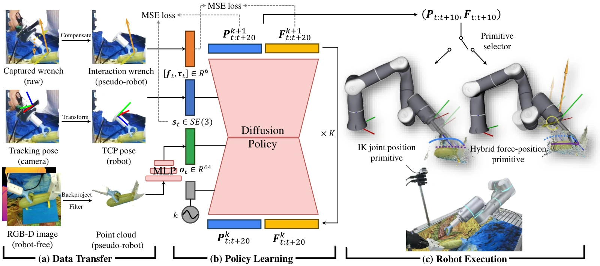

<!-- Generated by scripts/generate.py; edit data/works.json and data/media.json. -->

[← Back to the Awesome index](../../../README.md) · [Interactive website](https://chang-xinhai.github.io/Awesome-RGBDT-Manipulation/?collection=policy&item=forcemimic#library)

# ForceMimic / HybridIL

ForceMimic: Force-Centric Imitation Learning with Force-Motion Capture System for Contact-Rich Manipulation

**2024-10-10 · ICRA 2025 · Shanghai Jiao Tong University**

**[Paper](https://arxiv.org/abs/2410.07554)** · [Project](https://forcemimic.github.io/) · [Code](https://github.com/ForceMimic/hybridil) · [Data](https://drive.google.com/drive/folders/1sKqOj9tO-luddM8XIaJvTFbRSEZet7C3) · [Hardware](https://github.com/ForceMimic/forcecapture)

Robot-free wrench-motion demonstrations train a point-cloud diffusion policy that outputs force-position trajectories for hybrid control.

*ForceMimic: Force-Centric Imitation Learning with Force-Motion Capture System for Contact-Rich Manipulation authors · [Figure source](https://arxiv.org/abs/2410.07554) · Original rights retained.*

| Field | Reported value and source scope |
| :-- | :-- |
| Record type | policy |
| Policy family | Diffusion [1](https://arxiv.org/abs/2410.07554)  |
| Base model and architecture | Modified Diffusion Policy with MLP point-cloud encoder and hybrid force-position controller. [1](https://arxiv.org/abs/2410.07554)  |
| Model size and component | Not reported. [1](https://arxiv.org/abs/2410.07554)  |
| Deployment inputs | Learned policy: L515 RGB-D-derived colored point clouds and TCP pose history; official eval.py assembles XYZRGB points. Measured wrench is not selected in the provided HybridIL model config; the hybrid controller uses separate F/T feedback. [1](https://arxiv.org/abs/2410.07554) [5](https://github.com/ForceMimic/hybridil/blob/main/eval.py)  |
| Action outputs and horizon | 20-step TCP pose and wrench targets; predicted force selects IK position or orthogonal hybrid force-position primitives. [1](https://arxiv.org/abs/2410.07554)  |
| Training method | Imitate robot-free ForceCapture data after gravity compensation and pose/frame conversion; diffusion learns pose-wrench targets. [1](https://arxiv.org/abs/2410.07554)  |
| Training data | 15 zucchinis, 438 peeling segments and 30,199 action sequences; these are distinct levels of the same collection. Sensor recordings aligned to 30 Hz RGB-D observations. [1](https://arxiv.org/abs/2410.07554)  |
| Training duration | 500 epochs; wall-clock time Not reported. [1](https://arxiv.org/abs/2410.07554)  |
| Training hardware | Not reported. [1](https://arxiv.org/abs/2410.07554)  |
| Inference and control rates | Collection aligned to 30 Hz; deployment policy/controller rates Not reported. [1](https://arxiv.org/abs/2410.07554)  |
| Evaluation scope | Flexiv Rizon 4; right fixed peeler controlled by HybridIL, left arm stabilizes zucchini using rules. One learned peeling skill; HybridIL/vision baseline each 20 actions, force-input baselines each 10. Motion correctness and peel length &gt;10 cm are separate criteria. [1](https://arxiv.org/abs/2410.07554)  |
| Observations / modalities | RGB · Depth · Point cloud · Proprioception · Force/Torque |
| Evaluation domain | Real world |
| Embodiment | Robot arm with task-specific tool · Bimanual |
| Release: code | Available [2](https://forcemimic.github.io/) [3](https://github.com/ForceMimic/hybridil)  |
| Release: weights | Not verified [2](https://forcemimic.github.io/) [3](https://github.com/ForceMimic/hybridil)  |
| Release: data | Partial [2](https://forcemimic.github.io/) [3](https://github.com/ForceMimic/hybridil) [4](https://drive.google.com/drive/folders/1sKqOj9tO-luddM8XIaJvTFbRSEZet7C3)  |
| Release: license | MIT (actual HybridIL and ForceCapture LICENSE files). [2](https://forcemimic.github.io/) [3](https://github.com/ForceMimic/hybridil)  |
| Release: notes | Policy and ForceCapture code verified. Public example-data folder contains zucchini_shave.hdf5, conversion script and README; full-corpus coverage and pretrained policy weights not established. [2](https://forcemimic.github.io/) [3](https://github.com/ForceMimic/hybridil)  |

**Scope and qualifications**

- Force is a prediction target and low-level feedback signal, not a deployed learned-policy observation; force-input baselines perform worse in this paper.
- Bimanual hardware does not imply a learned two-arm policy; the left arm stabilizes by rules.
- The reported evidence covers one peeling skill and a controlled start configuration.
- Paper reports 500 training epochs; the current released train_dp_ftout config instead specifies 1000 epochs. This is an artifact-versus-paper difference, not a revised paper measurement.

**Primary evidence**

1. [Original paper and reviewed full text](https://arxiv.org/abs/2410.07554) — Full primary text, including available supplementary implementation details; first public date retained separately from reviewed revision.
2. [Official author project](https://forcemimic.github.io/) — Current project links and release claims checked independently of paper prose.
3. [Official implementation and repository files](https://github.com/ForceMimic/hybridil) — Training/deployment implementation, README and actual LICENSE inspected where present.
4. [Official public data link and visible file inventory](https://drive.google.com/drive/folders/1sKqOj9tO-luddM8XIaJvTFbRSEZet7C3) — Accessible public sample/example assets verified; completeness against full paper corpus not established.
5. [Released observation assembly and training config](https://github.com/ForceMimic/hybridil/blob/main/eval.py) — eval.py builds XYZRGB points and transmits wrench; train_dp_ftout.json selects only pointcloud and TCP pose keys, not wrench. Released config gives 1000 epochs versus paper 500.
