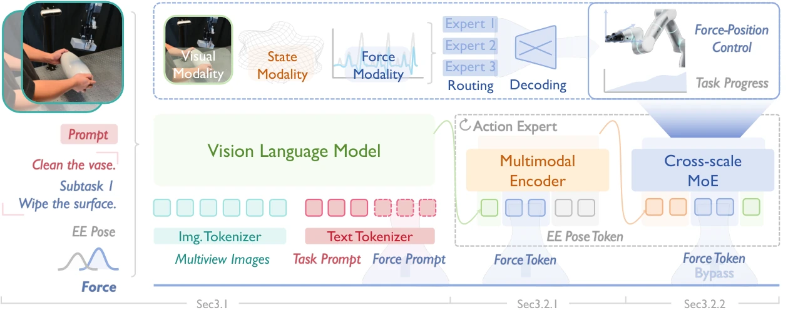

<!-- Generated by scripts/generate.py; edit data/works.json and data/media.json. -->

[← Back to the Awesome index](../../../README.md) · [Interactive website](https://chang-xinhai.github.io/Awesome-RGBDT-Manipulation/?collection=policy&item=forcevla2#library)

# ForceVLA2

ForceVLA2: Unleashing Hybrid Force-Position Control with Force Awareness for Contact-Rich Manipulation

**2026-03-16 · Preprint · Shanghai AI Laboratory / Shanghai Jiao Tong University and collaborators**

**[Paper](https://arxiv.org/abs/2603.15169)** · [Project](https://sites.google.com/view/force-vla2/home)

Force prompts and a cross-scale mixture-of-experts action expert perform closed-loop hybrid force-position control.

*ForceVLA2: Unleashing Hybrid Force-Position Control with Force Awareness for Contact-Rich Manipulation authors · [Figure source](https://arxiv.org/abs/2603.15169) · Original rights retained.*

| Field | Reported value and source scope |
| :-- | :-- |
| Record type | policy |
| Policy family | VLA [1](https://arxiv.org/abs/2603.15169)  |
| Base model and architecture | π0 / PaliGemma-SigLIP vision-language expert; flow-matching action expert with cross-scale MoE. [1](https://arxiv.org/abs/2603.15169)  |
| Model size and component | Not reported [1](https://arxiv.org/abs/2603.15169)  |
| Deployment inputs | Multi-view RGB, task and subtask-force prompts, end-effector pose and six-axis force/torque. [1](https://arxiv.org/abs/2603.15169)  |
| Action outputs and horizon | Hybrid force-position action chunks and subtask-progress predictions. [1](https://arxiv.org/abs/2603.15169)  |
| Training method | Supervised force-prompt segmentation and flow-matching hybrid control learning. [1](https://arxiv.org/abs/2603.15169)  |
| Training data | 1,000 demonstrations over five tasks: press bottle, clean vase, clean board, retrieve plate, assemble gears. [1](https://arxiv.org/abs/2603.15169)  |
| Training duration | 30,000 steps, approximately 10 h (appendix); model-name inconsistency retained. [1](https://arxiv.org/abs/2603.15169)  |
| Training hardware | 8 NVIDIA A100 GPUs (appendix calls the trained model Foca-VLA). [1](https://arxiv.org/abs/2603.15169)  |
| Inference and control rates | Appendix reports 15 Hz inference on RTX4090with 30-action chunks; force sensing 300 Hz. [1](https://arxiv.org/abs/2603.15169)  |
| Evaluation scope | Flexiv Rizon 4 s / DH AG-95 on five real contact-rich tasks. [1](https://arxiv.org/abs/2603.15169)  |
| Observations / modalities | RGB · Force/Torque · Proprioception · Language |
| Evaluation domain | Real world |
| Embodiment | Parallel-jaw gripper |
| Release: code | Not released [2](https://sites.google.com/view/force-vla2/home)  |
| Release: weights | Not verified [2](https://sites.google.com/view/force-vla2/home)  |
| Release: data | Not released [2](https://sites.google.com/view/force-vla2/home)  |
| Release: license | Not verified [2](https://sites.google.com/view/force-vla2/home)  |
| Release: notes | Official project says code and dataset coming soon; generic GitHub-home link is not a release. [2](https://sites.google.com/view/force-vla2/home)  |

**Scope and qualifications**

- Wrist/end-effector six-axis F/T is not skin tactile. RGB-D camera hardware does not establish runtime depth input.
- Appendix training paragraph uses Foca-VLA while the manuscript title/method use ForceVLA2; reported cost is explicitly qualified.

**Primary evidence**

1. [Original paper and supplementary implementation details](https://arxiv.org/abs/2603.15169) — Primary full text reviewed; dataset, deployment modalities and training-only privileges are scoped separately.
2. [Official author project](https://sites.google.com/view/force-vla2/home) — Live artifact status reviewed separately from paper claims.
