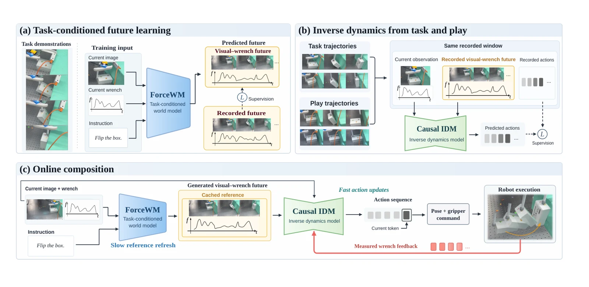

<!-- Generated by scripts/generate.py; edit data/works.json and data/media.json. -->

[← Back to the Awesome index](../../../README.md) · [Interactive website](https://chang-xinhai.github.io/Awesome-RGBDT-Manipulation/?collection=policy&item=forcewam#library)

# ForceWAM

ForceWAM: Decoupling Future and Response Learning from Demo and Play Data for Contact-Rich Manipulation

**2026-10-13 · arXiv preprint · Fudan University**

**[Paper](https://arxiv.org/abs/2610.18852)** · [Project](https://force-wam.github.io/)

Generates visual-wrench futures and translates them into reactive actions using task and play data.

*Forcewam authors; original rights retained. · [Figure source](https://arxiv.org/html/2610.18852v1) · Original rights retained.*

| Field | Reported value and source scope |
| :-- | :-- |
| Record type | policy |
| Policy family | World-action model [2](https://arxiv.org/html/2610.18852v1)  |
| Base model and architecture | Cosmos Predict 2B-initialized visual-wrench world model and diffusion inverse-dynamics model. [2](https://arxiv.org/html/2610.18852v1)  |
| Model size and component | 2B pretrained world-model backbone; total adapted system size Not reported. [2](https://arxiv.org/html/2610.18852v1)  |
| Deployment inputs | Wrist RGB, measured six-axis TCP wrench, robot state and instruction; generated visual/wrench futures condition the IDM. [2](https://arxiv.org/html/2610.18852v1)  |
| Action outputs and horizon | Relative TCP pose and gripper commands; auxiliary virtual-pose/stiffness prediction targets are discarded for execution. [2](https://arxiv.org/html/2610.18852v1)  |
| Training method | Visual-wrench future prediction and conditional diffusion IDM with future-conditioning augmentation. [2](https://arxiv.org/html/2610.18852v1)  |
| Training data | Successful task demonstrations train the world model; task and task-agnostic play trajectories train the IDM. [2](https://arxiv.org/html/2610.18852v1)  |
| Training duration | World model: 20,000 iterations; wall-clock Not reported. [2](https://arxiv.org/html/2610.18852v1)  |
| Training hardware | World-model training uses eight GPUs; model unspecified. [2](https://arxiv.org/html/2610.18852v1)  |
| Inference and control rates | Not reported [2](https://arxiv.org/html/2610.18852v1)  |
| Evaluation scope | Flexiv Rizon 4S force-regulated sliding, box flipping with/without disturbance and Hanoi ring placement. [2](https://arxiv.org/html/2610.18852v1)  |
| Observations / modalities | RGB · Force/Torque · Proprioception · Language |
| Evaluation domain | Real world |
| Embodiment | Parallel-jaw gripper |
| Release: code | Not verified [3](https://force-wam.github.io/)  |
| Release: weights | Not verified [3](https://force-wam.github.io/)  |
| Release: data | Not verified [3](https://force-wam.github.io/)  |
| Release: license | Not verified [3](https://force-wam.github.io/)  |
| Release: notes | Paper and public presentation verified; no implementation, weight or data release is inferred from a publication or demonstration. [3](https://force-wam.github.io/)  |

**Scope and qualifications**

- Six-axis end-effector F/T is a wrist wrench stream, not tactile skin.
- The paper announces code via the project; no downloadable implementation link was verified on the inspected project page.

**Primary evidence**

1. [Canonical author manuscript and arXiv submission history](https://arxiv.org/abs/2610.18852) — Date retains the initial v1 submission, independently of revisions or current artifact releases.
2. [Full author paper: method, observations and evaluation scope](https://arxiv.org/html/2610.18852v1) — Physical sensors, predicted signals, training labels and policy inputs are recorded separately; undisclosed quantities remain unknown.
3. [Official paper-linked project page; release review on 19 October 2026](https://force-wam.github.io/) — Current artifacts are checked separately from paper experiments. A project-only link is not proof of an implementation release.
