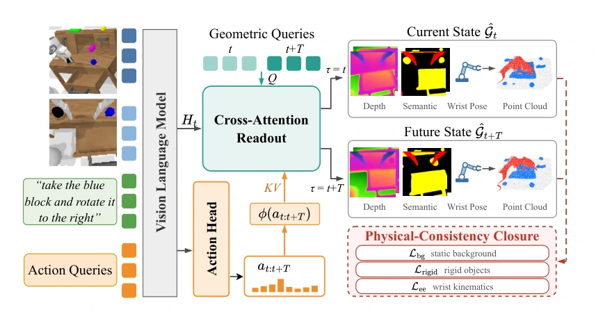

<!-- Generated by scripts/generate.py; edit data/works.json and data/media.json. -->

[← Back to the Awesome index](../../../README.md) · [Interactive website](https://chang-xinhai.github.io/Awesome-RGBDT-Manipulation/?collection=policy&item=foreact3d#library)

# ForeAct3D

ForeAct3D: Policy-Grounded Future World Modeling for VLA Policies

**2026-10-03 · arXiv preprint · University of Illinois Urbana-Champaign; University of Illinois Chicago; Cisco**

**[Paper](https://arxiv.org/abs/2610.04607)** · [Code](https://github.com/anthonytao80-crypto/ForeAct3D)

Action-conditioned semantic 3D forecasts and physical-consistency losses regularize a VLA during training.

*ForeAct3D authors · [Figure source](https://arxiv.org/html/2610.04607) · Original rights retained.*

| Field | Reported value and source scope |
| :-- | :-- |
| Record type | policy |
| Policy family | VLA [1](https://arxiv.org/abs/2610.04607)  |
| Base model and architecture | VLA backbone with current/future geometric queries for depth, segmentation and camera pose. [1](https://arxiv.org/abs/2610.04607)  |
| Model size and component | Not reported in the inspected primary-source sections [1](https://arxiv.org/abs/2610.04607)  |
| Deployment inputs | RGB, language and robot state at deployment. [1](https://arxiv.org/abs/2610.04607)  |
| Action outputs and horizon | Action chunks; current/future semantic 3D predictions are training-side auxiliaries. [1](https://arxiv.org/abs/2610.04607)  |
| Training method | Behavior cloning plus action-conditioned geometric forecasting, rigidity/background and wrist-kinematic constraints. [1](https://arxiv.org/abs/2610.04607)  |
| Training data | Target LIBERO/CALVIN and physical task demonstrations; no robot pretraining. [1](https://arxiv.org/abs/2610.04607)  |
| Training duration | 30K optimization steps [1](https://arxiv.org/abs/2610.04607)  |
| Training hardware | 16 NVIDIA A100 40GB GPUs [1](https://arxiv.org/abs/2610.04607)  |
| Inference and control rates | Not reported in the inspected primary-source sections [1](https://arxiv.org/abs/2610.04607)  |
| Evaluation scope | LIBERO, CALVIN and three real tabletop manipulation tasks. [1](https://arxiv.org/abs/2610.04607)  |
| Observations / modalities | RGB · Language · Proprioception |
| Evaluation domain | Simulation · Real world |
| Embodiment | Parallel-jaw gripper |
| Release: code | Not released [2](https://github.com/anthonytao80-crypto/ForeAct3D) [4](https://github.com/anthonytao80-crypto/ForeAct3D/tree/main)  |
| Release: weights | Not verified [2](https://github.com/anthonytao80-crypto/ForeAct3D)  |
| Release: data | Not verified [2](https://github.com/anthonytao80-crypto/ForeAct3D)  |
| Release: license | MIT for repository code; pretrained models, data and figure rights remain separate [2](https://github.com/anthonytao80-crypto/ForeAct3D) [3](https://github.com/anthonytao80-crypto/ForeAct3D/blob/main/LICENSE)  |
| Release: notes | Official repository contains LICENSE, README and four illustration assets; no training/inference implementation at review time. [2](https://github.com/anthonytao80-crypto/ForeAct3D)  |

**Scope and qualifications**

- No future model prediction is required at inference; auxiliary depth supervision is not measured deployment depth.

**Primary evidence**

1. [Original manuscript and first submission history](https://arxiv.org/abs/2610.04607) — Full author HTML method/evaluation/appendix inspected; depth observations, pseudo-labels and generated outputs retain distinct roles.
2. [Official implementation and release scope](https://github.com/anthonytao80-crypto/ForeAct3D) — Availability of research implementation does not establish public task-policy checkpoints.
3. [Actual license file in released source](https://github.com/anthonytao80-crypto/ForeAct3D/blob/main/LICENSE) — Only source code covered by this file; not a blanket license for paper figures or upstream weights.
4. [Actual repository content inventory](https://github.com/anthonytao80-crypto/ForeAct3D/tree/main) — 7 tracked paths inspected; code release is distinguished from a README/project/figure-only repository.
