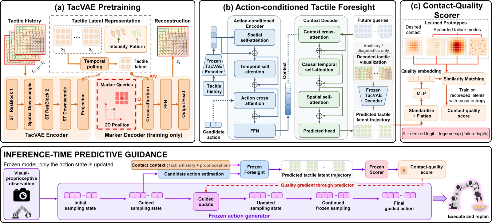

<!-- Generated by scripts/generate.py; edit data/works.json and data/media.json. -->

[← Back to the Awesome index](../../../README.md) · [Interactive website](https://chang-xinhai.github.io/Awesome-RGBDT-Manipulation/?collection=policy&item=foretac#library)

# ForeTac

ForeTac: Predictive Contact Guidance for Generative Robot Policies

**2026-10-13 · arXiv preprint · Not reported**

**[Paper](https://arxiv.org/abs/2610.18118)** · [Project](https://foretac.github.io/)

Guides diffusion/flow action generation with gradients of predicted future contact quality.

*Foretac authors; original rights retained. · [Figure source](https://foretac.github.io/) · Original rights retained.*

| Field | Reported value and source scope |
| :-- | :-- |
| Record type | policy |
| Policy family | Hybrid [2](https://arxiv.org/pdf/2610.18118)  |
| Base model and architecture | TacVAE, action-conditioned tactile foresight and learned quality scorer guiding frozen Diffusion Policy / pi0.5. [2](https://arxiv.org/pdf/2610.18118)  |
| Model size and component | DP configuration: 338.043M backbone plus 34.922M ForeTac parameters, 372.965M total. [2](https://arxiv.org/pdf/2610.18118)  |
| Deployment inputs | Visual/proprioceptive context and eight-frame 9×9×2 tactile marker-displacement history; candidate actions enter the predictor. [2](https://arxiv.org/pdf/2610.18118)  |
| Action outputs and horizon | Guided 16-step action sequences; model parameters stay frozen during sampling-time guidance. [2](https://arxiv.org/pdf/2610.18118)  |
| Training method | Tactile representation/prediction/scoring followed by gradient guidance of a pretrained generator. [2](https://arxiv.org/pdf/2610.18118)  |
| Training data | Successful and failed physical interactions supervise a task-specific contact-quality objective. [2](https://arxiv.org/pdf/2610.18118)  |
| Training duration | Not reported [2](https://arxiv.org/pdf/2610.18118)  |
| Training hardware | Not reported [2](https://arxiv.org/pdf/2610.18118)  |
| Inference and control rates | 261.26±5.16 ms per batch-one replan on RTX 4090; this is replanning latency, not low-level control frequency. [2](https://arxiv.org/pdf/2610.18118)  |
| Evaluation scope | Four physical tasks: planar wiping, vase wiping, card swiping and fragile-chip grasping; 20 trials/task. [2](https://arxiv.org/pdf/2610.18118)  |
| Observations / modalities | RGB · Tactile · Proprioception |
| Evaluation domain | Real world |
| Embodiment | Parallel-jaw gripper |
| Release: code | Not released [3](https://foretac.github.io/)  |
| Release: weights | Not verified [3](https://foretac.github.io/)  |
| Release: data | Not verified [3](https://foretac.github.io/)  |
| Release: license | Not verified [3](https://foretac.github.io/)  |
| Release: notes | Official project explicitly labels Code as Coming soon. Paper results do not establish a downloadable release. [3](https://foretac.github.io/)  |

**Scope and qualifications**

- ForeTac is distinct from the existing ForeTac-VLA work (arXiv:2609.20980).
- The inspected project anonymizes affiliations; no institution is inferred from unrelated names.

**Primary evidence**

1. [Canonical author manuscript and arXiv submission history](https://arxiv.org/abs/2610.18118) — Date retains the initial v1 submission, independently of revisions or current artifact releases.
2. [Full author paper: method, observations and evaluation scope](https://arxiv.org/pdf/2610.18118) — Physical sensors, predicted signals, training labels and policy inputs are recorded separately; undisclosed quantities remain unknown.
3. [Official paper-linked project page; release review on 19 October 2026](https://foretac.github.io/) — Current artifacts are checked separately from paper experiments. A project-only link is not proof of an implementation release.
