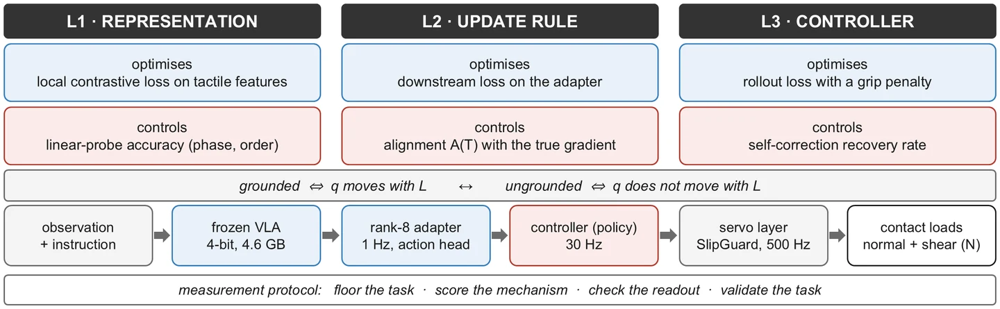

<!-- Generated by scripts/generate.py; edit data/works.json and data/media.json. -->

[← Back to the Awesome index](../../../README.md) · [Interactive website](https://chang-xinhai.github.io/Awesome-RGBDT-Manipulation/?collection=policy&item=forth-vtla#library)

# FORTH

FORTH: Grounding Tactile VLA Execution via Forward-Only Proxy-Control Pairing

**2026-11-19 · Preprint · University of Macau and collaborators**

**[Paper](https://arxiv.org/abs/2611.26744)** · [Code](https://github.com/Jordanlllll/FORTH)

Pairs tactile proxy objectives with measured control signals and tests a force-limited slip reflex separately from proxy learning.

*Junde Li and coauthors · [Figure source](https://arxiv.org/html/2611.26744v1) · Original rights retained.*

| Field | Reported value and source scope |
| :-- | :-- |
| Record type | policy |
| Policy family | Tactile representation + forward-only adaptation + slip reflex [1](https://arxiv.org/html/2611.26744v1)  |
| Base model and architecture | Not reported [1](https://arxiv.org/html/2611.26744v1)  |
| Model size and component | Not reported [1](https://arxiv.org/html/2611.26744v1)  |
| Deployment inputs | Visual-tactile patches and force channels from a gripper pad pair; SlipGuard consumes local tactile history and gripper state. Scope differs by experimental layer. [1](https://arxiv.org/html/2611.26744v1)  |
| Action outputs and horizon | Per-token action-head updates, slip decisions and capped grip-force ramps for a native gripper servo. [1](https://arxiv.org/html/2611.26744v1)  |
| Training method | Layer-local forward-forward tactile representation, token-parallel forward-only action-head adaptation, plus one-class slip calibration and force-limited native execution. [1](https://arxiv.org/html/2611.26744v1)  |
| Training data | Physical nominal contact calibration and material-specific trials; LIBERO and deformable simulation experiments use separate inputs. [1](https://arxiv.org/html/2611.26744v1)  |
| Training duration | Not reported [1](https://arxiv.org/html/2611.26744v1)  |
| Training hardware | Not reported [1](https://arxiv.org/html/2611.26744v1)  |
| Inference and control rates | Paper distinguishes 500 Hz native servo, 1 Hz adaptation and other layer-specific sampling. These are not a full VLA rate. [1](https://arxiv.org/html/2611.26744v1)  |
| Evaluation scope | Bench tests across contact materials plus separately scoped LIBERO and deformable simulation evaluations. Physical box-press force traces compare the capped reflex with a stiffer ramp. [1](https://arxiv.org/html/2611.26744v1)  |
| Observations / modalities | RGB · Tactile · Proprioception |
| Evaluation domain | Simulation · Real world |
| Embodiment | Parallel-jaw gripper |
| Release: code | Available — packaged three-layer research implementation and examples [2](https://github.com/Jordanlllll/FORTH#readme)  |
| Release: weights | Not verified |
| Release: data | Not verified |
| Release: license | MIT for the author repository [2](https://github.com/Jordanlllll/FORTH#readme)  |
| Release: notes | Released package provides reproduction examples; the physical training/evaluation logs have no separately verified archive. |

**Scope and qualifications**

- Proxies, measured force, local gripper reflex, and complete policy outcomes are reported at distinct layers.
- Force conditioning is not proof of an independent wrist F/T sensor or external measured depth.

**Primary evidence**

1. [Original paper and evaluation settings](https://arxiv.org/html/2611.26744v1)
2. [Installable source, hardware-independent examples and release license](https://github.com/Jordanlllll/FORTH#readme)
