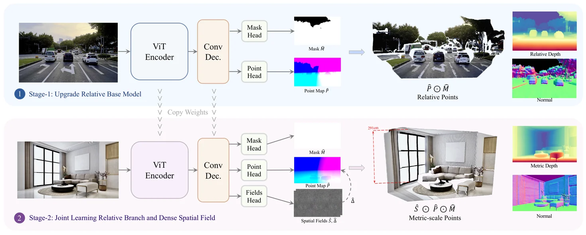

<!-- Generated by scripts/generate.py; edit data/works.json and data/media.json. -->

[← Back to the Awesome index](../../../README.md) · [Interactive website](https://chang-xinhai.github.io/Awesome-RGBDT-Manipulation/?collection=policy&item=foundationgeo#library)

# FoundationGeo

FoundationGeo: Learning Spatial Pixel-Wise Fields for Monocular Metric Geometry

**2026-07-13 · Preprint · University of Hong Kong**

**[Paper](https://arxiv.org/abs/2607.11588)** · [Project](https://mx-liu6.github.io/FoundationGeo-web/) · [Code](https://github.com/mx-liu6/FoundationGeo) · [Weights](https://huggingface.co/mxliu-hku/FoundationGeo-1.1) · [Relative Base Weights](https://huggingface.co/mxliu-hku/FoundationGeo-Base-1.1)

Learns high-detail relative point geometry, then predicts spatially varying metric scale and ray corrections to recover a camera-frame metric point map.

*Muxin Liu and coauthors · [Figure source](https://arxiv.org/html/2607.11588v1) · Original rights retained.*

| Field | Reported value and source scope |
| :-- | :-- |
| Record type | model |
| Model role and downstream interface | Geometry perception model [1](https://arxiv.org/html/2607.11588v1)  |
| Model family | Monocular metric 3D geometry [1](https://arxiv.org/html/2607.11588v1)  |
| Model architecture | DINOv3-initialized relative geometry backbone; learned scale and ray residual fields. [1](https://arxiv.org/html/2607.11588v1)  |
| Model size and component | Not reported [1](https://arxiv.org/html/2607.11588v1)  |
| Model inputs | One RGB image. [1](https://arxiv.org/html/2607.11588v1)  |
| Model outputs | Metric point map with pixel-aligned depths, rays and a predicted validity mask. [1](https://arxiv.org/html/2607.11588v1)  |
| Training method | Relative geometry supervision followed by metric point-wise calibration; wider focal coverage synthesized separately. [1](https://arxiv.org/html/2607.11588v1)  |
| Training data and scale | Paper reports a 10.2M-sample stage-1 mix and a Blender renderer for under-covered intrinsic regimes in the metric phase. [1](https://arxiv.org/html/2607.11588v1)  |
| Training duration | Not reported [1](https://arxiv.org/html/2607.11588v1)  |
| Training hardware | Not reported [1](https://arxiv.org/html/2607.11588v1)  |
| Inference setting and runtime | One forward pass with spatial scale and ray correction. Model predicts depth, not a calibrated sensor measurement. [1](https://arxiv.org/html/2607.11588v1)  |
| Downstream evaluation and scope | Seven zero-shot depth benchmarks span indoor, outdoor and synthetic conditions. Paper separately measures focal-length distribution shift. [1](https://arxiv.org/html/2607.11588v1)  |
| Observations / modalities | RGB |
| Evaluation domain | Simulation · Real world |
| Embodiment |  |
| Release: code | Available — author repository includes inference, training and evaluation entry points. [2](https://mx-liu6.github.io/FoundationGeo-web/) [3](https://github.com/mx-liu6/FoundationGeo)  |
| Release: weights | Available — official FoundationGeo 1.1 weights. [2](https://mx-liu6.github.io/FoundationGeo-web/) [5](https://huggingface.co/mxliu-hku/FoundationGeo-1.1)  |
| Release: data | Public evaluation mirror linked; complete mixed training corpus not verified. [2](https://mx-liu6.github.io/FoundationGeo-web/) [3](https://github.com/mx-liu6/FoundationGeo)  |
| Release: license | MIT source and FoundationGeo 1.1 model card. Dataset and DINOv3 terms are independent. [2](https://mx-liu6.github.io/FoundationGeo-web/) [4](https://github.com/mx-liu6/FoundationGeo/blob/main/LICENSE) [5](https://huggingface.co/mxliu-hku/FoundationGeo-1.1)  |
| Release: notes | Repository checkpoint is version 1.1; use the author’s variant guidance. [2](https://mx-liu6.github.io/FoundationGeo-web/)  |

**Scope and qualifications**

- Training focal coverage is a demonstrated failure axis; assess downstream geometry under the target lens.

**Primary evidence**

1. [Original author paper or dataset description](https://arxiv.org/html/2607.11588v1)
2. [Author source and artifact entry points](https://mx-liu6.github.io/FoundationGeo-web/)
3. [Official inference, train and evaluation code](https://github.com/mx-liu6/FoundationGeo)
4. [Source license](https://github.com/mx-liu6/FoundationGeo/blob/main/LICENSE)
5. [Version 1.1 weight card](https://huggingface.co/mxliu-hku/FoundationGeo-1.1)
