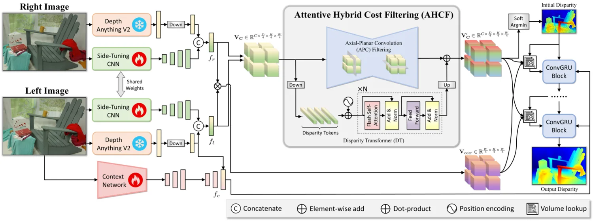

<!-- Generated by scripts/generate.py; edit data/works.json and data/media.json. -->

[← Back to the Awesome index](../../../README.md) · [Interactive website](https://chang-xinhai.github.io/Awesome-RGBDT-Manipulation/?collection=policy&item=foundationstereo#library)

# FoundationStereo

FoundationStereo: Zero-Shot Stereo Matching

**2025-01-17 · CVPR 2025 · NVIDIA**

**[Paper](https://arxiv.org/abs/2501.09898)** · [Project](https://nvlabs.github.io/FoundationStereo/) · [Code](https://github.com/NVlabs/FoundationStereo) · [Weights](https://huggingface.co/nvidia/c-foundationstereo-s)

A zero-shot stereo foundation model predicts dense disparities from calibrated image pairs.

*FoundationStereo authors · [Figure source](https://nvlabs.github.io/FoundationStereo/) · Original rights retained.*

| Field | Reported value and source scope |
| :-- | :-- |
| Record type | model |
| Model role and downstream interface | Depth and geometry perception reference [1](https://arxiv.org/html/2501.09898v1)  |
| Model family | Depth estimation [1](https://arxiv.org/html/2501.09898v1)  |
| Model architecture | See original paper [1](https://arxiv.org/html/2501.09898v1)  |
| Model size and component | Not reported [1](https://arxiv.org/html/2501.09898v1)  |
| Model inputs | Rectified left and right RGB stereo images. [1](https://arxiv.org/html/2501.09898v1)  |
| Model outputs | Stereo disparity; focal length and baseline convert disparity to metric depth. [1](https://arxiv.org/html/2501.09898v1)  |
| Training method | Stereo model training on a curated synthetic image-pair dataset with pretrained visual priors. [1](https://arxiv.org/html/2501.09898v1)  |
| Training data and scale | See original paper for dataset scope [1](https://arxiv.org/html/2501.09898v1)  |
| Training duration | Not reported [1](https://arxiv.org/html/2501.09898v1)  |
| Training hardware | Not reported [1](https://arxiv.org/html/2501.09898v1)  |
| Inference setting and runtime | See original paper and official implementation [1](https://arxiv.org/html/2501.09898v1)  |
| Downstream evaluation and scope | Zero-shot stereo matching; useful as a geometric frontend for robot manipulation. [1](https://arxiv.org/html/2501.09898v1)  |
| Observations / modalities | RGB |
| Evaluation domain |  |
| Embodiment |  |
| Release: code | Available — source linked [2](https://github.com/NVlabs/FoundationStereo)  |
| Release: weights | Commercial C-FoundationStereo model card available; research checkpoints linked separately by authors [2](https://github.com/NVlabs/FoundationStereo)  |
| Release: data | Not verified [2](https://github.com/NVlabs/FoundationStereo)  |
| Release: license | NVIDIA research license limits use; separately offered commercial version has separate terms. [2](https://github.com/NVlabs/FoundationStereo)  |
| Release: notes | Research source/checkpoints are distinct from the separately licensed NVIDIA C-FoundationStereo model. [2](https://github.com/NVlabs/FoundationStereo)  |

**Scope and qualifications**

- Predicted stereo depth is not a measured depth stream; calibrated camera geometry is necessary for metric conversion.

**Primary evidence**

1. [Author paper and first submission](https://arxiv.org/html/2501.09898v1)
2. [Official code and license](https://github.com/NVlabs/FoundationStereo)
