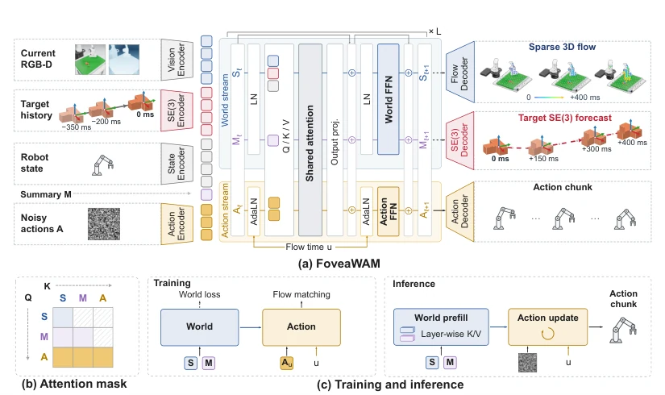

<!-- Generated by scripts/generate.py; edit data/works.json and data/media.json. -->

[← Back to the Awesome index](../../../README.md) · [Interactive website](https://chang-xinhai.github.io/Awesome-RGBDT-Manipulation/?collection=policy&item=foveawam#library)

# FoveaWAM

FoveaWAM: Role-Aware 4D World-Action Modeling for Dynamic Manipulation

**2026-11-23 · Preprint · Beijing Zhongguancun Academy; Peking University; Beijing Academy of Artificial Intelligence**

**[Paper](https://arxiv.org/abs/2611.31705)** · [Project](https://foveawam.github.io/) · [Code](https://github.com/ArrebolBlack/FoveaWAM) · [Data](https://huggingface.co/datasets/JiaqiYin/OnTimeBench) · [Weights](https://huggingface.co/JiaqiYin/FoveaWAM) · [Benchmark Harness](https://github.com/ArrebolBlack/OnTimeBench)

Predicts target pose and sparse context flow from RGB-D so direct action stays responsive for moving objects and obstacles.

*Jiaqi Yin and coauthors · [Figure source](https://arxiv.org/html/2611.31705v1) · Original rights retained.*

| Field | Reported value and source scope |
| :-- | :-- |
| Record type | policy |
| Policy family | FoveaWAM [1](https://arxiv.org/html/2611.31705v1)  |
| Base model and architecture | Not reported [1](https://arxiv.org/html/2611.31705v1)  |
| Model size and component | Not reported [1](https://arxiv.org/html/2611.31705v1)  |
| Deployment inputs | One RGB-D frame, robot state and eight recent target SE(3) samples. Physical tests use fixed RealSense D435 RGB-D and an online target tracker; simulation task variants can supply simulator pose history. [1](https://arxiv.org/html/2611.31705v1)  |
| Action outputs and horizon | Robot tool poses and gripper actions. Sparse future scene flow and target SE(3) are training outputs and are skipped in direct-action inference. [1](https://arxiv.org/html/2611.31705v1)  |
| Training method | Predictive world pretraining on DROID with geometry labels, then downstream action/world training on dynamic demonstrations. [1](https://arxiv.org/html/2611.31705v1)  |
| Training data | DROID geometry labels use PointWorld tracks. OnTimeBench supplies 11,200 simulation demonstrations; real diagnostics are separate. [1](https://arxiv.org/html/2611.31705v1)  |
| Training duration | Not reported [1](https://arxiv.org/html/2611.31705v1)  |
| Training hardware | Not reported [1](https://arxiv.org/html/2611.31705v1)  |
| Inference and control rates | 15.1 ms p95 ready-observation to action on one RTX 5090 in the reported simulation timing. Physical commands run at 20 Hz. [1](https://arxiv.org/html/2611.31705v1)  |
| Evaluation scope | 82.1% native-latency success reported on OnTimeBench. DOMINO and physical moving-object tests use separate protocols. [1](https://arxiv.org/html/2611.31705v1)  |
| Observations / modalities | RGB · Depth · Proprioception |
| Evaluation domain | Simulation · Real world |
| Embodiment | Parallel-jaw gripper |
| Release: code | Available — training, export and inference [3](https://github.com/ArrebolBlack/FoveaWAM#readme)  |
| Release: weights | Available — OnTimeBench simulation checkpoint [4](https://huggingface.co/JiaqiYin/FoveaWAM/tree/main)  |
| Release: data | Available — 11,200 simulation demos in HDF5 [5](https://huggingface.co/datasets/JiaqiYin/OnTimeBench/tree/main)  |
| Release: license | Apache-2.0 code; non-commercial model terms plus MAE terms; dataset CC BY 4.0. [3](https://github.com/ArrebolBlack/FoveaWAM#readme)  |
| Release: notes | Public releases scope to OnTimeBench; the paper’s complete DROID-pretraining and physical policy releases were not established. |

**Scope and qualifications**

- Physical target pose history comes from online tracking with the calibrated RGB-D scene; simulator-backed pose history is a different regime.
- Render and control rates must not be compared with the policy-only timing estimate.

**Primary evidence**

1. [Original author paper with methods, evaluation and scope](https://arxiv.org/html/2611.31705v1)
2. [Public author project with method and evaluation examples](https://foveawam.github.io/)
3. [Official code, architecture, and commercial-use distinctions](https://github.com/ArrebolBlack/FoveaWAM#readme)
4. [Executable simulator checkpoint files](https://huggingface.co/JiaqiYin/FoveaWAM/tree/main)
5. [Public HDF5 training demos](https://huggingface.co/datasets/JiaqiYin/OnTimeBench/tree/main)
