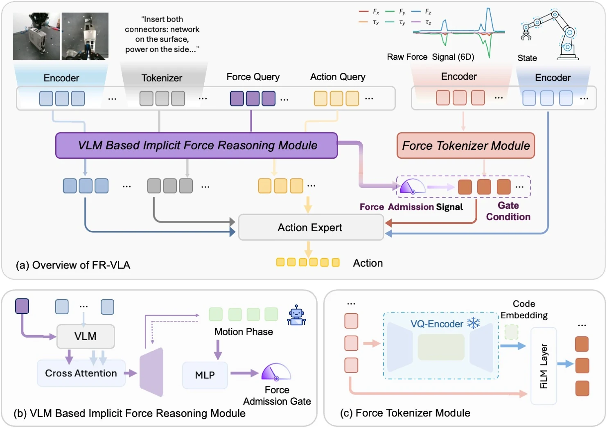

<!-- Generated by scripts/generate.py; edit data/works.json and data/media.json. -->

[← Back to the Awesome index](../../../README.md) · [Interactive website](https://chang-xinhai.github.io/Awesome-RGBDT-Manipulation/?collection=policy&item=fr-vla#library)

# FR-VLA

FR-VLA: Implicit Force Reasoning VLA for Contact-Rich Manipulation

**2026-10-19 · CoRL 2026 · Nanyang Technological University**

**[Paper](https://arxiv.org/abs/2610.25981)**

A vision-language force-admission signal gates separately encoded wrench information before action generation in contact-rich tasks.

*FR-VLA authors; original rights retained · [Figure source](https://arxiv.org/abs/2610.25981) · Original rights retained.*

| Field | Reported value and source scope |
| :-- | :-- |
| Record type | policy |
| Policy family | Vision-language-action [1](https://arxiv.org/html/2610.25981)  |
| Base model and architecture | VLA-Adapter-style VLM/action backbone with force-query reasoning and frozen VQ-VAE wrench tokenizer. [1](https://arxiv.org/html/2610.25981)  |
| Model size and component | Not reported [1](https://arxiv.org/html/2610.25981)  |
| Deployment inputs | Scene/wrist RGB, language, robot state and recent measured 6D wrench; vision-language features determine admission. [1](https://arxiv.org/html/2610.25981)  |
| Action outputs and horizon | Robot action chunks conditioned on force admission and external continuous/tokenized wrench. [1](https://arxiv.org/html/2610.25981)  |
| Training method | Train force relevance/motion-phase reasoning plus gated action conditioning; tokenize wrench histories before VLA training. [1](https://arxiv.org/html/2610.25981)  |
| Training data | 70–90 demonstrations/task, collected with 3D mouse, five tasks across UR5e/UR3e. [1](https://arxiv.org/html/2610.25981)  |
| Training duration | Not reported [1](https://arxiv.org/html/2610.25981)  |
| Training hardware | Training 2 RTX A6000; inference 1 RTX 3090. [1](https://arxiv.org/html/2610.25981)  |
| Inference and control rates | Images collected10 Hz, force/state/actions50 Hz; streams aligned to images for training, not a measured VLM refresh rate. [1](https://arxiv.org/html/2610.25981)  |
| Evaluation scope | Gear assembly, cable connection, surface cleaning, screw tightening and seat-belt insertion; five tasks/six evaluated stages with controlled baselines. [1](https://arxiv.org/html/2610.25981)  |
| Observations / modalities | RGB · Force/Torque · Proprioception · Language |
| Evaluation domain | Real world |
| Embodiment | Parallel-jaw gripper |
| Release: code | Not verified |
| Release: weights | Not verified |
| Release: data | Not verified |
| Release: license | Not verified |
| Release: notes | The inspected primary sources do not establish a public implementation, model checkpoint or dataset download. Paper figures retain their original rights. |

**Scope and qualifications**

- Built-in UR six-axis F/T is not cutaneous tactile; camera hardware does not establish depth input.
- Motion-phase labels are generated offline from demonstrations and are not an extra oracle input during deployment.

**Primary evidence**

1. [Original full paper, methods and evaluation](https://arxiv.org/html/2610.25981) — Publication date is arXiv v1; implementation and deployment observations are distinguished from training supervision, generated geometry and base-model identity.
