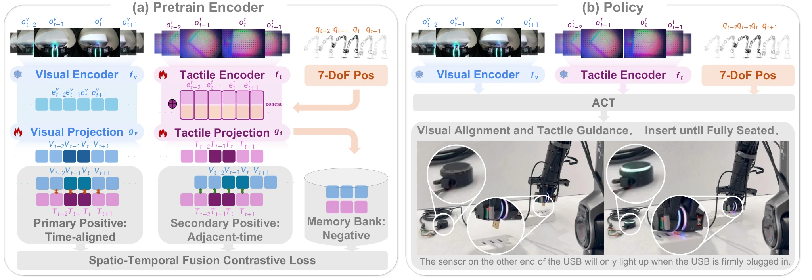

<!-- Generated by scripts/generate.py; edit data/works.json and data/media.json. -->

[← Back to the Awesome index](../../../README.md) · [Interactive website](https://chang-xinhai.github.io/Awesome-RGBDT-Manipulation/?collection=policy&item=freetacman#library)

# FreeTacMan

FreeTacMan: Robot-free Visuo-Tactile Data Collection System for Contact-rich Manipulation

**2025-06-02 · ICRA 2026 · Shanghai Innovation Institute / University of Hong Kong / Shanghai University / Fudan University / Shanghai Jiao Tong University**

**[Paper](https://arxiv.org/abs/2506.01941)** · [Project](https://opendrivelab.com/FreeTacMan) · [Code](https://github.com/OpenDriveLab/FreeTacMan) · [Data](https://huggingface.co/datasets/OpenDriveLab/FreeTacMan)

A robot-free wearable gripper collects high-fidelity touch demonstrations used for tactile-pretrained manipulation policies.

*FreeTacMan: Robot-free Visuo-Tactile Data Collection System for Contact-rich Manipulation authors · [Figure source](https://arxiv.org/abs/2506.01941) · Original rights retained.*

| Field | Reported value and source scope |
| :-- | :-- |
| Record type | policy |
| Policy family | ACT [1](https://arxiv.org/abs/2506.01941)  |
| Base model and architecture | ACT with pretrained visual/tactile representations. [1](https://arxiv.org/abs/2506.01941)  |
| Model size and component | Not reported [1](https://arxiv.org/abs/2506.01941)  |
| Deployment inputs | RGB, tactile images and robot proprioception. [1](https://arxiv.org/abs/2506.01941)  |
| Action outputs and horizon | Robot end-effector/gripper action sequences. [1](https://arxiv.org/abs/2506.01941)  |
| Training method | Self-collected tactile representation pretraining followed by ACT imitation. [1](https://arxiv.org/abs/2506.01941)  |
| Training data | Dataset&gt;10k trajectories, 50 collection tasks,&gt;3 M paired visual/tactile images; separate five-task policy subsets and 50/100 demo ablation settings. [1](https://arxiv.org/abs/2506.01941)  |
| Training duration | Not reported [1](https://arxiv.org/abs/2506.01941)  |
| Training hardware | Not reported [1](https://arxiv.org/abs/2506.01941)  |
| Inference and control rates | RGB/touch 30 Hz; measured inference latency&lt;20 ms, not fixed control Hz. [1](https://arxiv.org/abs/2506.01941)  |
| Evaluation scope | PIPER arm:fragile cup, calligraphy, texture sorting, stamp press, USB plug; dataset coverage is broader than evaluated policy tasks. [1](https://arxiv.org/abs/2506.01941)  |
| Observations / modalities | RGB · Tactile · Proprioception |
| Evaluation domain | Real world |
| Embodiment | Parallel-jaw gripper |
| Release: code | Available [2](https://opendrivelab.com/FreeTacMan) [3](https://github.com/OpenDriveLab/FreeTacMan) [4](https://huggingface.co/datasets/OpenDriveLab/FreeTacMan)  |
| Release: weights | Not verified [2](https://opendrivelab.com/FreeTacMan) [3](https://github.com/OpenDriveLab/FreeTacMan) [4](https://huggingface.co/datasets/OpenDriveLab/FreeTacMan)  |
| Release: data | Available [2](https://opendrivelab.com/FreeTacMan) [3](https://github.com/OpenDriveLab/FreeTacMan) [4](https://huggingface.co/datasets/OpenDriveLab/FreeTacMan)  |
| Release: license | Apache-2.0 [2](https://opendrivelab.com/FreeTacMan) [3](https://github.com/OpenDriveLab/FreeTacMan) [4](https://huggingface.co/datasets/OpenDriveLab/FreeTacMan)  |
| Release: notes | Author-linked repository and actual LICENSE inspected; code, checkpoints anddatasets have independent availability. [2](https://opendrivelab.com/FreeTacMan) [3](https://github.com/OpenDriveLab/FreeTacMan) [4](https://huggingface.co/datasets/OpenDriveLab/FreeTacMan)  |

**Scope and qualifications**

- Dataset collection task count is not the number of evaluated robot policy tasks.

**Primary evidence**

1. [Original paper and supplementary implementation details](https://arxiv.org/abs/2506.01941) — Primary full text reviewed; dataset, deployment modalities and training-only privileges are scoped separately.
2. [Official author project](https://opendrivelab.com/FreeTacMan) — Live artifact status reviewed separately from paper claims.
3. [Official released implementation and LICENSE](https://github.com/OpenDriveLab/FreeTacMan) — Repository metadata,README and actualLICENSE inspected; availability scoped to the listed component.
4. [Author-linked released dataset](https://huggingface.co/datasets/OpenDriveLab/FreeTacMan) — Public repository file inventory inspected; component/data scope follows model/dataset card.
