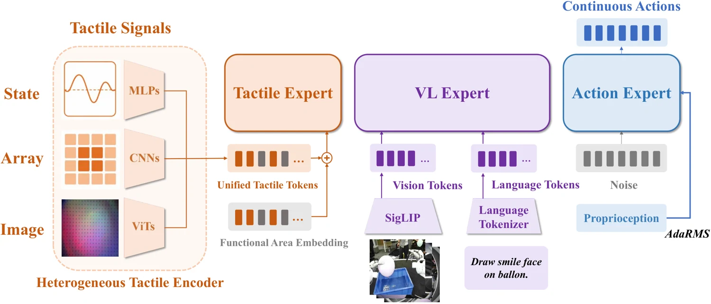

<!-- Generated by scripts/generate.py; edit data/works.json and data/media.json. -->

[← Back to the Awesome index](../../../README.md) · [Interactive website](https://chang-xinhai.github.io/Awesome-RGBDT-Manipulation/?collection=policy&item=ftp-1#library)

# FTP-1

FTP-1: A Generalist Foundation Tactile Policy Across Tactile Sensors for Contact-Rich Manipulation

**2026-06-11 · Preprint · Tsinghua University**

**[Paper](https://arxiv.org/abs/2606.13102)** · [Project](https://ftp1-policy.github.io/) · [Code](https://github.com/michaelyuancb/ftp1-policy) · [Data](https://huggingface.co/datasets/MJJJJ1064/FTP-1-Dataset) · [Weights](https://huggingface.co/MJJJJ1064/ftp1_v0426_50kstep)

A cross-sensor tactile foundation policy that maps image, array and state sensors into morphology-aware tokens and a shared tactile expert.

*FTP-1 authors · [Figure source](https://arxiv.org/html/2606.13102) · Original rights retained.*

| Field | Reported value and source scope |
| :-- | :-- |
| Record type | policy |
| Policy family | VLA [1](https://arxiv.org/abs/2606.13102)  |
| Base model and architecture | π0.5 vision-language/action experts; T3 image-tactile trunk [1](https://arxiv.org/abs/2606.13102) [3](https://arxiv.org/html/2606.13102)  |
| Model size and component | 300M tactile expert; total model size not reported [1](https://arxiv.org/abs/2606.13102) [3](https://arxiv.org/html/2606.13102)  |
| Deployment inputs | RGB, instruction, proprioception and sensor-specific tactile observations [1](https://arxiv.org/abs/2606.13102) [3](https://arxiv.org/html/2606.13102)  |
| Action outputs and horizon | Flow-matching action chunks in a unified embodiment action space [1](https://arxiv.org/abs/2606.13102) [3](https://arxiv.org/html/2606.13102)  |
| Training method | Heterogeneous pretraining, followed by sensor/embodiment/task fine-tuning [1](https://arxiv.org/abs/2606.13102) [3](https://arxiv.org/html/2606.13102)  |
| Training data | ≈3,000 h; 26 sources, 21 tactile sensors; human, dexterous-hand and gripper data [1](https://arxiv.org/abs/2606.13102) [3](https://arxiv.org/html/2606.13102)  |
| Training duration | 50k pretraining updates; 20k downstream updates; wall-clock not reported [1](https://arxiv.org/abs/2606.13102) [3](https://arxiv.org/html/2606.13102)  |
| Training hardware | Pretraining: 48 NVIDIA H20; downstream: 8 A800 [1](https://arxiv.org/abs/2606.13102) [3](https://arxiv.org/html/2606.13102)  |
| Inference and control rates | Not reported [1](https://arxiv.org/abs/2606.13102) [3](https://arxiv.org/html/2606.13102)  |
| Evaluation scope | Six UniVTAC tasks; Sharpa North, Sharpa–Dexmate and unseen Xense/Contactile setups [1](https://arxiv.org/abs/2606.13102) [3](https://arxiv.org/html/2606.13102)  |
| Observations / modalities | RGB · Tactile · Force/Torque · Proprioception · Language |
| Evaluation domain | Simulation · Real world |
| Embodiment | Parallel-jaw gripper · Dexterous hand · Bimanual |
| Release: code | Available [2](https://github.com/michaelyuancb/ftp1-policy)  |
| Release: weights | Available [2](https://github.com/michaelyuancb/ftp1-policy)  |
| Release: data | Available [2](https://github.com/michaelyuancb/ftp1-policy)  |
| Release: license | Not verified [2](https://github.com/michaelyuancb/ftp1-policy)  |
| Release: notes | Official repository links pretraining and six UniVTAC checkpoints, dataset and fine-tuning/deployment recipes. [2](https://github.com/michaelyuancb/ftp1-policy)  |

**Scope and qualifications**

- State-type tactile sources include force/torque; their information differs from optical tactile images.
- UniVTAC evaluation excludes Grasp Classify and Insert HDMI.

**Primary evidence**

1. [Author manuscript and submission history](https://arxiv.org/abs/2606.13102) — Policy facts refer to the full manuscript available on the verification date; date is first arXiv submission.
2. [Official repository](https://github.com/michaelyuancb/ftp1-policy) — Release status is checked separately from paper claims; a project page alone does not imply released implementation or weights.
3. [Full paper: method and implementation details](https://arxiv.org/html/2606.13102) — Unreported specifications remain explicitly unknown; hardware/rates are scoped to training, inference or low-level control.
