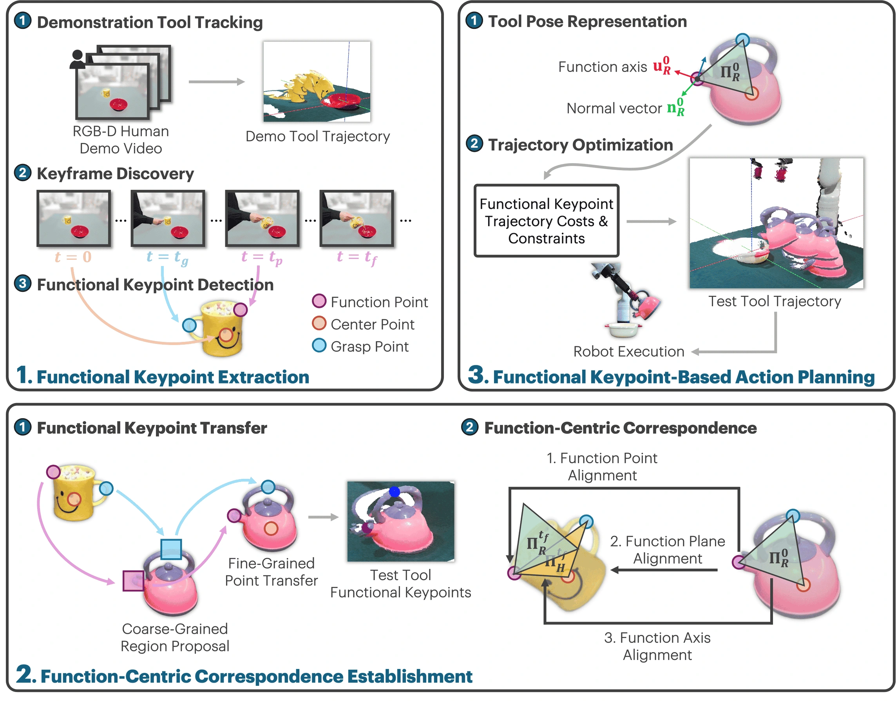

<!-- Generated by scripts/generate.py; edit data/works.json and data/media.json. -->

[← Back to the Awesome index](../../../README.md) · [Interactive website](https://chang-xinhai.github.io/Awesome-RGBDT-Manipulation/?collection=policy&item=functo#library)

# FUNCTO

FUNCTO: Function-Centric One-Shot Imitation Learning for Tool Manipulation

**2025-02-17 · Preprint · Southern University of Science and Technology / National University of Singapore**

**[Paper](https://arxiv.org/abs/2502.11744)** · [Project](https://sites.google.com/view/functo)

Function, grasp and center keypoints transfer a human-demonstrated tool-use skill across tools with different geometry.

*FUNCTO authors · [Figure source](https://arxiv.org/html/2502.11744) · Original rights retained.*

| Field | Reported value and source scope |
| :-- | :-- |
| Record type | policy |
| Policy family | Geometric transfer [1](https://arxiv.org/abs/2502.11744)  |
| Base model and architecture | Function-centric keypoint correspondence and planning. Grounding-SAM, CoTracker, functional VLM reasoning, GraspGPT grasp sampling and constrained trajectory optimization; exact VLM backbone is not identified in the inspected manuscript. [1](https://arxiv.org/abs/2502.11744)  |
| Model size and component | Not reported [1](https://arxiv.org/abs/2502.11744)  |
| Deployment inputs | One human tool-use video and RGB-D scene/tool geometry; functional task context, tracked tool keypoints and robot state. [1](https://arxiv.org/abs/2502.11744)  |
| Action outputs and horizon | Functional keypoint trajectory, feasible end-effector poses and joint-velocity commands. [1](https://arxiv.org/abs/2502.11744)  |
| Training method | Extract functional keypoints, establish function-centric correspondences and optimize robot motion preserving geometric constraints. [1](https://arxiv.org/abs/2502.11744)  |
| Training data | One human demonstration per skill; no target-task behavioral cloning dataset. [1](https://arxiv.org/abs/2502.11744)  |
| Training duration | Not reported [1](https://arxiv.org/abs/2502.11744)  |
| Training hardware | Not reported [1](https://arxiv.org/abs/2502.11744)  |
| Inference and control rates | Commands at 10 Hz; interpolated joint-velocity controller runs at 200 Hz. [1](https://arxiv.org/abs/2502.11744)  |
| Evaluation scope | Five real tool functions (pour, cut, scoop, brush, pound), five tool/target tasks per function spanning spatial/instance/category transfer, ten trials/task (250 total per method). [1](https://arxiv.org/abs/2502.11744)  |
| Observations / modalities | RGB · Depth · Proprioception · Language |
| Evaluation domain | Real world |
| Embodiment | Parallel-jaw gripper |
| Release: code | Not verified [2](https://sites.google.com/view/functo)  |
| Release: weights | Not verified [2](https://sites.google.com/view/functo)  |
| Release: data | Not verified [2](https://sites.google.com/view/functo)  |
| Release: license | Not verified [2](https://sites.google.com/view/functo)  |
| Release: notes | No author-linked implementation was verified in the inspected primary manuscript/project. This is an evidence gap, not proof that no implementation exists. [2](https://sites.google.com/view/functo)  |

**Scope and qualifications**

- High-rate inner control is distinct from functional correspondence/planning throughput.
- This is a modular geometric/foundation-model system, not an end-to-end video-to-action network.

**Primary evidence**

1. [Original manuscript and first submission history](https://arxiv.org/abs/2502.11744) — Original method, evaluation and available implementation/appendix sections inspected. The survey is discovery evidence only.
2. [Official project](https://sites.google.com/view/functo) — Author-linked source. Component and artifact release terms may differ.
