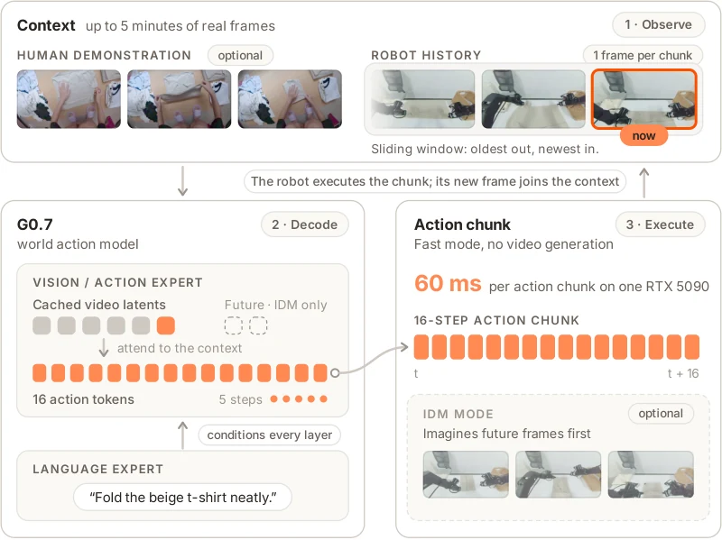

<!-- Generated by scripts/generate.py; edit data/works.json and data/media.json. -->

[← Back to the Awesome index](../../../README.md) · [Interactive website](https://chang-xinhai.github.io/Awesome-RGBDT-Manipulation/?collection=policy&item=g07#library)

# G0.7

G0.7: Scaling Up a Fast World Action Model with Long Context

**2026-11-24 · Preprint · Galaxea**

**[Paper](https://arxiv.org/abs/2611.31822)** · [Project](https://www.galaxea-ai.com/model-g07.html)

Scales a direct-action WAM to five minutes of visual context and co-trains on robot teleoperation and human egocentric video.

*Galaxea Team · [Figure source](https://arxiv.org/html/2611.31822v2) · Original rights retained.*

| Field | Reported value and source scope |
| :-- | :-- |
| Record type | policy |
| Policy family | G0.7 [1](https://arxiv.org/html/2611.31822v2)  |
| Base model and architecture | Fast-WAM-style world/action mixture of experts with recurrent context cache [1](https://arxiv.org/html/2611.31822v2)  |
| Model size and component | Not reported [1](https://arxiv.org/html/2611.31822v2)  |
| Deployment inputs | Current robot RGB with rolling RGB history of up to five minutes, instruction and optional reference human video. Robotics actions are read out from the same checkpoint under Fast and IDM modes. [1](https://arxiv.org/html/2611.31822v2)  |
| Action outputs and horizon | 16-step action chunks. IDM separately generates future frames; Fast mode directly decodes action. [1](https://arxiv.org/html/2611.31822v2)  |
| Training method | Large-scale joint video/action prediction and robot task post-training; human-ego wrist motion estimated offline. [1](https://arxiv.org/html/2611.31822v2)  |
| Training data | Galaxea R1 Pro/R1 Lite teleoperation, named public robot data and proprietary human ego video. Separate object transfer and downstream data sources. [1](https://arxiv.org/html/2611.31822v2)  |
| Training duration | Not reported [1](https://arxiv.org/html/2611.31822v2)  |
| Training hardware | Not reported [1](https://arxiv.org/html/2611.31822v2)  |
| Inference and control rates | 60 ms per 16-step chunk on one RTX 5090 in Fast mode in the paper (7.6× faster than matched IDM mode). [1](https://arxiv.org/html/2611.31822v2)  |
| Evaluation scope | Five simulation suites and physical Galaxea fleets. Zero-shot real pick-and-place is reported separately on 25 R1 Pro and 50 R1 Lite trials. [1](https://arxiv.org/html/2611.31822v2)  |
| Observations / modalities | RGB · Language · Proprioception |
| Evaluation domain | Simulation · Real world |
| Embodiment | Bimanual · Parallel-jaw gripper |
| Release: code | Not verified |
| Release: weights | Not verified |
| Release: data | Not verified |
| Release: license | Not verified |
| Release: notes | Public paper verified. Code, task weights and data are tracked separately. |

**Scope and qualifications**

- Human-ego priors are pretrained from RGB video with offline geometry-based action extraction. This does not imply a depth sensor at inference.
- No G0.7-specific source, weights or full training data were verified on the official report page.

**Primary evidence**

1. [Original author paper with methods, evaluation and scope](https://arxiv.org/html/2611.31822v2)
2. [Public author project with method and evaluation examples](https://www.galaxea-ai.com/model-g07.html)
