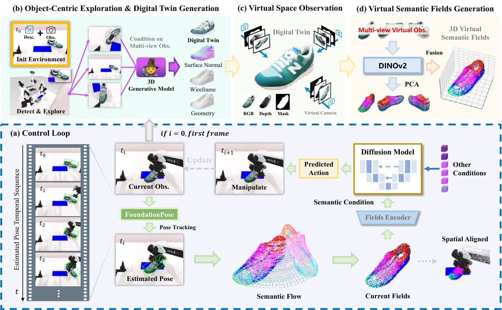

<!-- Generated by scripts/generate.py; edit data/works.json and data/media.json. -->

[← Back to the Awesome index](../../../README.md) · [Interactive website](https://chang-xinhai.github.io/Awesome-RGBDT-Manipulation/?collection=policy&item=g3flow#library)

# G3Flow

G3Flow: Generative 3D Semantic Flow for Pose-aware and Generalizable Object Manipulation

**2024-11-27 · arXiv preprint · HKU; Tencent Robotics X; Shenzhen University; collaborating institutions**

**[Paper](https://arxiv.org/abs/2411.18369)** · [Project](https://tianxingchen.github.io/G3Flow/) · [Code](https://github.com/TianxingChen/G3Flow)

Generated object twins and pose tracking provide a persistent 3D semantic flow to a diffusion controller.

*G3Flow authors · [Figure source](https://arxiv.org/html/2411.18369) · Original rights retained.*

| Field | Reported value and source scope |
| :-- | :-- |
| Record type | policy |
| Policy family | Diffusion [1](https://arxiv.org/abs/2411.18369)  |
| Base model and architecture | 3D generative digital twins, visual semantic features, object pose tracking and diffusion policy. [1](https://arxiv.org/abs/2411.18369)  |
| Model size and component | Not reported in the inspected primary-source sections [1](https://arxiv.org/abs/2411.18369)  |
| Deployment inputs | RGB-D observations, object segmentation/poses and proprioception. [1](https://arxiv.org/abs/2411.18369)  |
| Action outputs and horizon | Object-semantic-flow-conditioned robot actions. [1](https://arxiv.org/abs/2411.18369)  |
| Training method | Foundation-model twin initialization and task demonstration diffusion learning. [1](https://arxiv.org/abs/2411.18369)  |
| Training data | Five simulated manipulation tasks with fixed-pose and cross-object settings. [1](https://arxiv.org/abs/2411.18369)  |
| Training duration | 3,000 epochs per task; wall-clock not reported [1](https://arxiv.org/abs/2411.18369)  |
| Training hardware | Not reported in the inspected primary-source sections [1](https://arxiv.org/abs/2411.18369)  |
| Inference and control rates | 34.04 Hz model decision-frequency profiling on RTX 4090; excludes initial digital-twin generation. [1](https://arxiv.org/abs/2411.18369)  |
| Evaluation scope | Pose-aware terminal constraints and unseen-object manipulation, with object occlusion analysis. [1](https://arxiv.org/abs/2411.18369)  |
| Observations / modalities | RGB · Depth · Point cloud · Proprioception |
| Evaluation domain | Simulation |
| Embodiment | Parallel-jaw gripper |
| Release: code | Available [2](https://tianxingchen.github.io/G3Flow/) [3](https://github.com/TianxingChen/G3Flow) [5](https://github.com/TianxingChen/G3Flow/tree/main)  |
| Release: weights | Not verified [2](https://tianxingchen.github.io/G3Flow/) [3](https://github.com/TianxingChen/G3Flow)  |
| Release: data | Not verified [2](https://tianxingchen.github.io/G3Flow/) [3](https://github.com/TianxingChen/G3Flow)  |
| Release: license | MIT for repository code; pretrained models, data and figure rights remain separate [2](https://tianxingchen.github.io/G3Flow/) [3](https://github.com/TianxingChen/G3Flow) [4](https://github.com/TianxingChen/G3Flow/blob/main/LICENSE)  |
| Release: notes | Code, data and weights are checked independently; an upstream pretrained model is not a released task policy. [2](https://tianxingchen.github.io/G3Flow/) [3](https://github.com/TianxingChen/G3Flow)  |

**Scope and qualifications**

- Digital-twin creation and tracking prerequisites can fail; do not treat a foundation-model twin as ground-truth object geometry.

**Primary evidence**

1. [Original manuscript and first submission history](https://arxiv.org/abs/2411.18369) — Full author HTML method/evaluation/appendix inspected; depth observations, pseudo-labels and generated outputs retain distinct roles.
2. [Official author project](https://tianxingchen.github.io/G3Flow/) — Public author-linked project; figure and downstream scope verified separately.
3. [Official current implementation linked by author project](https://github.com/TianxingChen/G3Flow) — Actual runnable release and model artifacts checked independently.
4. [Actual license file in released source](https://github.com/TianxingChen/G3Flow/blob/main/LICENSE) — Only source code covered by this file; not a blanket license for paper figures or upstream weights.
5. [Actual repository content inventory](https://github.com/TianxingChen/G3Flow/tree/main) — 917 tracked paths inspected; code release is distinguished from a README/project/figure-only repository.
