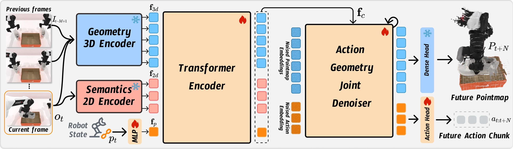

<!-- Generated by scripts/generate.py; edit data/works.json and data/media.json. -->

[← Back to the Awesome index](../../../README.md) · [Interactive website](https://chang-xinhai.github.io/Awesome-RGBDT-Manipulation/?collection=policy&item=gap-action-geometry#library)

# GAP — Action-Geometry Prediction

Action-Geometry Prediction with 3D Geometric Prior for Bimanual Manipulation

**2026-02-27 · arXiv preprint · Sichuan University; UESTC; Dexmal; Chinese University of Hong Kong**

**[Paper](https://arxiv.org/abs/2602.23814)** · [Code](https://github.com/Chongyang-99/GAP)

Jointly predicts a bimanual action chunk and future pointmap latent from RGB-derived 3D features.

*GAP — Action-Geometry Prediction authors · [Figure source](https://arxiv.org/html/2602.23814) · Original rights retained.*

| Field | Reported value and source scope |
| :-- | :-- |
| Record type | policy |
| Policy family | Diffusion [1](https://arxiv.org/abs/2602.23814)  |
| Base model and architecture | π³ geometric foundation encoder, 2D semantic features and DETR-based joint action/geometry diffusion decoder. [1](https://arxiv.org/abs/2602.23814)  |
| Model size and component | Not reported in the inspected primary-source sections [1](https://arxiv.org/abs/2602.23814)  |
| Deployment inputs | Current/past RGB frames and proprioception; no measured depth or sensor point cloud required. [1](https://arxiv.org/abs/2602.23814)  |
| Action outputs and horizon | Bimanual action chunks plus future 3D latent/pointmap prediction. [1](https://arxiv.org/abs/2602.23814)  |
| Training method | Joint diffusion learning of action and scene geometry. [1](https://arxiv.org/abs/2602.23814)  |
| Training data | 100 expert demonstrations per simulation task; 50 teleoperated demonstrations for each of four physical tasks. [1](https://arxiv.org/abs/2602.23814)  |
| Training duration | Not reported in the inspected primary-source sections [1](https://arxiv.org/abs/2602.23814)  |
| Training hardware | NVIDIA RTX 4090 GPUs for the proposed model [1](https://arxiv.org/abs/2602.23814)  |
| Inference and control rates | Not reported in the inspected primary-source sections [1](https://arxiv.org/abs/2602.23814)  |
| Evaluation scope | RoboTwin2 and AgileX Cobot Magic scan-object, hang-mug, bowl-stack and dual-shoe tasks. [1](https://arxiv.org/abs/2602.23814)  |
| Observations / modalities | RGB · Proprioception |
| Evaluation domain | Simulation · Real world |
| Embodiment | Bimanual · Parallel-jaw gripper |
| Release: code | Available [2](https://github.com/Chongyang-99/GAP) [3](https://github.com/Chongyang-99/GAP/tree/main)  |
| Release: weights | Not verified [2](https://github.com/Chongyang-99/GAP)  |
| Release: data | Not verified [2](https://github.com/Chongyang-99/GAP)  |
| Release: license | Not verified [2](https://github.com/Chongyang-99/GAP)  |
| Release: notes | Code, data and weights are checked independently; an upstream pretrained model is not a released task policy. [2](https://github.com/Chongyang-99/GAP)  |

**Scope and qualifications**

- RealSense camera hardware is used for RGB; this does not make depth a deployed policy input.

**Primary evidence**

1. [Original manuscript and first submission history](https://arxiv.org/abs/2602.23814) — Full author HTML method/evaluation/appendix inspected; depth observations, pseudo-labels and generated outputs retain distinct roles.
2. [Official implementation and release scope](https://github.com/Chongyang-99/GAP) — Availability of research implementation does not establish public task-policy checkpoints.
3. [Actual repository content inventory](https://github.com/Chongyang-99/GAP/tree/main) — 165 tracked paths inspected; code release is distinguished from a README/project/figure-only repository.
