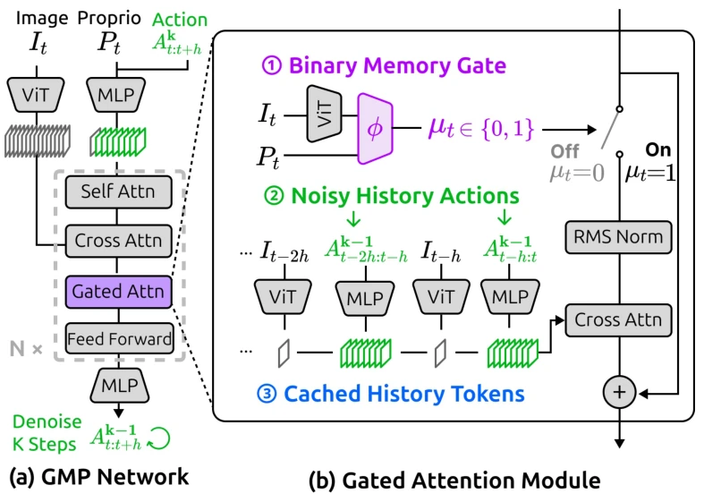

<!-- Generated by scripts/generate.py; edit data/works.json and data/media.json. -->

[← Back to the Awesome index](../../../README.md) · [Interactive website](https://chang-xinhai.github.io/Awesome-RGBDT-Manipulation/?collection=policy&item=gated-memory-policy#library)

# Gated Memory Policy (GMP)

Gated Memory Policy: In-Context Memorization and Adaptation

**2026-04-21 · Preprint · Stanford University**

**[Paper](https://arxiv.org/abs/2604.18933)** · [Project](https://gated-memory-policy.github.io/) · [Code](https://github.com/real-stanford/gated-memory-policy) · [Data](https://huggingface.co/datasets/yihuai-gao/gated-memory-policy) · [Weights](https://huggingface.co/yihuai-gao/gated-memory-policy)

A diffusion policy learns when to recall visual/action history and what context matters for within-trial memory and cross-trial adaptation.

*Gated Memory Policy (GMP) authors · [Figure source](https://arxiv.org/abs/2604.18933) · Original rights retained.*

| Field | Reported value and source scope |
| :-- | :-- |
| Record type | policy |
| Policy family | Diffusion [1](https://arxiv.org/abs/2604.18933)  |
| Base model and architecture | Transformer Diffusion Policy with gated history cross-attention, memory encoder and a calibrated memory gate. [1](https://arxiv.org/abs/2604.18933)  |
| Model size and component | Not reported [1](https://arxiv.org/abs/2604.18933)  |
| Deployment inputs | Current RGB image, robot proprioception, historical images / actions and trial context. [1](https://arxiv.org/abs/2604.18933)  |
| Action outputs and horizon | Continuous robot action chunks; appendix simulation setting uses a 16-step horizon. [1](https://arxiv.org/abs/2604.18933)  |
| Training method | Diffusion behavior cloning, history-action noise, cross-attention memory and gate calibration from rollouts. [1](https://arxiv.org/abs/2604.18933)  |
| Training data | MemMimic task demonstrations plus RoboMimic and MIKASA-Robo experiments; public simulation and real deployment datasets. [1](https://arxiv.org/abs/2604.18933)  |
| Training duration | Iterative Pushing example: 1.2 H100 GPU-hours baseline, 6.7 memory policy, 6.4 rollouts, 1.3 gate training, 31.2 GMP; these are separate pipeline stages, not wall-clock time. [1](https://arxiv.org/abs/2604.18933)  |
| Training hardware | H100 GPU-hour training budgets; RTX 3080 latency comparison and RTX 5090 deployment timing are separate inference measurements. [1](https://arxiv.org/abs/2604.18933)  |
| Inference and control rates | Reported real-context policy inference: 0.16 s with eight denoising steps on RTX 5090. Example simulation commands run at 10 Hz with 500 Hz physics. [1](https://arxiv.org/abs/2604.18933)  |
| Evaluation scope | Six MemMimic task families across simulation / real robots; RoboMimic and MIKASA-Robo memory tasks. [1](https://arxiv.org/abs/2604.18933)  |
| Observations / modalities | RGB · Proprioception |
| Evaluation domain | Simulation · Real world |
| Embodiment | Parallel-jaw gripper |
| Release: code | Available [2](https://gated-memory-policy.github.io/) [3](https://github.com/real-stanford/gated-memory-policy)  |
| Release: weights | Available [2](https://gated-memory-policy.github.io/) [3](https://github.com/real-stanford/gated-memory-policy)  |
| Release: data | Available [2](https://gated-memory-policy.github.io/) [3](https://github.com/real-stanford/gated-memory-policy)  |
| Release: license | MIT for repository code; external model, dataset and dependency terms remain separate. [2](https://gated-memory-policy.github.io/) [3](https://github.com/real-stanford/gated-memory-policy) [4](https://github.com/real-stanford/gated-memory-policy/blob/HEAD/LICENSE)  |
| Release: notes | Official training/evaluation, task data and in-the-wild deployment checkpoint are public; robot deployment uses the separately linked iPhUMI implementation. [2](https://gated-memory-policy.github.io/) [3](https://github.com/real-stanford/gated-memory-policy)  |

**Scope and qualifications**

- No tactile or wrist force stream is claimed from RGB/history-based memory.
- The training-cost breakdown is for one challenging task, not the total complete benchmark.

**Primary evidence**

1. [Original paper / author report](https://arxiv.org/abs/2604.18933) — Original full paper and supplementary experimental / implementation details; deployment inputs are separated from supervision and benchmark state.
2. [Official project](https://gated-memory-policy.github.io/) — Author-linked project and current release checked on the catalog cutoff.
3. [Official code / release documentation](https://github.com/real-stanford/gated-memory-policy) — Current repository documentation; paper settings and subsequently released artifacts are distinguished.
4. [Repository LICENSE](https://github.com/real-stanford/gated-memory-policy/blob/HEAD/LICENSE) — Actual license file inspected; code license does not automatically license data or weights.
