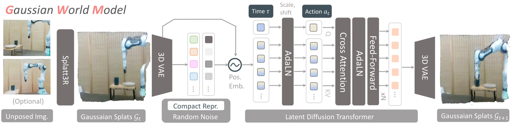

<!-- Generated by scripts/generate.py; edit data/works.json and data/media.json. -->

[← Back to the Awesome index](../../../README.md) · [Interactive website](https://chang-xinhai.github.io/Awesome-RGBDT-Manipulation/?collection=policy&item=gaussian-world-model#library)

# Gaussian World Model (GWM)

GWM: Towards Scalable Gaussian World Models for Robotic Manipulation

**2025-08-25 · ICCV 2025 · Tsinghua University; BIGAI; Nanyang Technological University**

**[Paper](https://arxiv.org/abs/2508.17600)** · [Project](https://gaussian-world-model.github.io/)

Action-conditioned Gaussian scene dynamics supply geometric features and a neural simulator for robot policy learning.

*Gaussian World Model (GWM) authors · [Figure source](https://arxiv.org/html/2508.17600) · Original rights retained.*

| Field | Reported value and source scope |
| :-- | :-- |
| Record type | model |
| Model role and downstream interface | Geometric representation and learned simulator for IL / model-based RL [1](https://arxiv.org/abs/2508.17600)  |
| Model family | Predictive world model [1](https://arxiv.org/abs/2508.17600)  |
| Model architecture | Splatt3R/MASt3R reconstruction, 3D Gaussian VAE and latent diffusion transformer; downstream IL / model-based RL. [1](https://arxiv.org/abs/2508.17600)  |
| Model size and component | Not reported in the inspected primary-source sections [1](https://arxiv.org/abs/2508.17600)  |
| Model inputs | RGB observations and actions; geometry is reconstructed in the Gaussian representation. [1](https://arxiv.org/abs/2508.17600)  |
| Model outputs | Future 3D Gaussians/rendered views; a separately trained downstream agent produces robot actions. [1](https://arxiv.org/abs/2508.17600)  |
| Training method | Self-supervised world-model learning followed by imitation or model-based reinforcement learning. [1](https://arxiv.org/abs/2508.17600)  |
| Training data and scale | Robot interaction sequences across MetaWorld, RoboCasa and real Franka pick-place settings. [1](https://arxiv.org/abs/2508.17600)  |
| Training duration | Not reported in the inspected primary-source sections [1](https://arxiv.org/abs/2508.17600)  |
| Training hardware | Not reported in the inspected primary-source sections [1](https://arxiv.org/abs/2508.17600)  |
| Inference setting and runtime | Not reported in the inspected primary-source sections [1](https://arxiv.org/abs/2508.17600)  |
| Downstream evaluation and scope | 31 robotic tasks across three domains and physical pick-place variations. [1](https://arxiv.org/abs/2508.17600)  |
| Observations / modalities | RGB · Proprioception |
| Evaluation domain | Simulation · Real world |
| Embodiment |  |
| Release: code | Not verified |
| Release: weights | Not verified |
| Release: data | Not verified |
| Release: license | Not verified |
| Release: notes | Code, data and weights are checked independently; an upstream pretrained model is not a released task policy. |

**Scope and qualifications**

- World-model outputs are 3D scene states; downstream policy training and action selection are separate components.

**Primary evidence**

1. [Original manuscript and first submission history](https://arxiv.org/abs/2508.17600) — Full author HTML method/evaluation/appendix inspected; depth observations, pseudo-labels and generated outputs retain distinct roles.
