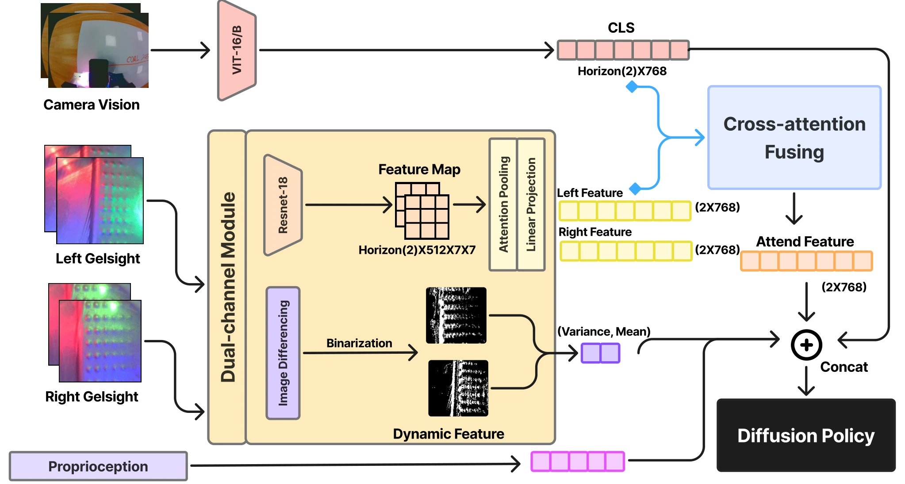

<!-- Generated by scripts/generate.py; edit data/works.json and data/media.json. -->

[← Back to the Awesome index](../../../README.md) · [Interactive website](https://chang-xinhai.github.io/Awesome-RGBDT-Manipulation/?collection=policy&item=gelfusion#library)

# GelFusion

GelFusion: Enhancing Robotic Manipulation under Visual Constraints via Visuotactile Fusion

**2025-05-12 · Preprint · Not reported**

**[Paper](https://arxiv.org/abs/2505.07455)** · [Project](https://gelfusion.github.io/) · [Code](https://github.com/GelFusion/GelFusion) · [Data](https://huggingface.co/datasets/shu1ong/GelFusion)

Vision-dominated cross-attention fuses tactile geometry and interaction dynamics for manipulation under visual constraints.

*GelFusion: Enhancing Robotic Manipulation under Visual Constraints via Visuotactile Fusion authors · [Figure source](https://arxiv.org/abs/2505.07455) · Original rights retained.*

| Field | Reported value and source scope |
| :-- | :-- |
| Record type | policy |
| Policy family | Diffusion [1](https://arxiv.org/abs/2505.07455)  |
| Base model and architecture | Dual-channel GelSight representation and visual–tactile cross-attention policy. [1](https://arxiv.org/abs/2505.07455)  |
| Model size and component | Not reported [1](https://arxiv.org/abs/2505.07455)  |
| Deployment inputs | RGB, GelSight tactile images/dynamics and robot state. [1](https://arxiv.org/abs/2505.07455)  |
| Action outputs and horizon | Robot manipulation action predictions. [1](https://arxiv.org/abs/2505.07455)  |
| Training method | Imitation learning with dual-channel tactile feature extraction and fusion. [1](https://arxiv.org/abs/2505.07455)  |
| Training data | 50 demonstrations each for whiteboard wiping, peg insertion and fragile chip grasping. [1](https://arxiv.org/abs/2505.07455)  |
| Training duration | Not reported [1](https://arxiv.org/abs/2505.07455)  |
| Training hardware | Not reported [1](https://arxiv.org/abs/2505.07455)  |
| Inference and control rates | Not reported [1](https://arxiv.org/abs/2505.07455)  |
| Evaluation scope | Three real contact-rich tasks with visual ambiguity/occlusion. [1](https://arxiv.org/abs/2505.07455)  |
| Observations / modalities | RGB · Tactile · Proprioception |
| Evaluation domain | Real world |
| Embodiment | Parallel-jaw gripper |
| Release: code | Not released — implementation files absent from current repository [4](https://github.com/GelFusion/GelFusion) [5](https://huggingface.co/datasets/shu1ong/GelFusion)  |
| Release: weights | Not verified [4](https://github.com/GelFusion/GelFusion) [5](https://huggingface.co/datasets/shu1ong/GelFusion)  |
| Release: data | Available — three processed tactile dataset archives [4](https://github.com/GelFusion/GelFusion) [5](https://huggingface.co/datasets/shu1ong/GelFusion)  |
| Release: license | MIT [4](https://github.com/GelFusion/GelFusion) [5](https://huggingface.co/datasets/shu1ong/GelFusion)  |
| Release: notes | The current only branch and GitHub release inventory contain README, LICENSE, environment.yml and an illustration, with no actual implementation despite README references to DataCollection/train.py. The official linked HF dataset does contain ChipPick_replay_buffer.zip, Insertation_replay_buffer.zip and wiping_replay_buffer.zip; code and data availability are independent. [4](https://github.com/GelFusion/GelFusion) [5](https://huggingface.co/datasets/shu1ong/GelFusion)  |

**Scope and qualifications**

- Tactile-image geometry is not an external measured depth stream.

**Primary evidence**

1. [Original paper and supplementary implementation details](https://arxiv.org/abs/2505.07455) — Primary full text reviewed; dataset, deployment modalities and training-only privileges are scoped separately.
2. [Official author project](https://gelfusion.github.io/) — Research/project provenance; current artifact availability and licensing are superseded by the separately cited 2026-10-19 file inventories.
3. [Official released implementation and LICENSE](https://github.com/GelFusion/GelFusion) — Research/project provenance; current artifact availability and licensing are superseded by the separately cited 2026-10-19 file inventories.
4. [Current artifact inventory and release scope](https://github.com/GelFusion/GelFusion) — 2026-10-19 current file-tree/implementation/model-data inventory audit; release scope and licensing are independent. Not a runtime reproduction.
5. [Current artifact inventory and release scope](https://huggingface.co/datasets/shu1ong/GelFusion) — 2026-10-19 current file-tree/implementation/model-data inventory audit; release scope and licensing are independent. Not a runtime reproduction.
