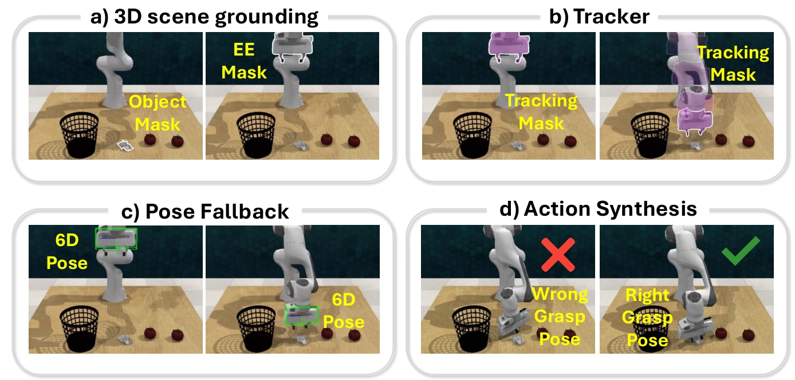

<!-- Generated by scripts/generate.py; edit data/works.json and data/media.json. -->

[← Back to the Awesome index](../../../README.md) · [Interactive website](https://chang-xinhai.github.io/Awesome-RGBDT-Manipulation/?collection=policy&item=gem-4d#library)

# GEM-4D

GEM-4D: Geometry-Enhanced Video World Models for Robot Manipulation

**2026-05-20 · arXiv preprint · Harvard University; MIT; Princeton University; MIT-IBM Watson AI Lab**

**[Paper](https://arxiv.org/abs/2605.22882)** · [Project](https://gem-4d.github.io/) · [Code](https://github.com/kaichen-z/GEM-4d)

Geometry-supervised video generation is paired with a geometric inverse-dynamics system to recover executable manipulation trajectories.

*GEM-4D authors · [Figure source](https://arxiv.org/html/2605.22882) · Original rights retained.*

| Field | Reported value and source scope |
| :-- | :-- |
| Record type | policy |
| Policy family | World-action model [1](https://arxiv.org/abs/2605.22882)  |
| Base model and architecture | Video DiT plus training-only geometry flow branch; adaptive inverse-dynamics tracking, pose fallback and action synthesis. [1](https://arxiv.org/abs/2605.22882)  |
| Model size and component | Not reported in the inspected primary-source sections [1](https://arxiv.org/abs/2605.22882)  |
| Deployment inputs | Initial RGB observation, language and geometry/calibration used by the inverse-dynamics stage. [1](https://arxiv.org/abs/2605.22882)  |
| Action outputs and horizon | Future video and reconstructed 6-DoF gripper trajectory. [1](https://arxiv.org/abs/2605.22882)  |
| Training method | Flow-matching video generation regularized by frozen geometry features; geometric rollout-to-action conversion. [1](https://arxiv.org/abs/2605.22882)  |
| Training data | Robot manipulation video data with dense geometry teacher features. [1](https://arxiv.org/abs/2605.22882)  |
| Training duration | Not reported in the inspected primary-source sections [1](https://arxiv.org/abs/2605.22882)  |
| Training hardware | Not reported in the inspected primary-source sections [1](https://arxiv.org/abs/2605.22882)  |
| Inference and control rates | Not reported in the inspected primary-source sections [1](https://arxiv.org/abs/2605.22882)  |
| Evaluation scope | Video/geometry evaluation, RLBench execution and real manipulation; distinguish human-rated generated DROID videos from physical trials. [1](https://arxiv.org/abs/2605.22882)  |
| Observations / modalities | RGB · Language · Proprioception |
| Evaluation domain | Simulation · Real world |
| Embodiment | Parallel-jaw gripper |
| Release: code | Not verified [2](https://gem-4d.github.io/) [3](https://github.com/kaichen-z/GEM-4d) [4](https://github.com/kaichen-z/GEM-4d/tree/main)  |
| Release: weights | Not verified [2](https://gem-4d.github.io/) [3](https://github.com/kaichen-z/GEM-4d)  |
| Release: data | Not verified [2](https://gem-4d.github.io/) [3](https://github.com/kaichen-z/GEM-4d)  |
| Release: license | Not verified [2](https://gem-4d.github.io/) [3](https://github.com/kaichen-z/GEM-4d)  |
| Release: notes | Project advertises official code URL; actual runnable repository contents could not be verified. Do not equate project link with released implementation. [2](https://gem-4d.github.io/) [3](https://github.com/kaichen-z/GEM-4d)  |

**Scope and qualifications**

- The geometry branch is training-only; the action-extraction pipeline has separate geometric assumptions.
- Generated-video success judgements and actual robot-execution success are separate measurements.

**Primary evidence**

1. [Original manuscript and first submission history](https://arxiv.org/abs/2605.22882) — Full author HTML method/evaluation/appendix inspected; depth observations, pseudo-labels and generated outputs retain distinct roles.
2. [Official author project](https://gem-4d.github.io/) — Public author-linked project; figure and downstream scope verified separately.
3. [Official implementation and release scope](https://github.com/kaichen-z/GEM-4d) — Availability of research implementation does not establish public task-policy checkpoints.
4. [Actual repository content inventory](https://github.com/kaichen-z/GEM-4d/tree/main) — 0 tracked paths inspected; code release is distinguished from a README/project/figure-only repository.
